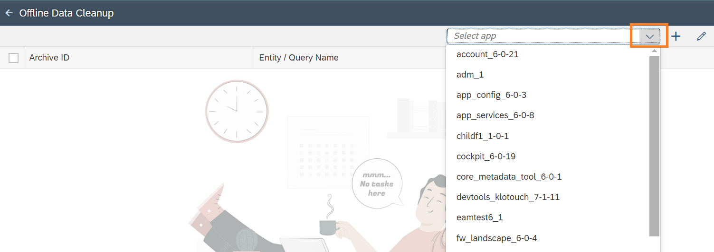
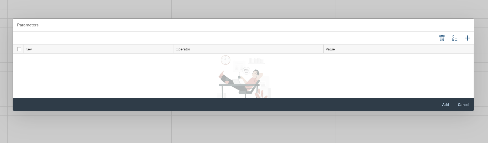
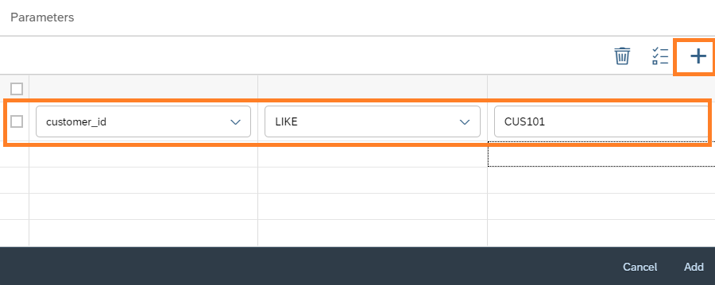
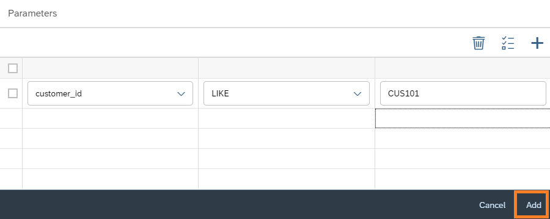
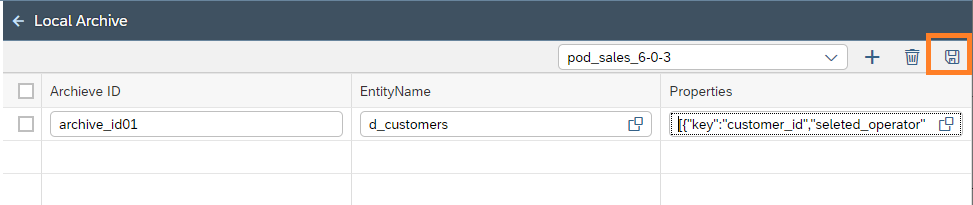

# How to use the feature

To create an entry in Local archive, follow the given steps:

**Step 1 : Select the flavor from the drop down.**

**Step 2 : Click on add button to add archive rule**

One entry will get created with Archive ID auto fill. If you want, you can change the value.

**Step 3 : Select the entity or Query from the value help**

Click on the value help which is inside the ‘**Entity / Query Name**’ column and select the entity from which you want to delete unnecessary data.

**NOTE :**

1.  If you are selecting a query, then sql statement(Modeled Query) will also get considered while archiving data. Data will get archived based on your query WHERE clause.

2.  If you are selecting a query and you are adding properties values from the Local archive tool and if those properties are not being used in the query WHERE value,the archiving will not work.

**Step 4: Select the properties**

Click on the value help icon, which is inside the **properties** column, a pop up will open to add the parameters for the selected entity.

**Step 5: Click on the add icon to add param**

On clicking on the add icon, it will add an entry where you can select **key**, **operators** and its **value.**

**Key :** It will list all the properties for the selected entity/query.

**Operators :** There will be some existing operators.

**Value :** This field will take value for the selected property.

- If the operator is **IS_NULL** or **IS_NOT_NULL**, then it will not take any values, its value will be assigned as ‘true’ automatically.

- If the operator is **IN** or **NOT_IN,** then the value provided must be in an array. Eg: \[“abc”,”pqr”,9\]

- If the operator is **LIKE,** then the format of value should be %value%.

**NOTE** : Based on the **key**(property), **operator** and **value**, it will delete that specific property data from the local data store.

**Step 6 : Click on add footer button**

To add the newly created param, click on the add button.

**Step 7: Click on save icon to save newly archive rule**

Click on save icon to create an entry in **m_archive** for deleting unnecessary locally stored offline data.

