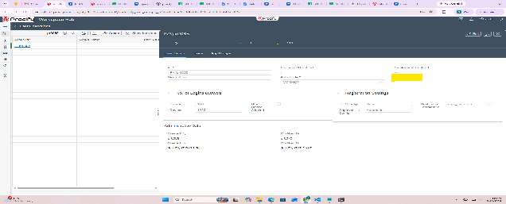
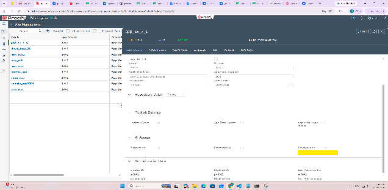

# Developer AI — Setup For Developer AI

## User \- Assignment {#user---assignment}

* Adm version should be more than 1-0-47  
* Cockpit version should be more than 6-0-174

## User Collection

In User Collections, Developer AI needs to be enabled

## App Management

In App Management, for the App,  Developer AI needs to be enabled

