					

#   **Developer AI \- User Guide**

---

**Date of Issue: JULY 2026**

**Target Audience: Application Developers, Trainees**

**Prepared by: [Ravi Shankar Jha](mailto:ravi.shankar@procifynow.com)**

**Platform Version: 6.0**

				

*A User Manual for application creation, knowledge and work reference.*

# 

# **Copyright** {#copyright}

Copyright © 2023 Procify Innovations Pvt. Ltd. All rights reserved.

No part of this publication may be reproduced or transmitted in any form or without purpose the permission of **Procify Innovations Pvt. Ltd.** The information contained in this document might change on the basis of new developments without prior notice.

# **Disclaimer** {#disclaimer}

THESE MATERIALS ARE PROVIDED BY PROCIFY INNOVATIONS PVT LTD, ON AN "AS IS" BASIS, AND EXPRESSLY DISCLAIMS ANY AND ALL WARRANTIES, EXPRESS OR APPLIED, INCLUDING WITHOUT LIMITATION WARRANTIES OF MERCHANTABILITY AND FITNESS FOR A PARTICULAR PURPOSE, WITH RESPECT TO THESE MATERIALS AND THE SERVICE, INFORMATION, TEXT, GRAPHICS, LINKS, OR ANY OTHER MATERIALS AND PRODUCTS CONTAINED HEREIN. IN NO EVENT SHALL PROCIFY INNOVATIONS PVT LTD  BE LIABLE FOR ANY DIRECT, INDIRECT, SPECIAL, INCIDENTAL, CONSEQUENTIAL, OR PUNITIVE DAMAGES OF ANY KIND WHATSOEVER, INCLUDING WITHOUT LIMITATION LOST REVENUES OR LOST PROFITS, WHICH MAY RESULT FROM THE USE OF THESE MATERIALS OR INCLUDED SOFTWARE COMPONENTS.

## 

- [Copyright](#copyright)
- [Disclaimer](#disclaimer)
- [Developer AI](#developer-ai)
  - [Overview](#overview)
  - [What is Developer AI](#what-is-developer-ai)
  - [How Developer AI Works](#how-developer-ai-works)
  - [Why Developer AI](#why-developer-ai)
  - [Key Reasons to Use Developer AI](#key-reasons-to-use-developer-ai)
- [Setup For Developer AI](#setup-for-developer-ai)
  - [User - Assignment](#user---assignment)
  - [Config Changes](#config-changes)
- [ProcessFlow of Developer AI](#processflow-of-developer-ai)
  - [Select Application](#select-application)
  - [Token Quota](#token-quota)
  - [Token Units](#token-units)
  - [Generate BBP](#generate-bbp)
  - [Upload BRD / BBP Document](#upload-brd--bbp-document)
  - [Preparing a BBP for Developer AI](#preparing-a-bbp-for-developer-ai)
  - [Export Options](#export-options)
    - [Export to JSON](#export-to-json)
    - [Export to TXT](#export-to-txt)
  - [Re-Analyze](#re-analyze)
  - [Mark All Review Completed](#mark-all-review-completed)
  - [Execution Plan](#execution-plan)
  - [Refine BBP with AI](#refine-bbp-with-ai)
  - [Review BBP Changes Before Build](#review-bbp-changes-before-build)
  - [Execution Selection](#execution-selection)
  - [Component Selection](#component-selection)
  - [Execute](#execute)
  - [Build Application](#build-application)
  - [Execution Progress](#execution-progress)
  - [Execution Log](#execution-log)
  - [Build Completed](#build-completed)
  - [Setup & Config (Upcoming Feature)](#setup--config-upcoming-feature)
  - [Publish App (Upcoming Feature)](#publish-app-upcoming-feature)
  - [Test Automation (Upcoming Feature)](#test-automation-upcoming-feature)
  - [Documentation (Upcoming Feature)](#documentation-upcoming-feature)
  - [Finish (Upcoming Feature)](#finish-upcoming-feature)

[**Generated Application Walkthrough	4**](#generated-application-walkthrough)**1-46**

[**Features Not Yet Supported**](#features-not-yet-supported)	**[4](#“as-developer-ai-uses-artificial-intelligence-to-interpret-business-requirements,-the-generated-application-may-not-always-be-complete-or-entirely-accurate.-the-quality-of-the-generated-output-depends-on-the-clarity-and-completeness-of-the-provided-brd-or-bbp.-it-is-recommended-to-perform-a-thorough-functional-and-technical-review-before-deploying-the-application.-”)7**

# 

# 

# 

# **Developer AI** {#developer-ai}

## Overview {#overview}

**Developer AI** is an enhancement to the **Procify Low-Code/No-Code Platform** that enables users to build enterprise applications by describing their requirements in natural language. Instead of manually configuring application components, users can generate applications through a single prompt, significantly accelerating the application development process. 

## What is Developer AI  {#what-is-developer-ai}

**Developer AI** is an AI-powered application development capability built on top of the **Procify Low-Code/No-Code Platform**. It transforms business requirements, provided in natural language, into a structured application design and automatically generates the foundational components required to build an enterprise application.

Rather than requiring users to manually analyze requirements, design data models, create user interfaces, and configure application components, Developer AI automates these activities using artificial intelligence. This significantly reduces the time and effort involved in the initial stages of application development while ensuring consistency and alignment with business requirements.

## How Developer AI Works {#how-developer-ai-works}

When a user provides a business requirement through a prompt, Developer AI performs the following activities:

1. **Requirement Understanding**  
   * Interprets the user's business requirement using Natural Language Processing (NLP).  
   * Identifies the business objective, workflows, business entities, users, and relationships.  
   * Extracts key functional and data requirements from the provided description.  
2. **Business Analysis**  
   * Converts the natural language requirement into structured business insights.  
   * Identifies business processes, modules, and system interactions.  
   * Determines the application's functional scope and required components.  
3. **Data Model Generation**  
   * Analyzes the business entities involved.  
   * Identifies attributes, primary keys, foreign keys, and relationships.  
   * Generates a normalized data model suitable for the application.  
4. **Diagram Generation**  
    Based on the analyzed requirements, Developer AI automatically generates design artifacts such as:

   * Entity Relationship (ER) Diagram  
   * Data Relationship Diagrams  
   * Business Process Flow Diagrams  
   * Other architecture and visualization diagrams required for application planning  
5. These diagrams provide a clear visual representation of the application's structure before development begins.

6. **Entity Creation**  
   * Creates all required business entities.  
   * Defines fields, data types, validations, constraints, and relationships.  
   * Configures entities according to Procify platform standards.  
7. **Screen Generation**  
    Developer AI automatically generates the application's user interface, including:

   * Data Entry Screens  
   * List/Grid Views  
   * Detail Pages  
   * Forms  
   * Navigation structure  
8. The generated screens are mapped directly to the underlying business entities and workflows.

9. **Dashboard Generation**  
    Based on the application's business context, Developer AI creates dashboards containing:

   * Key Performance Indicators (KPIs)  
   * Charts and Graphs  
   * Summary Cards  
   * Business Metrics  
   * Data Visualizations  
10. These dashboards provide users with meaningful insights into their business data from the outset.

11. **Application Foundation Creation**  
     After generating the business model, entities, screens, and dashboards, Developer AI produces the initial application structure within the Procify platform. This foundation serves as the starting point for further customization, refinement, and deployment.

## Why Developer AI {#why-developer-ai}

Developer AI is designed to simplify and accelerate enterprise application development by leveraging Artificial Intelligence. It minimizes manual effort in the initial stages of development and enables organizations to transform business ideas into functional applications more efficiently.

## Key Reasons to Use Developer AI {#key-reasons-to-use-developer-ai}

* **Accelerates Application Development**  
  * Converts business requirements into application components within minutes, significantly reducing development time.  
* **Reduces Manual Effort**  
  * Eliminates the need for manually analyzing requirements, designing data models, and creating initial application structures.  
* **Converts Natural Language into Applications**  
  * Enables users to describe business requirements in plain language, allowing AI to generate the application's foundation automatically.  
* **Automates Requirement Analysis**  
  * Interprets business requirements and extracts key business entities, workflows, relationships, and functional requirements.  
* **Generates Design Artifacts Automatically**  
  * Creates Entity Relationship (ER) diagrams, business process diagrams, and other visual models without manual intervention.  
* **Automatically Creates Business Entities**  
  * Generates entities, attributes, relationships, validations, and data models based on the identified business requirements.  
* **Builds User Interface Components**  
  * Automatically creates forms, screens, list pages, navigation, and dashboards, reducing UI development effort.  
* **Ensures Consistency and Standardization**  
  * Produces applications following Procify platform standards and best practices, ensuring uniformity across projects.  
* **Improves Productivity**  
  * Allows developers to focus on business logic and advanced customizations instead of repetitive setup tasks.  
* **Accelerates Time-to-Market**  
  * Reduces the overall application development lifecycle, enabling organizations to deliver solutions faster.  
* **Minimizes Human Errors**  
  * Automates repetitive design and configuration tasks, reducing the likelihood of manual mistakes.  
* **Supports Rapid Prototyping**  
  * Enables quick creation of application prototypes that can be reviewed, refined, and enhanced based on stakeholder feedback.  
* **Enhances Collaboration**  
  * Provides generated diagrams and structured application models that improve communication between business users, analysts, and developers.  
* **Scales with Business Needs**  
  * Supports the rapid creation of applications of varying complexity while maintaining consistency and quality.  
* **Provides a Strong Application Foundation**  
  * Generates the initial application structure, allowing developers to focus on enhancements, integrations, and business-specific customizations rather than starting from scratch.

# 

# **Setup For Developer AI** {#setup-for-developer-ai}

## User \- Assignment {#user---assignment}

* Adm version should be more than 1-0-47  
* Cockpit version should be more than 6-0-174

## User Collection

In User Collections, Developer AI needs to be enabled

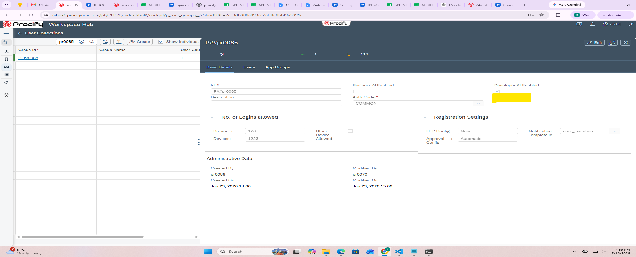

## App Management

In App Management, for the App,  Developer AI needs to be enabled

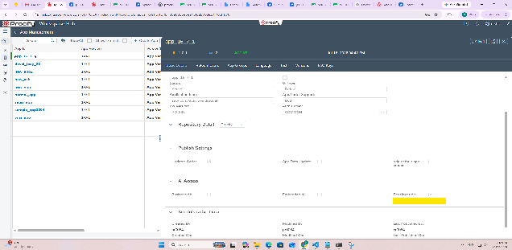

# **ProcessFlow of Developer AI** {#processflow-of-developer-ai}

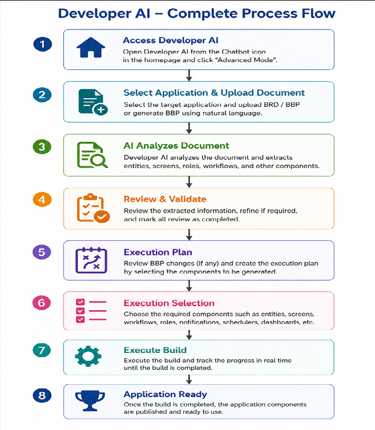

## Chatbot and Advanced Mode

We can access Developer AI from chatbot, the chatbot Icon is preset beside notification icon, in Homepage header

**Note: The chatbot icon is displayed only when Developer AI is enabled for the current landscape. If Developer AI is not enabled, the chatbot icon will not be visible.** 

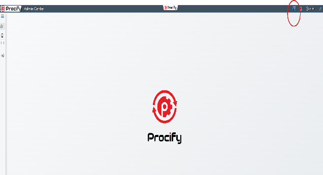

After click on this chatbot Icon, it will open the chatbot, from there to use the Developer AI, click on “Advanced Mode “ option, which will open the screen for using Developer AI

**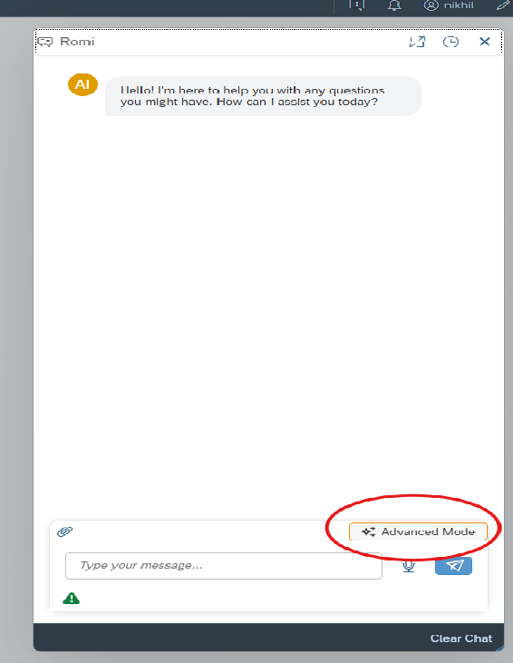**

## **Developer AI Wizard Screen and Its Tabs**

### **Step 1 : Upload BRD (Business Requirement Document )**

The **Upload Business Requirement Document** screen is the first step in the Developer AI application generation workflow. In this step, users select the target application, review the available AI token quota, and upload the Business Requirement Document (BRD) or Business Blueprint (BBP) that Developer AI will analyze to generate the application. 

#### **Select Application**

The **Select Application** dropdown displays all applications, select application with Developer AI enabled the selected application acts as the target application where Developer AI will generate all the required components.

* All AI-generated artifacts, such as entities, screens, dashboards, workflows, and configurations, are created within the selected application.  
* Ensure the correct application is selected before proceeding with document upload.

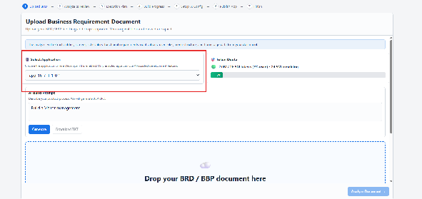

**Note :-** 

**1\. Developer AI not Enabled for Application**

If Developer AI is not enabled for the selected Application, It will show warning that Developer AI is not enabled for that application

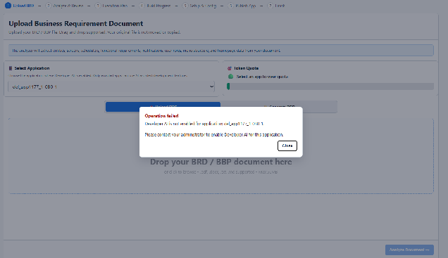

**2\. Developer AI server is not available**

If the Developer AI Server is not running, a dialog will be displayed with the message: “*Developer AI server is currently unavailable. Kindly contact the Administration team.*”

**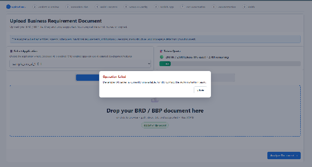**

**3\. BBP Build is triggered when other BBP build is in-progress in the same application**

If Build is triggered in the same application when other BBP Build is in-progress in the same application, then also the warning will come showing the BBP Build is already in progress

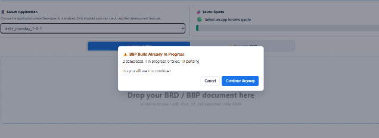

#### **Token Quota**  {#token-quota}

The **Token Quota** section displays the AI token consumption details for the selected user.

A token represents a unit of text processed by the AI model. Every analysis performed on a BRD or BBP consumes tokens.

The Token Quota panel provides the following information:

* **Tokens Used** – Total number of tokens consumed by Developer AI.  
* **Total Token Allocation** – Maximum tokens allocated to the application.  
* **Remaining Tokens** – Tokens still available for future AI operations.  
* **Usage Percentage** – Visual progress bar showing the percentage of the allocated quota that has been consumed.

#### **Token Units** {#token-units}

Developer AI displays large token counts using abbreviated units:

| Unit |   Meaning | Example |
| :---- | :---- | :---- |
| **K** | Thousand (1,000) | 250K \= 250,000 tokens |
| **M** | Million (1,000,000) | 2.0M \= 2,000,000 tokens |

**Example**

If the Token Quota displays:

* **2.0M / 26.5M tokens**  
* **7% Used**  
* **24.5M Remaining**

**It means:**

* A total of **26.5 million tokens** have been allocated.  
* **2.0 million tokens** have already been consumed.  
* **24.5 million tokens** are still available.  
* Approximately **7%** of the total token allocation has been utilized.

**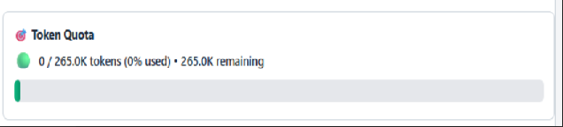**

#### **Generate BBP** {#generate-bbp}

The **Generate BBP** feature enables users to generate a **Business Blueprint (BBP)** by simply describing their application requirements in natural language. Instead of manually preparing a detailed BBP document, users can provide a high-level business description, and Developer AI automatically transforms it into a structured Business Blueprint.

**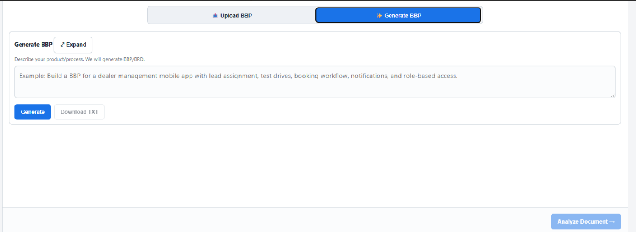**

#### **Upload BRD / BBP Document**  {#upload-brd-/-bbp-document}

Once the application has been selected, upload the project documentation for analysis.

Developer AI supports the following documents:

* **Business Requirement Document (BRD)**  
* **Business Blueprint (BBP)**

The document can be uploaded by:

* Dragging and dropping the file into the upload area.  
* Selecting the file from the local system.

Once the document is uploaded, Developer AI begins analyzing its contents to understand the business requirements and extract key information required to build the application. During this process, Developer AI identifies and generates:

* Business entities  
* Functional requirements  
* User roles  
* Application screens  
* Menu structure  
* Business workflows  
* Notifications  
* Schedulers  
* Dashboard requirements  
* Homepage configuration  
* Relationships between business objects

The extracted information is then used to automatically generate the initial application structure within the selected Procify application.

#### **Preparing a BBP for Developer AI** {#preparing-a-bbp-for-developer-ai}

Developer AI expects the **Business Blueprint (BBP)** to follow a predefined structure for accurate analysis and application generation. If your existing BBP is not already in this format, it must be converted before uploading.

To prepare a Developer AI-compatible BBP:

1. Ensure you have the existing **Business Blueprint (BBP)** for your project.  
2. Refer to the **Developer AI BBP Conversion Prompt** document ([Prompt](https://docs.google.com/document/d/18dXHlydkvZ2SMipZpGXcWWWLH1r762fjQcnmV8Y79Pg/edit?tab=t.0)).  
3. Upload both:  
   * Your existing BBP.  
   * The Developer AI BBP Conversion Prompt.  
4. Submit both documents to [**Claude**](https://claude.ai/new) for processing. The conversion prompt has been specifically designed and validated for **Claude**, and it is recommended **not to use other AI models** for this conversion.  
5. Claude will generate a new BBP that conforms to the standardized format required by Developer AI.  
6. Review the generated BBP to verify that the business requirements have been accurately converted.  
7. Upload the converted BBP using the **Upload Business Requirement Document** section to continue the application generation process.

Once uploaded, Developer AI will analyze the standardized BBP and generate the application's foundational components, including entities, screens, dashboards, workflows, configurations, and other required artifacts.

**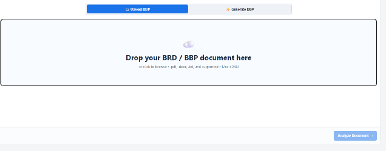**

### **Step 2 : Analyze & Review** 

The **Analyze & Review** tab is the second step in the Developer AI application generation workflow. In this stage, Developer AI processes the uploaded **BRD** or **BBP** and extracts all the business information required to build the application.

The purpose of this step is to validate that the uploaded document has been successfully analyzed before proceeding with application generation.

**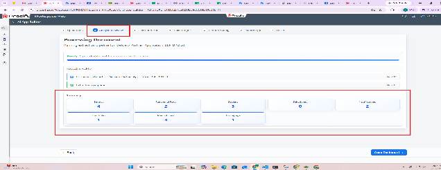**

Once the document analysis is completed successfully and the extracted summary has been reviewed, click Open Dashboard to proceed to the detailed review screen.

The Open Dashboard button opens the Review Extracted Information dashboard, where users can:

* Review all extracted business components in detail.  
* Verify entities, screens, functional requirements, user roles, notifications, schedulers, menu access, and homepage configuration.  
* Modify, add, or remove extracted items as required.  
* Validate the extracted information before proceeding to the Execution Plan stage.

**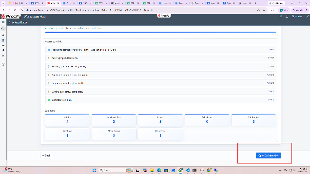**

#### **Review Extracted Information**

This section provides categorized access to all the information extracted from the uploaded BRD or BBP. Each category displays the number of items identified during the analysis, allowing users to review every component before proceeding with application generation.

The available categories include:

* **Entities** – Displays the  entities extracted from the document.  
* **Screens** – Lists the application screens identified during analysis.  
* **Schedulers** – Displays scheduled jobs or background processes.  
* **Functional Requirements** – Shows the extracted business requirements.  
* **Notifications** – Lists notification and alert configurations.  
* **User Roles** – Displays user roles identified for role-based access control.  
* **Menu Access** – Shows the application's navigation menu structure.  
* **Homepage** – Displays the extracted homepage configuration.  
* **Out of Scope** – Lists requirements identified as outside the application's scope.  
* **AI Visualize** – Provides AI-generated visual representations of the extracted business information.

  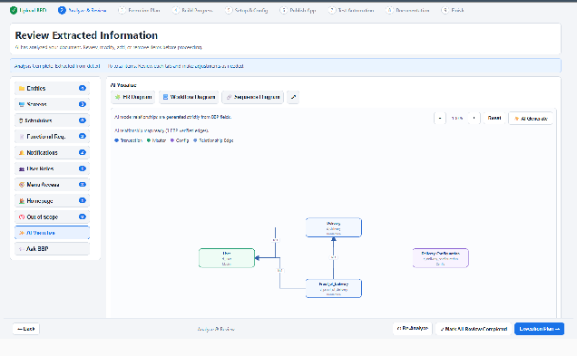

* **Ask BBP –** An AI-powered assistant that answers questions related to the uploaded BBP.

Selecting a category displays its corresponding details in the main content area for review.

**Note: At present, manual addition, modification, or deletion of extracted components is not supported. The entities, screens, functional requirements, user roles, and other components displayed on this screen are generated by Developer AI based on the uploaded BRD or BBP and are used as the foundation for application generation. Users can review the extracted information before proceeding to the next step.**

**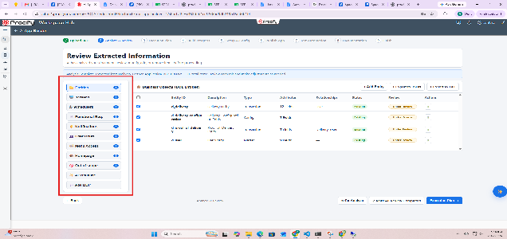**

### **Export Options** {#export-options}

Developer AI provides an option to export the extracted entity information for offline review or integration.

#### **Export to JSON** {#export-to-json}

The Export to JSON button downloads the extracted entity metadata in JSON (JavaScript Object Notation) format.

The exported file contains structured information such as:

* Entity details  
* Attributes  
* Relationships  
* Entity types  
* Associated metadata

The JSON format can be used for documentation, integration with external systems, or further processing.

#### **Export to TXT** {#export-to-txt}

**The Export to TXT option is currently not supported.**

Although the option is visible in the interface, exporting the extracted information in TXT format is not available in the current release and will be supported in a future version.

**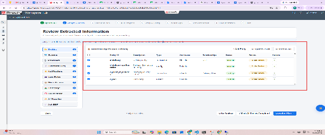**

## **Re-Analyze** {#re-analyze}

The Re-Analyze button allows users to run the document analysis again if changes have been made to the uploaded BRD or BBP, or if the extracted results need to be refreshed.

When clicked, Developer AI:

* Reprocesses the uploaded document.  
* Extracts the latest business requirements and application components.  
* Updates the extracted entities, screens, functional requirements, user roles, notifications, menu access, and other information.

**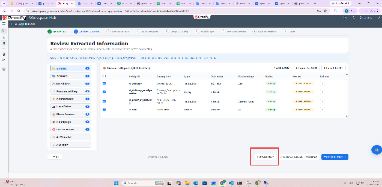**

## **Mark All Review Completed** {#mark-all-review-completed}

The Mark All Review Completed button confirms that the extracted information has been reviewed and approved.

Selecting this option indicates that:

* The extracted entities have been verified.  
* Screens and functional requirements have been reviewed.  
* User roles, menu access, homepage configuration, and other extracted components have been validated.  
* The application is ready to proceed to the next stage.

**Note: Marking the review as complete is mandatory before proceeding. If this step is not completed, an alert message will appear when you attempt to continue, prompting you to mark all reviews as completed before moving to the next stage.** 

**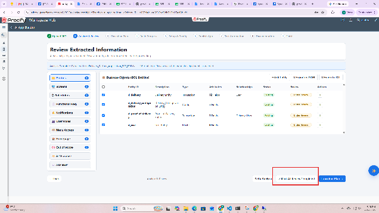**

## **Execution Plan** {#execution-plan}

The Execution Plan button navigates to the next step in the Developer AI workflow.

After the review is completed, clicking Execution Plan opens the Execution Plan screen, where Developer AI displays the sequence of activities required to generate the application.

The Execution Plan provides an overview of:

* Components to be generated.  
* Order of execution.

This serves as the final review before Developer AI begins generating the application.

**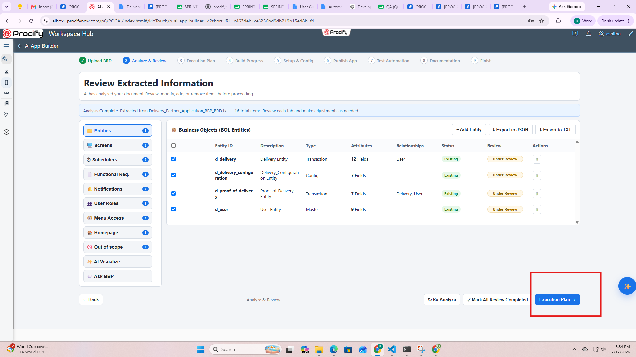**

## **Refine BBP with AI** {#refine-bbp-with-ai}

The Refine BBP with AI feature is designed to allow users to improve or modify the extracted Business Blueprint (BBP) using natural language instructions before proceeding with application generation.

This option can be accessed by clicking the ✨ (AI Refine) button available on the Review Extracted Information screen.

### How it Works

1. Click the ✨ (AI Refine) button.  
2. The Refine BBP with AI dialog is displayed.  
3. What should AI change? text box, enter the required modifications or enhancements in natural language.

Examples:

* Tighten the module scope.  
* Add missing approval rules.  
* Correct notification triggers.  
* Add a new business entity.  
* Update the workflow for order approval.  
4. Click Apply AI Changes.

Developer AI is designed to analyze the provided instructions and update the extracted BBP accordingly. The refined information would then be reflected in the extracted components for further review before proceeding with application generation.

**Note: The Refine BBP with AI feature is currently not supported in the current release. Although the option is available in the interface, AI-based refinement of the extracted BBP is not yet functional and will be supported in a future release.** 

**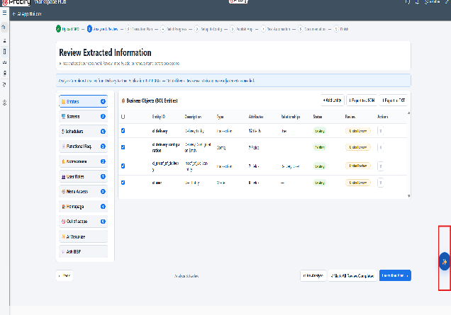**

### **Review BBP Changes Before Build** {#review-bbp-changes-before-build}

After clicking Execution Plan, the Review BBP Changes Before Build dialog is displayed. This screen provides a final summary of the extracted Business Blueprint (BBP) before the application build process begins.

The summary displays the number of:

* Existing in BBP – Components that were identified from the uploaded BRD or BBP.  
* Added – New components that have been added during the review process.  
* Updated – Components that have been modified before execution.

The dialog also lists all the extracted application components, such as:

* Entities  
* Screens  
* Functional Requirements  
* Notifications  
* User Roles  
* Other extracted artifacts

This allows users to perform a final verification of the application metadata before proceeding with the build.

Available Options

* **Compare AI Changes** – Displays a comparison between the original extracted information and any AI-generated changes (if applicable).  
* **Back to Review** – Returns to the Review Extracted Information screen to make further changes or validations.  
* **Proceed to Execution Plan** – Confirms the review and navigates to the Execution Plan screen, where the application generation workflow is initiated.

**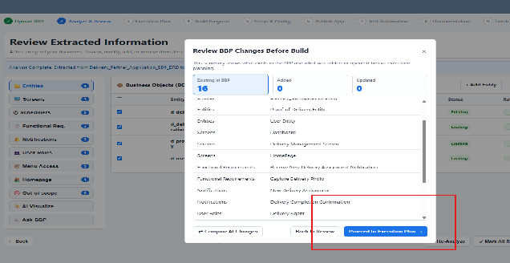**

### **Step 3 : Execution Selection**

After clicking Proceed to Execution Plan, the Execution Selection screen is displayed. This screen allows users to review all extracted components and select the items that should be included in the application generation process.

A summary at the top of the screen displays the total number of extracted components, including:

* Entities  
* UI Screens  
* Schedulers  
* Workflows  
* Notifications  
* User Roles  
* Menu Access  
* Homepage

Each category shows the number of items identified from the uploaded BRD or BBP.

### **Component Selection** {#component-selection}

The lower section displays the extracted components grouped by category. Each item is accompanied by a checkbox, allowing users to choose whether it should be included in the application build.

Users can:

* Review the extracted entities and screens.  
* Select or deselect individual components.  
* Use the Select All option to include all available components for generation.

Only the selected components will be considered during the application generation process.

### **Execute** {#execute}

After reviewing and selecting the required components, click Execute to start the application generation process.

Developer AI begins generating the selected application components within the chosen Procify application. This includes creating the selected entities, screens, workflows, notifications, user roles, menu access, homepage configuration, and other supported artifacts.

**Note: Ensure that all required components are selected before clicking Execute, as only the selected items will be included in the application generation process.** 

**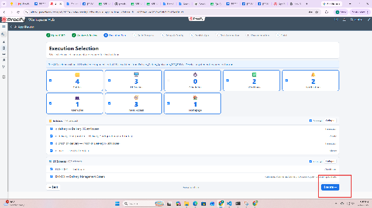**

### **Step 4 :** **Build Application** {#step-4-:-build-application}

After clicking Execute, the Execution Progress screen is displayed. This screen tracks the progress of the application generation process and shows the status of each component being created.

To begin generating the application, click Build Application.

### **Build Application** {#build-application}

The Build Application button initiates the application generation process based on the components selected in the Execution Plan.

During the build process, Developer AI automatically creates and configures the selected application components, including:

* Business entities  
* UI screens  
* Value Helps  
* Sample data  
* Application roles  
* Notifications  
* Business rules  
* Menus  
* Homepage configuration  
* Permissions  
* Other supported application artifacts

### **Execution Progress** {#execution-progress}

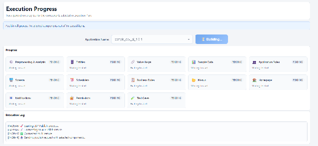

As the build progresses, the Execution Progress section displays the status of each component.

Each component is marked with one of the following statuses:

* In Progress – The component is currently being generated.  
* Completed – The component has been successfully created.

The progress cards provide a quick overview of the build status for each application component.

### **Execution Log** {#execution-log}

The Execution Log records every step performed during the application generation process.

The log includes information such as:

* Analysis completion  
* Entity creation  
* Screen generation  
* Business rule creation  
* Sample data insertion  
* Role creation  
* Menu generation  
* Homepage configuration  
* Permission assignment  
* Any warnings or errors encountered during the build

The execution log helps users monitor the build process and troubleshoot issues if required.

### **Build Completed** {#build-completed}

When all selected components have been generated successfully, the status changes to Build Completed.

A confirmation message indicates that the application has been successfully created within the selected Procify application.

Users can then click Continue to proceed to the next step in the Developer AI workflow.**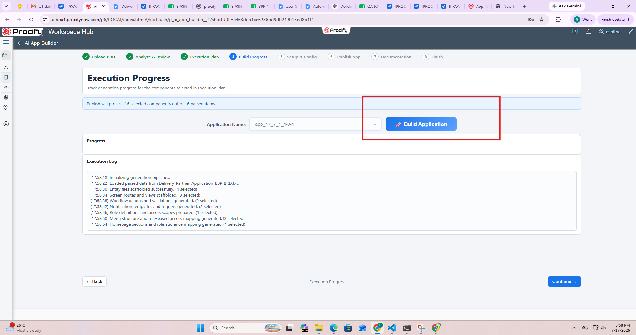**

**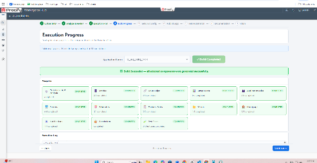Note :-** 

1. **Build Queue Notification** 

   When a BBP build is triggered for an application while another BBP build is already in progress for a different application, the new build request is not started immediately. Instead, it is automatically placed in a system-wide queue and will begin execution once the currently running build is completed. 

   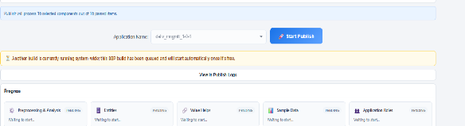

2. **Build Already in Progress** 

   If a BBP build is triggered for an application that already has an active build in progress, Developer AI does not start a new build for the same application. Instead, it notifies the user that a build is already running and provides an option to view the current build progress.

   Click **Yes, Show Progress** to open the ongoing build progress screen, or click **Cancel** to close the notification

   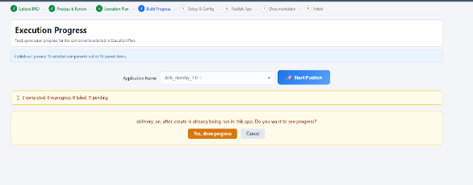

## 

## **Setup & Config *(Upcoming Feature)*** {#setup-&-config-(upcoming-feature)}

This step will allow users to configure application settings, assign users and roles, manage permissions, customize branding, and define deployment-related configurations before publishing the application.

## **Publish App *(Upcoming Feature)*** {#publish-app-(upcoming-feature)}

This step will allow users to validate the generated application, perform publish readiness checks, and publish the application to the target environment.

## **Test Automation *(Upcoming Feature)*** {#test-automation-(upcoming-feature)}

This step will allow users to generate AI-powered test cases and execute automated Playwright tests to validate the generated application.

## **Documentation *(Upcoming Feature)*** {#documentation-(upcoming-feature)}

This step will allow users to generate AI-powered technical documentation, user guides, configuration guides, and downloadable project documentation for the generated application.

## **Finish *(Upcoming Feature)*** {#finish-(upcoming-feature)}

This step will allow users to review the final application generation summary, verify the completed workflow, and conclude the Developer AI application generation process.

# **Generated Application Walkthrough**  {#generated-application-walkthrough}

**Entities** 

After the application is generated, all the business entities created by Developer AI are automatically available in the Data Studio. These entities form the core data model of the generated application and can be reviewed and further configured as needed.

The left navigation panel displays the list of all generated entities. Selecting an entity opens its complete configuration, where you can review its properties, relationships, business rules, workflows, access control, and other metadata.

**Note:** If the generated entities are not immediately visible in the Data Studio, refresh the application or browser. The entities will be displayed once the latest metadata is loaded. 

**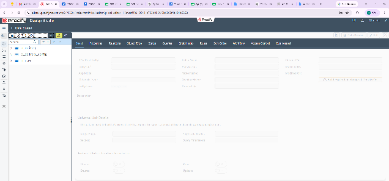**

**Screens** 

Developer AI automatically generates the required application pages based on the uploaded BRD/BBP. These pages provide the user interface for interacting with the generated business entities and application features.

The generated pages are available in the **Page Builder** and can be reviewed, customized, or enhanced using the standard Procify page designer.

In the example shown, Developer AI has generated the following pages:

* **p\_homepage\_001** – The application's landing page that provides users with the initial view after logging in.  
* **p\_dashboard\_001** – Displays the application's dashboard, providing a consolidated view of key information, widgets, and business insights.  
* **p\_delivery\_mgmt** – The Delivery Management page used to create, view, update, and manage delivery-related transactions.

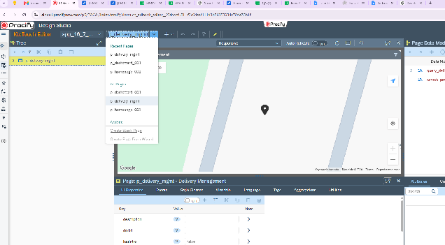

**Role & Users** 

The roles and users generated by **Developer AI** can be viewed from the **Roles & Users** section under the **Details** tab of the generated application in **App Management**.

This section allows you to review the user roles and user assignments created for the application.

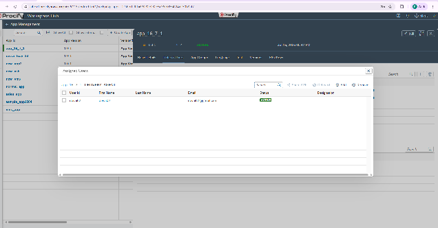

**Homepage**

Log in using one of the users created in the **Roles & Users** section. After successful login, the application opens the **Homepage** generated by Developer AI.

The homepage displayed corresponds to the configuration defined in the **Homepage** component during the application generation process. It serves as the application's landing page and provides users with quick access to the generated modules, dashboards, and navigation menus based on their assigned role and permissions.

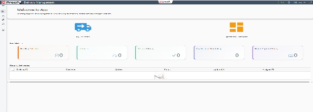

**Dashboard**

Developer AI automatically generates the application dashboard based on the requirements defined in the uploaded BRD or BBP.

The generated dashboard provides users with a consolidated view of key business information, metrics, and navigation components relevant to the application. It is designed to offer quick access to important data and frequently used features immediately after login.

The dashboard created by Developer AI can be accessed from the **Dashboard** menu within the generated application and can be further customized using the standard Procify dashboard designer to meet specific business requirements.

**Note:** The layout, widgets, and overall design of the generated dashboard are determined by **Developer AI** based on its analysis of the uploaded BBP or BRD. Dashboard generation is AI-driven, and users cannot control or define the dashboard layout by providing screenshots or sample designs. To influence the generated dashboard, include clear and detailed dashboard requirements within the BBP or BRD. 

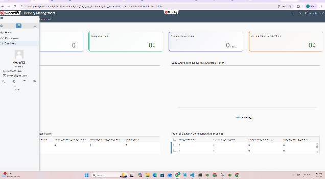

**Menu**

Developer AI automatically generates the application's navigation menu based on the modules, screens, and user workflows defined in the uploaded BRD or BBP.

The generated menu provides users with organized navigation to access the application's features. Menu items are created based on the business requirements and are assigned appropriate access according to the generated user roles and permissions.

In the example shown, Developer AI has generated the following menu items:

* **Home** – The default landing page that provides users with quick access to the application.  
* **My Deliveries** – A module for managing and viewing delivery-related transactions.  
* **Dashboard** – Provides access to the application's dashboard, displaying key business insights and summary information.

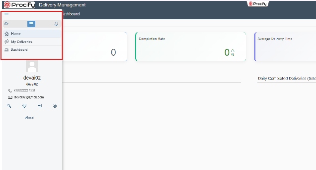

# 

# **Features Not Yet Supported**  {#features-not-yet-supported}

1. **Row-Wise Authorization**  
2. **Saved Query / Initial Sync**  
3. **Framework Offline Related Features**  
4. **Entity Indexing**  
5. **Sort Order**

# ***“As Developer AI uses Artificial Intelligence to interpret business requirements, the generated application may not always be complete or entirely accurate. The quality of the generated output depends on the clarity and completeness of the provided BRD or BBP. It is recommended to perform a thorough functional and technical review before deploying the application. ”*** {#“as-developer-ai-uses-artificial-intelligence-to-interpret-business-requirements,-the-generated-application-may-not-always-be-complete-or-entirely-accurate.-the-quality-of-the-generated-output-depends-on-the-clarity-and-completeness-of-the-provided-brd-or-bbp.-it-is-recommended-to-perform-a-thorough-functional-and-technical-review-before-deploying-the-application.-”}

