# ProcessFlow of Developer AI

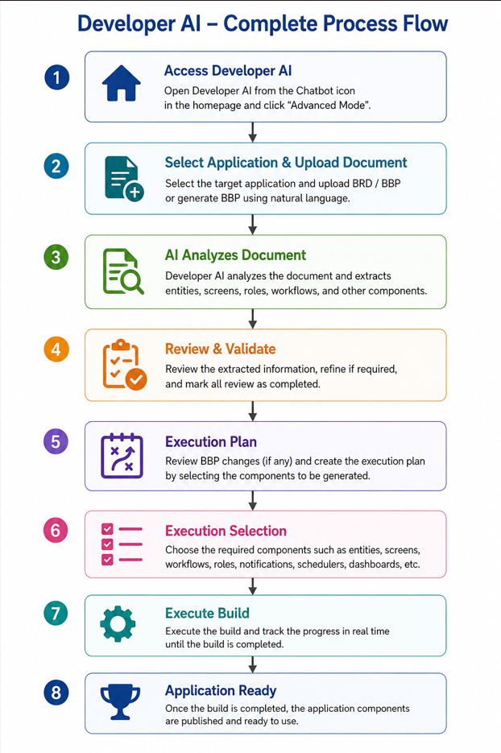

## Chatbot and Advanced Mode

We can access Developer AI from chatbot, the chatbot Icon is preset beside notification icon, in Homepage header

**Note: The chatbot icon is displayed only when Developer AI is enabled for the current landscape. If Developer AI is not enabled, the chatbot icon will not be visible.**

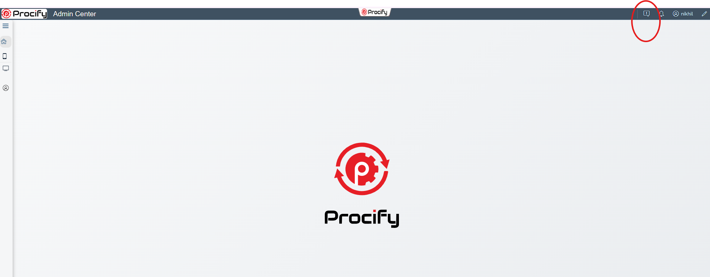

After click on this chatbot Icon, it will open the chatbot, from there to use the Developer AI, click on “Advanced Mode “ option, which will open the screen for using Developer AI

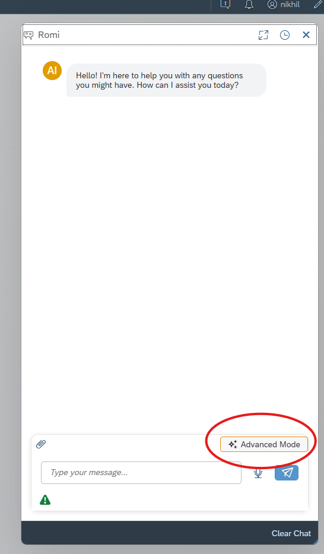

## **Developer AI Wizard Screen and Its Tabs**

### **Step 1 : Upload BRD (Business Requirement Document )**

The **Upload Business Requirement Document** screen is the first step in the Developer AI application generation workflow. In this step, users select the target application, review the available AI token quota, and upload the Business Requirement Document (BRD) or Business Blueprint (BBP) that Developer AI will analyze to generate the application.

#### Select Application

The **Select Application** dropdown displays all applications, select application with Developer AI enabled the selected application acts as the target application where Developer AI will generate all the required components.

- All AI-generated artifacts, such as entities, screens, dashboards, workflows, and configurations, are created within the selected application.

- Ensure the correct application is selected before proceeding with document upload.

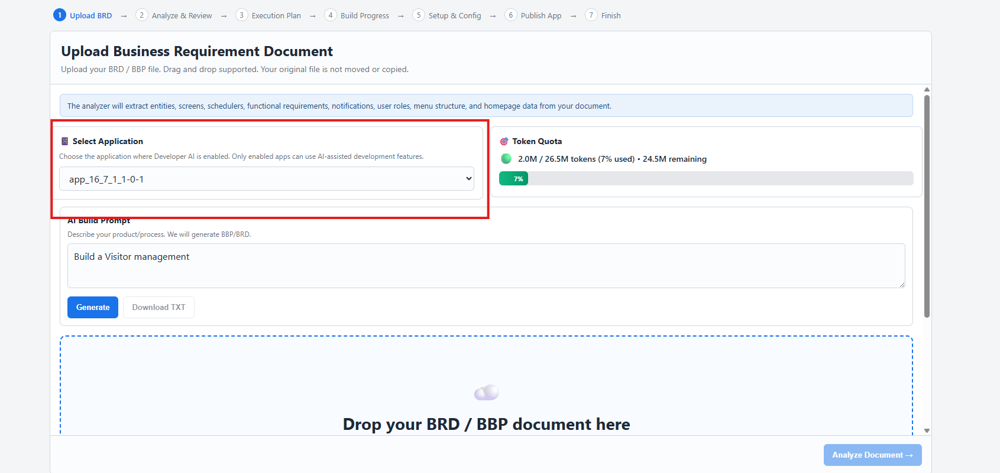

**Note :-**

**1. Developer AI not Enabled for Application**

If Developer AI is not enabled for the selected Application, It will show warning that Developer AI is not enabled for that application

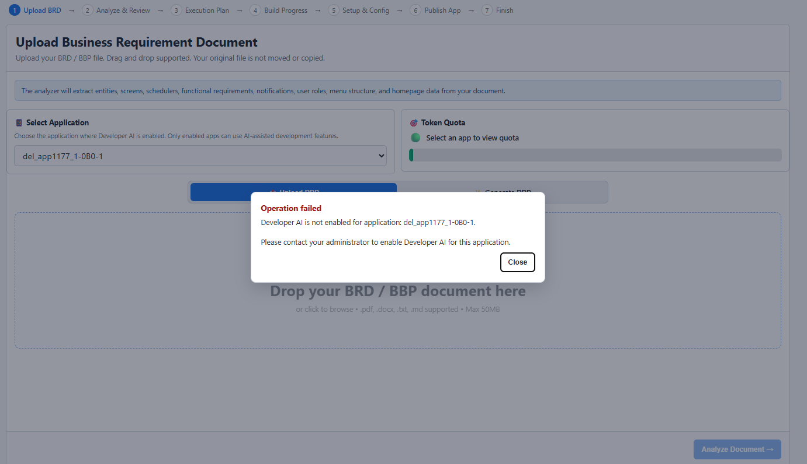

**2. Developer AI server is not available**

If the Developer AI Server is not running, a dialog will be displayed with the message: “*Developer AI server is currently unavailable. Kindly contact the Administration team.*”

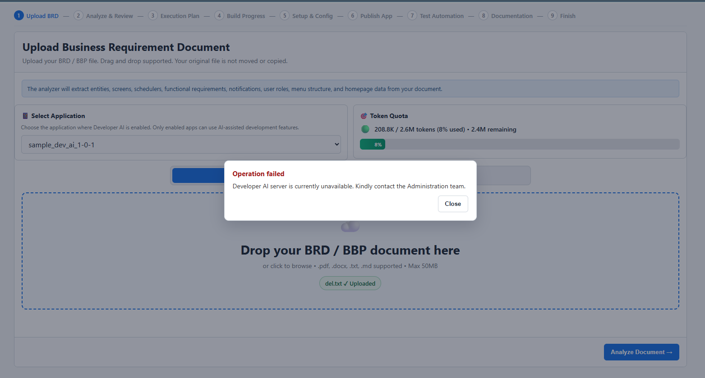

**3. BBP Build is triggered when other BBP build is in-progress in the same application**

If Build is triggered in the same application when other BBP Build is in-progress in the same application, then also the warning will come showing the BBP Build is already in progress

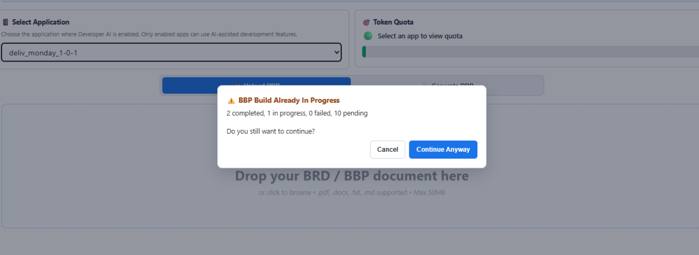

#### Token Quota

The **Token Quota** section displays the AI token consumption details for the selected user.

A token represents a unit of text processed by the AI model. Every analysis performed on a BRD or BBP consumes tokens.

The Token Quota panel provides the following information:

- **Tokens Used** – Total number of tokens consumed by Developer AI.

- **Total Token Allocation** – Maximum tokens allocated to the application.

- **Remaining Tokens** – Tokens still available for future AI operations.

- **Usage Percentage** – Visual progress bar showing the percentage of the allocated quota that has been consumed.

#### **Token Units**

Developer AI displays large token counts using abbreviated units:

<table>
<colgroup>
<col style="width: 15%" />
<col style="width: 39%" />
<col style="width: 44%" />
</colgroup>
<thead>
<tr class="header">
<th><strong>Unit</strong></th>
<th><blockquote>

<strong>Meaning</strong>

</blockquote></th>
<th><blockquote>

<strong>Example</strong>

</blockquote></th>
</tr>
<tr class="odd">
<th><strong>K</strong></th>
<th><blockquote>

Thousand (1,000)

</blockquote></th>
<th><blockquote>

250K = 250,000 tokens

</blockquote></th>
</tr>
<tr class="header">
<th><strong>M</strong></th>
<th><blockquote>

Million (1,000,000)

</blockquote></th>
<th><blockquote>

2.0M = 2,000,000 tokens

</blockquote></th>
</tr>
</thead>
<tbody>
</tbody>
</table>

**Example**

If the Token Quota displays:

- **2.0M / 26.5M tokens**

- **7% Used**

- **24.5M Remaining**

**It means:**

- A total of **26.5 million tokens** have been allocated.

- **2.0 million tokens** have already been consumed.

- **24.5 million tokens** are still available.

- Approximately **7%** of the total token allocation has been utilized.

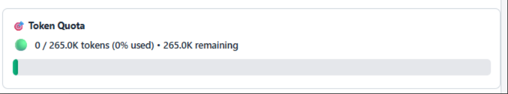

#### Generate BBP

The **Generate BBP** feature enables users to generate a **Business Blueprint (BBP)** by simply describing their application requirements in natural language. Instead of manually preparing a detailed BBP document, users can provide a high-level business description, and Developer AI automatically transforms it into a structured Business Blueprint.

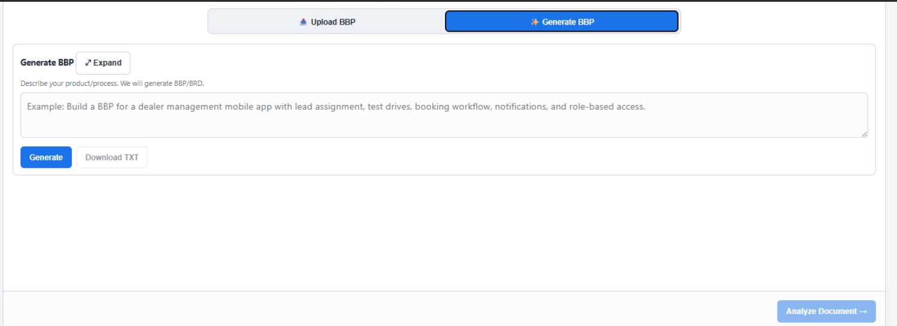

#### Upload BRD / BBP Document

Once the application has been selected, upload the project documentation for analysis.

Developer AI supports the following documents:

- **Business Requirement Document (BRD)**

- **Business Blueprint (BBP)**

The document can be uploaded by:

- Dragging and dropping the file into the upload area.

- Selecting the file from the local system.

Once the document is uploaded, Developer AI begins analyzing its contents to understand the business requirements and extract key information required to build the application. During this process, Developer AI identifies and generates:

- Business entities

- Functional requirements

- User roles

- Application screens

- Menu structure

- Business workflows

- Notifications

- Schedulers

- Dashboard requirements

- Homepage configuration

- Relationships between business objects

The extracted information is then used to automatically generate the initial application structure within the selected Procify application.

#### Preparing a BBP for Developer AI

Developer AI expects the **Business Blueprint (BBP)** to follow a predefined structure for accurate analysis and application generation. If your existing BBP is not already in this format, it must be converted before uploading.

To prepare a Developer AI-compatible BBP:

1.  Ensure you have the existing **Business Blueprint (BBP)** for your project.

2.  Refer to the **Developer AI BBP Conversion Prompt** document ([<u>Prompt</u>](https://docs.google.com/document/d/18dXHlydkvZ2SMipZpGXcWWWLH1r762fjQcnmV8Y79Pg/edit?tab=t.0)).

3.  Upload both:

    - Your existing BBP.

    - The Developer AI BBP Conversion Prompt.

4.  Submit both documents to [**<u>Claude</u>**](https://claude.ai/new) for processing. The conversion prompt has been specifically designed and validated for **Claude**, and it is recommended **not to use other AI models** for this conversion.

5.  Claude will generate a new BBP that conforms to the standardized format required by Developer AI.

6.  Review the generated BBP to verify that the business requirements have been accurately converted.

7.  Upload the converted BBP using the **Upload Business Requirement Document** section to continue the application generation process.

Once uploaded, Developer AI will analyze the standardized BBP and generate the application's foundational components, including entities, screens, dashboards, workflows, configurations, and other required artifacts.

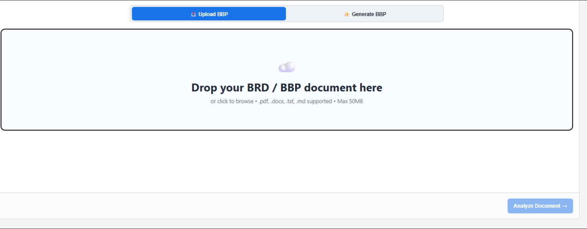

### **Step 2 : Analyze & Review**

The **Analyze & Review** tab is the second step in the Developer AI application generation workflow. In this stage, Developer AI processes the uploaded **BRD** or **BBP** and extracts all the business information required to build the application.

The purpose of this step is to validate that the uploaded document has been successfully analyzed before proceeding with application generation.

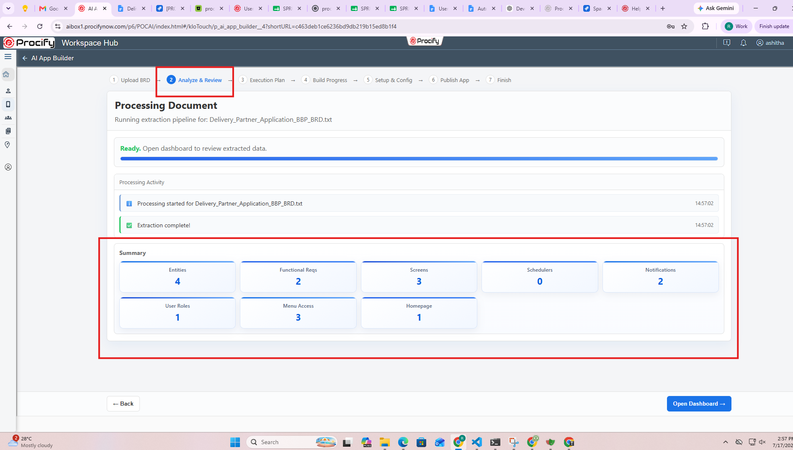

Once the document analysis is completed successfully and the extracted summary has been reviewed, click Open Dashboard to proceed to the detailed review screen.

The Open Dashboard button opens the Review Extracted Information dashboard, where users can:

- Review all extracted business components in detail.

- Verify entities, screens, functional requirements, user roles, notifications, schedulers, menu access, and homepage configuration.

- Modify, add, or remove extracted items as required.

- Validate the extracted information before proceeding to the Execution Plan stage.

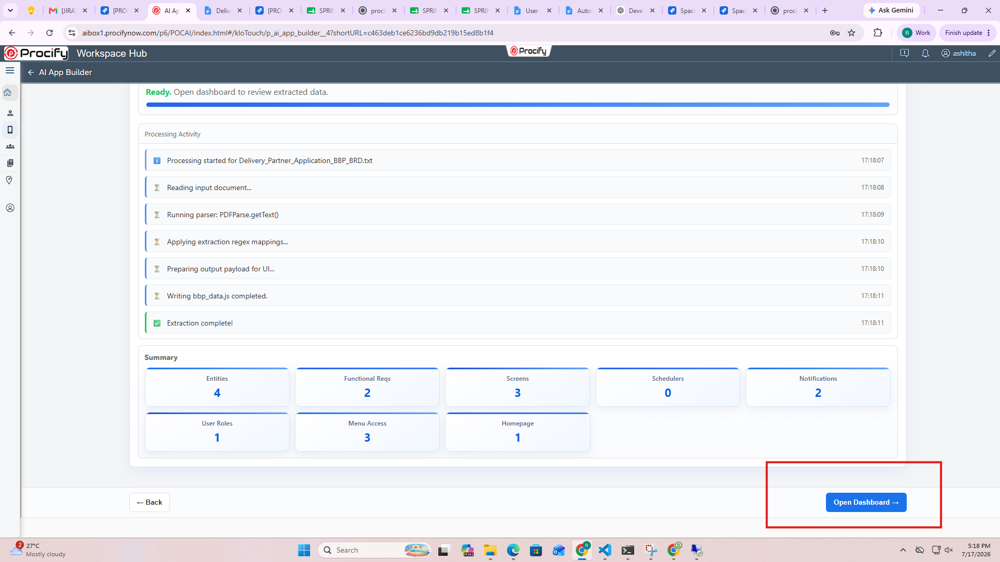

#### Review Extracted Information

This section provides categorized access to all the information extracted from the uploaded BRD or BBP. Each category displays the number of items identified during the analysis, allowing users to review every component before proceeding with application generation.

The available categories include:

- **Entities** – Displays the entities extracted from the document.

- **Screens** – Lists the application screens identified during analysis.

- **Schedulers** – Displays scheduled jobs or background processes.

- **Functional Requirements** – Shows the extracted business requirements.

- **Notifications** – Lists notification and alert configurations.

- **User Roles** – Displays user roles identified for role-based access control.

- **Menu Access** – Shows the application's navigation menu structure.

- **Homepage** – Displays the extracted homepage configuration.

- **Out of Scope** – Lists requirements identified as outside the application's scope.

- **AI Visualize** – Provides AI-generated visual representations of the extracted business information.

> 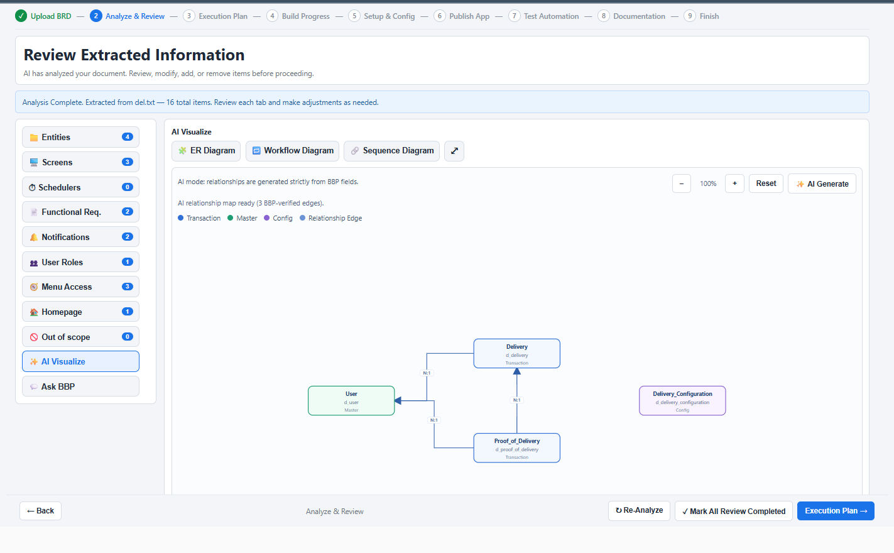

- **Ask BBP –** An AI-powered assistant that answers questions related to the uploaded BBP.

Selecting a category displays its corresponding details in the main content area for review.

**Note: At present, manual addition, modification, or deletion of extracted components is not supported. The entities, screens, functional requirements, user roles, and other components displayed on this screen are generated by Developer AI based on the uploaded BRD or BBP and are used as the foundation for application generation. Users can review the extracted information before proceeding to the next step.**

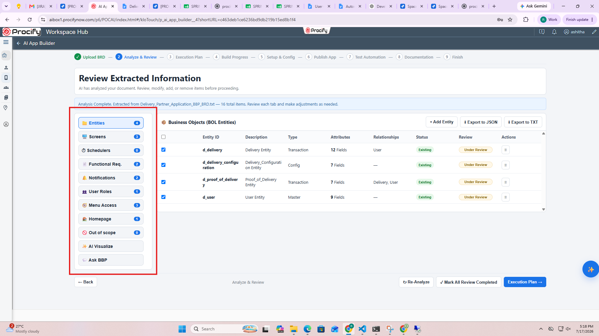

### **Export Options**

Developer AI provides an option to export the extracted entity information for offline review or integration.

#### **Export to JSON**

The Export to JSON button downloads the extracted entity metadata in JSON (JavaScript Object Notation) format.

The exported file contains structured information such as:

- Entity details

- Attributes

- Relationships

- Entity types

- Associated metadata

The JSON format can be used for documentation, integration with external systems, or further processing.

#### **Export to TXT**

**The Export to TXT option is currently not supported.**

Although the option is visible in the interface, exporting the extracted information in TXT format is not available in the current release and will be supported in a future version.

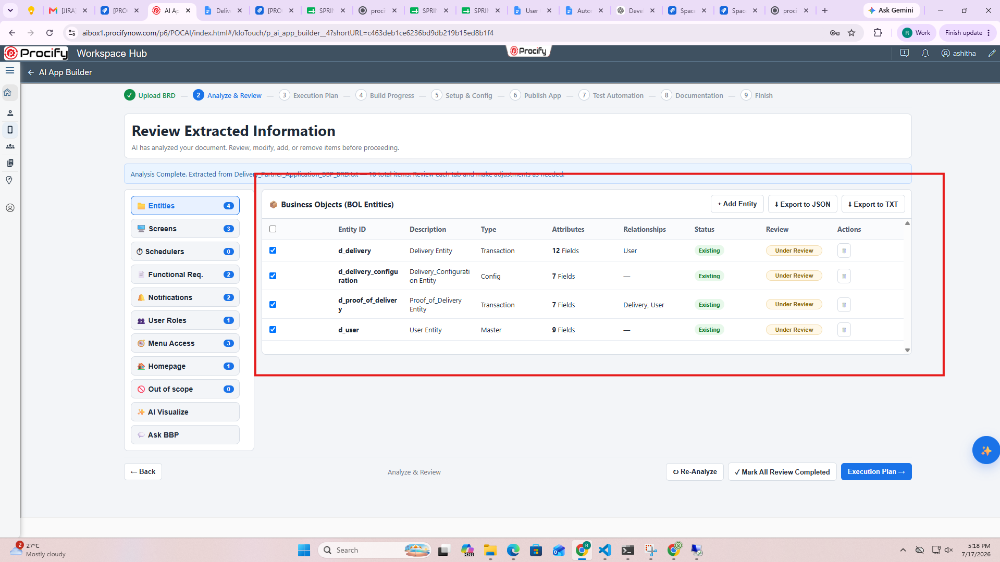

## **Re-Analyze**

The Re-Analyze button allows users to run the document analysis again if changes have been made to the uploaded BRD or BBP, or if the extracted results need to be refreshed.

When clicked, Developer AI:

- Reprocesses the uploaded document.

- Extracts the latest business requirements and application components.

- Updates the extracted entities, screens, functional requirements, user roles, notifications, menu access, and other information.

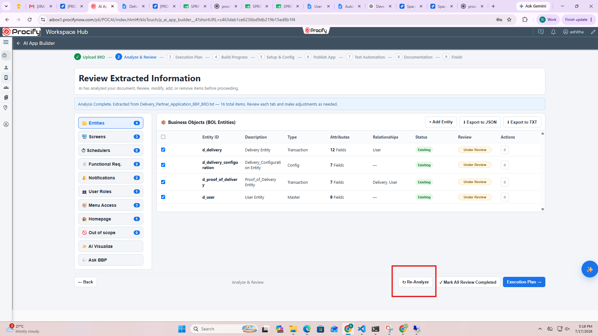

## **Mark All Review Completed**

The Mark All Review Completed button confirms that the extracted information has been reviewed and approved.

Selecting this option indicates that:

- The extracted entities have been verified.

- Screens and functional requirements have been reviewed.

- User roles, menu access, homepage configuration, and other extracted components have been validated.

- The application is ready to proceed to the next stage.

**Note: Marking the review as complete is mandatory before proceeding. If this step is not completed, an alert message will appear when you attempt to continue, prompting you to mark all reviews as completed before moving to the next stage.**

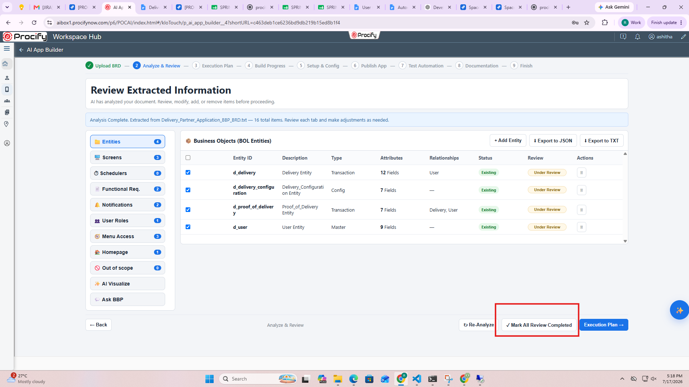

## **Execution Plan**

The Execution Plan button navigates to the next step in the Developer AI workflow.

After the review is completed, clicking Execution Plan opens the Execution Plan screen, where Developer AI displays the sequence of activities required to generate the application.

The Execution Plan provides an overview of:

- Components to be generated.

- Order of execution.

This serves as the final review before Developer AI begins generating the application.

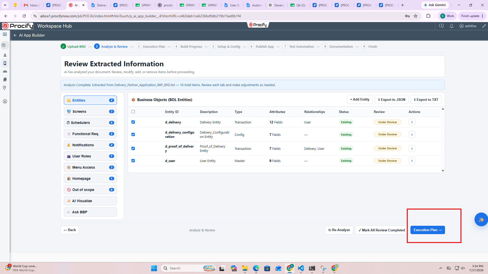

## **Refine BBP with AI**

The Refine BBP with AI feature is designed to allow users to improve or modify the extracted Business Blueprint (BBP) using natural language instructions before proceeding with application generation.

This option can be accessed by clicking the ✨ (AI Refine) button available on the Review Extracted Information screen.

### How it Works

1.  Click the ✨ (AI Refine) button.

2.  The Refine BBP with AI dialog is displayed.

3.  What should AI change? text box, enter the required modifications or enhancements in natural language.

Examples:

- Tighten the module scope.

- Add missing approval rules.

- Correct notification triggers.

- Add a new business entity.

- Update the workflow for order approval.

4.  Click Apply AI Changes.

Developer AI is designed to analyze the provided instructions and update the extracted BBP accordingly. The refined information would then be reflected in the extracted components for further review before proceeding with application generation.

**Note: The Refine BBP with AI feature is currently not supported in the current release. Although the option is available in the interface, AI-based refinement of the extracted BBP is not yet functional and will be supported in a future release.**

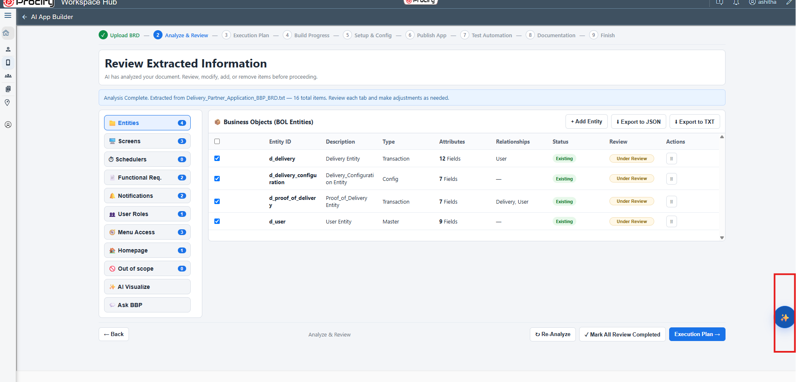

### **Review BBP Changes Before Build**

After clicking Execution Plan, the Review BBP Changes Before Build dialog is displayed. This screen provides a final summary of the extracted Business Blueprint (BBP) before the application build process begins.

The summary displays the number of:

- Existing in BBP – Components that were identified from the uploaded BRD or BBP.

- Added – New components that have been added during the review process.

- Updated – Components that have been modified before execution.

The dialog also lists all the extracted application components, such as:

- Entities

- Screens

- Functional Requirements

- Notifications

- User Roles

- Other extracted artifacts

This allows users to perform a final verification of the application metadata before proceeding with the build.

Available Options

- **Compare AI Changes** – Displays a comparison between the original extracted information and any AI-generated changes (if applicable).

- **Back to Review** – Returns to the Review Extracted Information screen to make further changes or validations.

- **Proceed to Execution Plan** – Confirms the review and navigates to the Execution Plan screen, where the application generation workflow is initiated.

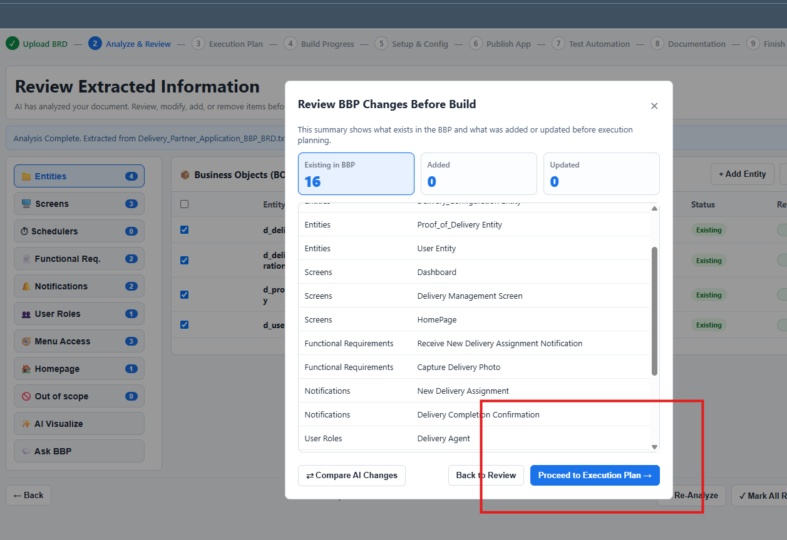

### **Step 3 : Execution Selection**

After clicking Proceed to Execution Plan, the Execution Selection screen is displayed. This screen allows users to review all extracted components and select the items that should be included in the application generation process.

A summary at the top of the screen displays the total number of extracted components, including:

- Entities

- UI Screens

- Schedulers

- Workflows

- Notifications

- User Roles

- Menu Access

- Homepage

Each category shows the number of items identified from the uploaded BRD or BBP.

### **Component Selection**

The lower section displays the extracted components grouped by category. Each item is accompanied by a checkbox, allowing users to choose whether it should be included in the application build.

Users can:

- Review the extracted entities and screens.

- Select or deselect individual components.

- Use the Select All option to include all available components for generation.

Only the selected components will be considered during the application generation process.

### **Execute**

After reviewing and selecting the required components, click Execute to start the application generation process.

Developer AI begins generating the selected application components within the chosen Procify application. This includes creating the selected entities, screens, workflows, notifications, user roles, menu access, homepage configuration, and other supported artifacts.

**Note: Ensure that all required components are selected before clicking Execute, as only the selected items will be included in the application generation process.**

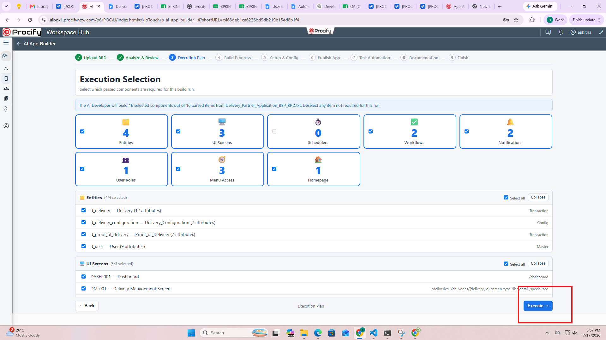

### **Step 4 :Build Application**

After clicking Execute, the Execution Progress screen is displayed. This screen tracks the progress of the application generation process and shows the status of each component being created.

To begin generating the application, click Build Application.

### **Build Application**

The Build Application button initiates the application generation process based on the components selected in the Execution Plan.

During the build process, Developer AI automatically creates and configures the selected application components, including:

- Business entities

- UI screens

- Value Helps

- Sample data

- Application roles

- Notifications

- Business rules

- Menus

- Homepage configuration

- Permissions

- Other supported application artifacts

### **Execution Progress**

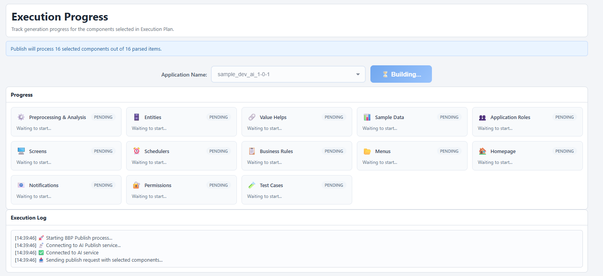

As the build progresses, the Execution Progress section displays the status of each component.

Each component is marked with one of the following statuses:

- In Progress – The component is currently being generated.

- Completed – The component has been successfully created.

The progress cards provide a quick overview of the build status for each application component.

### **Execution Log**

The Execution Log records every step performed during the application generation process.

The log includes information such as:

- Analysis completion

- Entity creation

- Screen generation

- Business rule creation

- Sample data insertion

- Role creation

- Menu generation

- Homepage configuration

- Permission assignment

- Any warnings or errors encountered during the build

The execution log helps users monitor the build process and troubleshoot issues if required.

### **Build Completed**

When all selected components have been generated successfully, the status changes to Build Completed.

A confirmation message indicates that the application has been successfully created within the selected Procify application.

Users can then click Continue to proceed to the next step in the Developer AI workflow.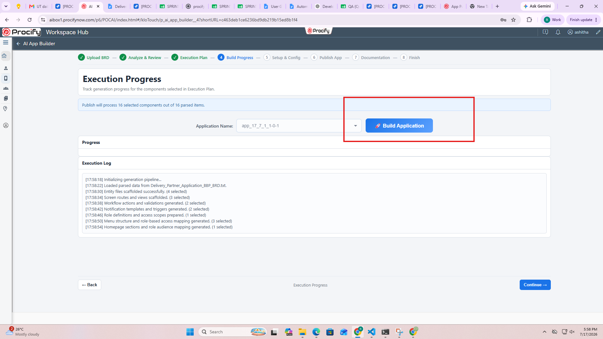

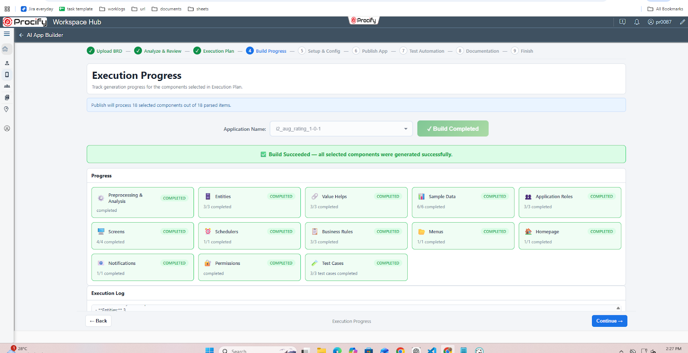**Note :-**

1.  **Build Queue Notification**

> When a BBP build is triggered for an application while another BBP build is already in progress for a different application, the new build request is not started immediately. Instead, it is automatically placed in a system-wide queue and will begin execution once the currently running build is completed.
>
> 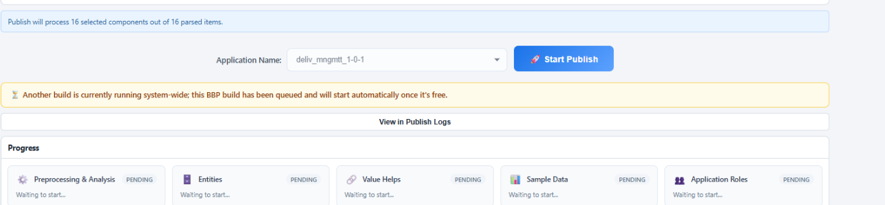

2.  **Build Already in Progress**

> If a BBP build is triggered for an application that already has an active build in progress, Developer AI does not start a new build for the same application. Instead, it notifies the user that a build is already running and provides an option to view the current build progress.
>
> Click **Yes, Show Progress** to open the ongoing build progress screen, or click **Cancel** to close the notification
>
> 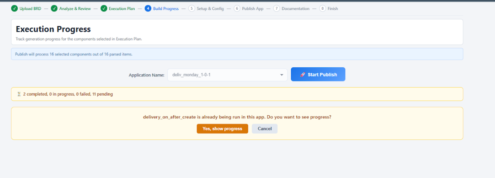

## **Setup & Config *(Upcoming Feature)***

This step will allow users to configure application settings, assign users and roles, manage permissions, customize branding, and define deployment-related configurations before publishing the application.

## **Publish App *(Upcoming Feature)***

This step will allow users to validate the generated application, perform publish readiness checks, and publish the application to the target environment.

## **Test Automation *(Upcoming Feature)***

This step will allow users to generate AI-powered test cases and execute automated Playwright tests to validate the generated application.

## **Documentation *(Upcoming Feature)***

This step will allow users to generate AI-powered technical documentation, user guides, configuration guides, and downloadable project documentation for the generated application.

## **Finish *(Upcoming Feature)***

This step will allow users to review the final application generation summary, verify the completed workflow, and conclude the Developer AI application generation process.
