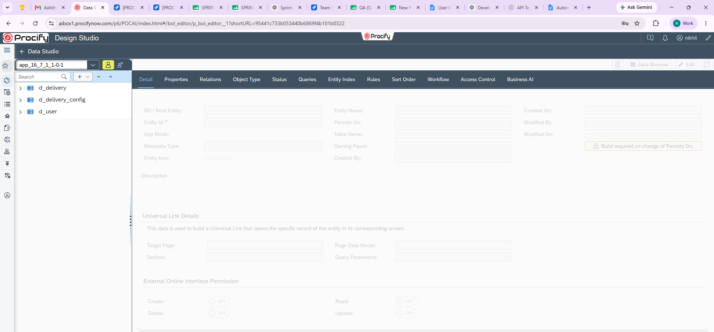
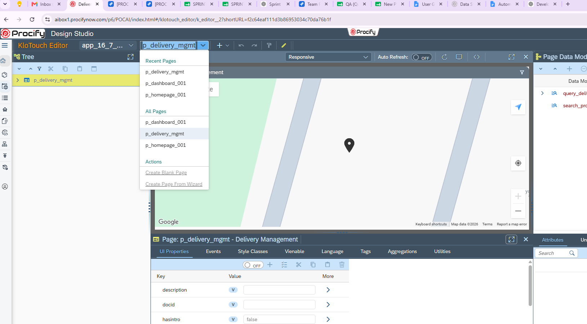
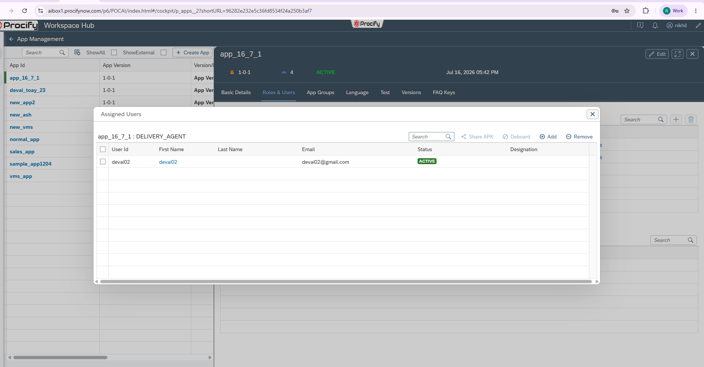
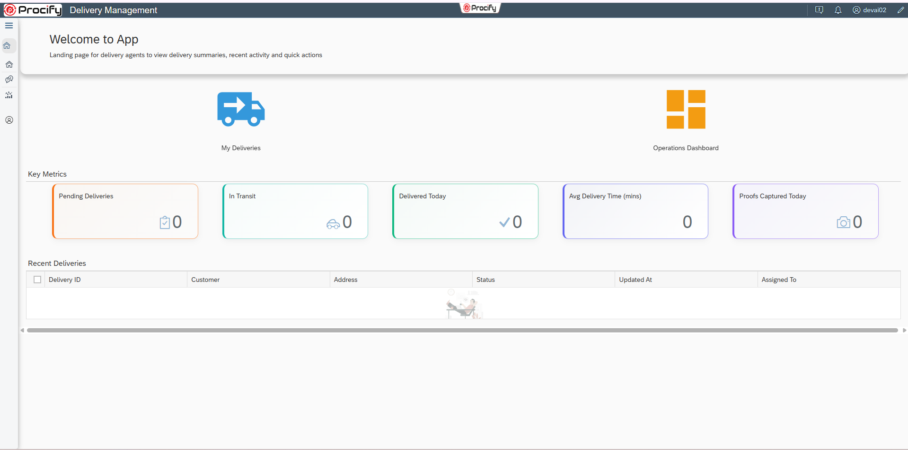
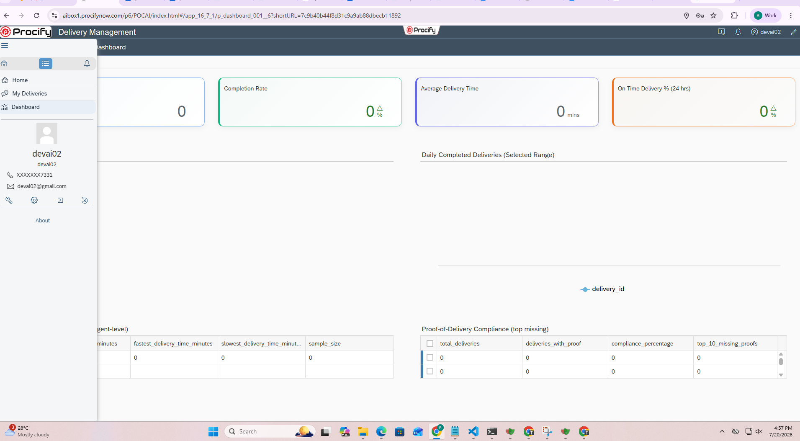
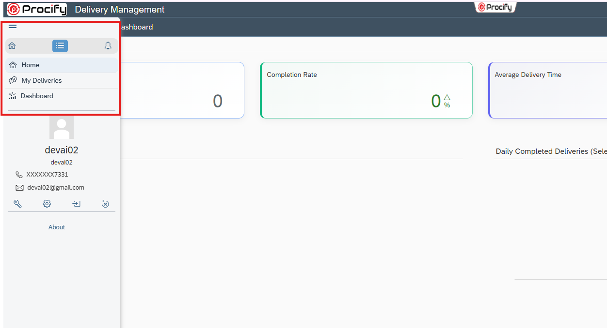

# Generated Application Walkthrough

**Entities**

After the application is generated, all the business entities created by Developer AI are automatically available in the Data Studio. These entities form the core data model of the generated application and can be reviewed and further configured as needed.

The left navigation panel displays the list of all generated entities. Selecting an entity opens its complete configuration, where you can review its properties, relationships, business rules, workflows, access control, and other metadata.

**Note:** If the generated entities are not immediately visible in the Data Studio, refresh the application or browser. The entities will be displayed once the latest metadata is loaded.

**Screens**

Developer AI automatically generates the required application pages based on the uploaded BRD/BBP. These pages provide the user interface for interacting with the generated business entities and application features.

The generated pages are available in the **Page Builder** and can be reviewed, customized, or enhanced using the standard Procify page designer.

In the example shown, Developer AI has generated the following pages:

- **p_homepage_001** – The application's landing page that provides users with the initial view after logging in.

- **p_dashboard_001** – Displays the application's dashboard, providing a consolidated view of key information, widgets, and business insights.

- **p_delivery_mgmt** – The Delivery Management page used to create, view, update, and manage delivery-related transactions.

**Role & Users**

The roles and users generated by **Developer AI** can be viewed from the **Roles & Users** section under the **Details** tab of the generated application in **App Management**.

This section allows you to review the user roles and user assignments created for the application.

**Homepage**

Log in using one of the users created in the **Roles & Users** section. After successful login, the application opens the **Homepage** generated by Developer AI.

The homepage displayed corresponds to the configuration defined in the **Homepage** component during the application generation process. It serves as the application's landing page and provides users with quick access to the generated modules, dashboards, and navigation menus based on their assigned role and permissions.

**Dashboard**

Developer AI automatically generates the application dashboard based on the requirements defined in the uploaded BRD or BBP.

The generated dashboard provides users with a consolidated view of key business information, metrics, and navigation components relevant to the application. It is designed to offer quick access to important data and frequently used features immediately after login.

The dashboard created by Developer AI can be accessed from the **Dashboard** menu within the generated application and can be further customized using the standard Procify dashboard designer to meet specific business requirements.

**Note:** The layout, widgets, and overall design of the generated dashboard are determined by **Developer AI** based on its analysis of the uploaded BBP or BRD. Dashboard generation is AI-driven, and users cannot control or define the dashboard layout by providing screenshots or sample designs. To influence the generated dashboard, include clear and detailed dashboard requirements within the BBP or BRD.

**Menu**

Developer AI automatically generates the application's navigation menu based on the modules, screens, and user workflows defined in the uploaded BRD or BBP.

The generated menu provides users with organized navigation to access the application's features. Menu items are created based on the business requirements and are assigned appropriate access according to the generated user roles and permissions.

In the example shown, Developer AI has generated the following menu items:

- **Home** – The default landing page that provides users with quick access to the application.

- **My Deliveries** – A module for managing and viewing delivery-related transactions.

- **Dashboard** – Provides access to the application's dashboard, displaying key business insights and summary information.

