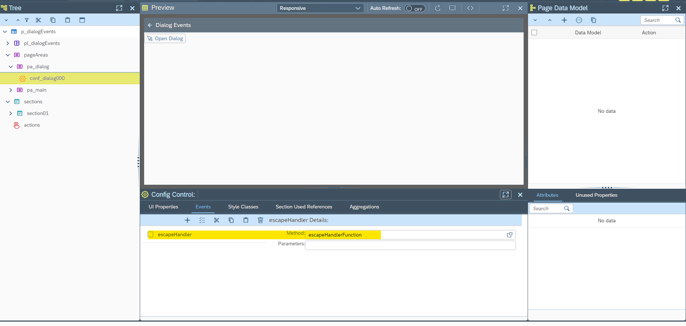
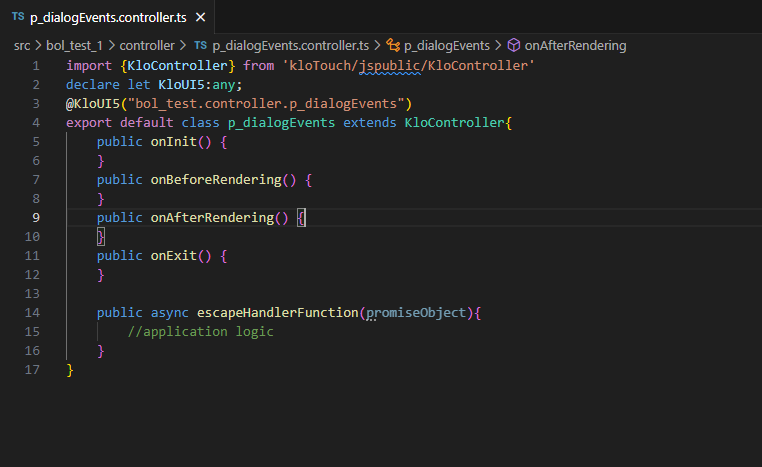
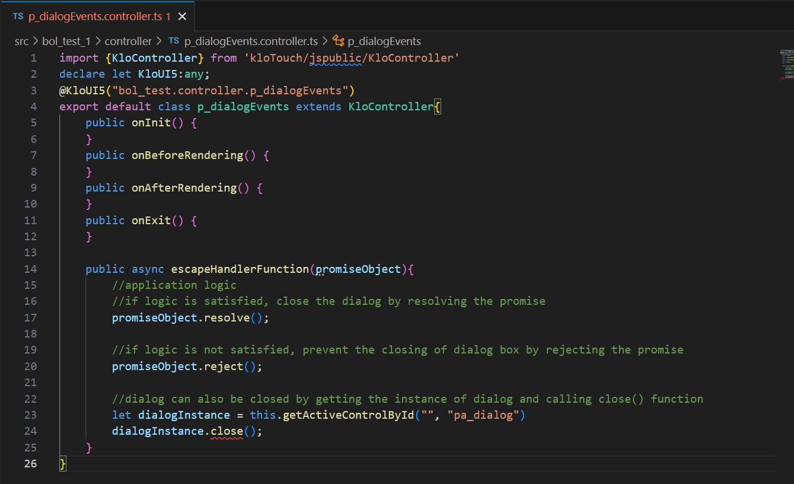

# escapeHandler

## Overview

This event can be used to override the default escape handler function on the press of escape button on the keyboard provided by sap by providing a user defined function.

## How to use the feature

1.  In the events tab of Dialog config, select the escapeHandler event and provide the name of the user defined function.  
    > 

2.  Write the application logic in your controller file.

> 
>
> When the event is triggered, the dialog’s promise object is passed as a functional parameter. It contains two properties:

1.  resolve(): This is the dialog promise’s resolve function that can be used to resolve the dialog’s promise on close by pressing the escape button on the keyboard.

2.  reject(): This is the dialog promise’s reject function that can be used to reject the dialog’s promise on close by pressing the escape button on the keyboard.

**Note:** Application developers can manually close the dialog by either getting the dialog instance using the getActiveControlById()function or by resolving the dialogs promise.

