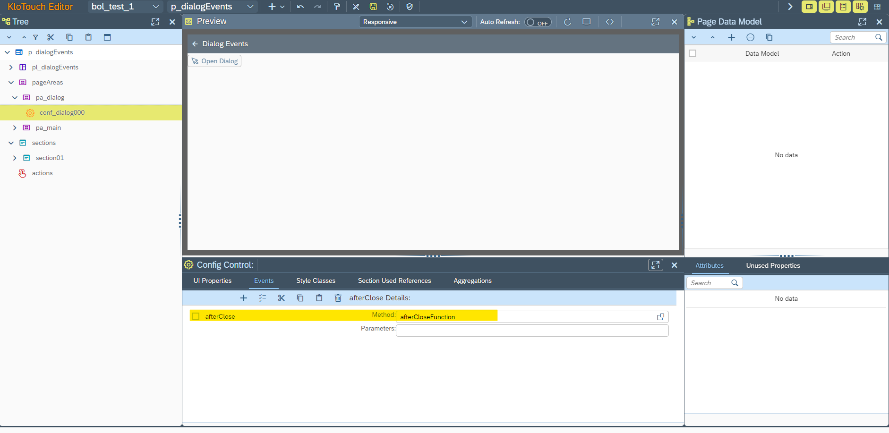
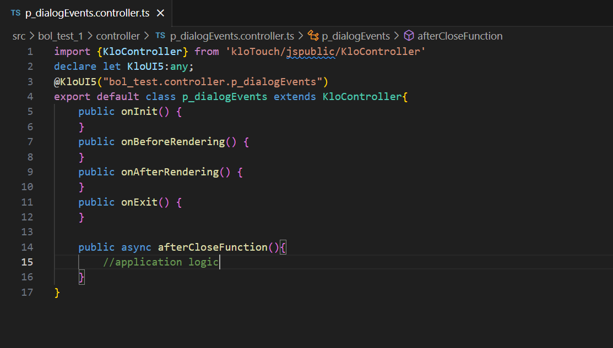

# afterClose

## Overview

This event can be used to trigger a user defined function after the dialog box has closed.

One can refer to this documentation for further details : [<u>OpenUI5 After Close Documentation</u>](https://sdk.openui5.org/api/sap.m.Dialog#events/afterClose).

## How to use the feature

1.  In the events tab of Dialog config, select the afterClose event and provide the name of the user defined function.  
    > 

2.  Write the application logic in your controller file.

