# Getting the Endpoint

This is used for server-side debugging(server-side callbacks).

We can get the endpoint of the device using the steps below:

## In Browser

**Step 1:** Put the application link in the browser and open it.

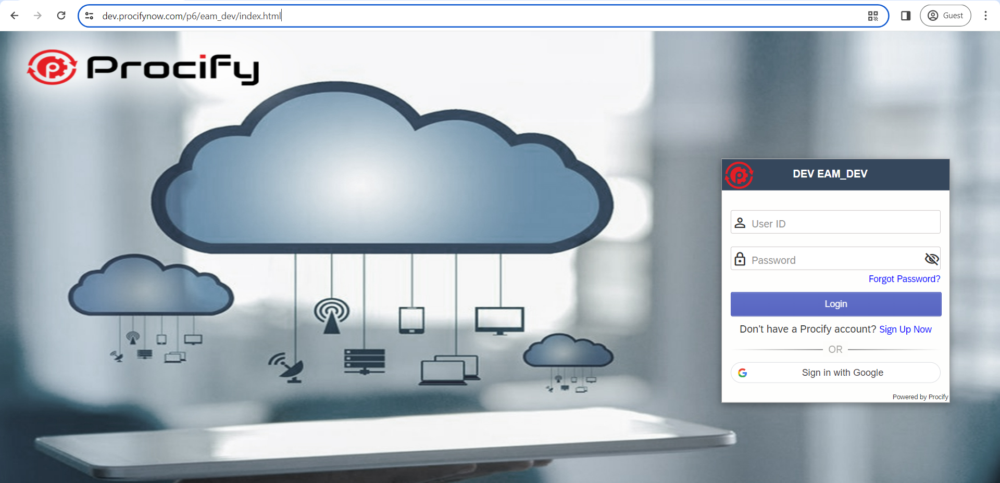

**Step 2:** Open the developer tools by right-clicking on the page and clicking on the inspect option.

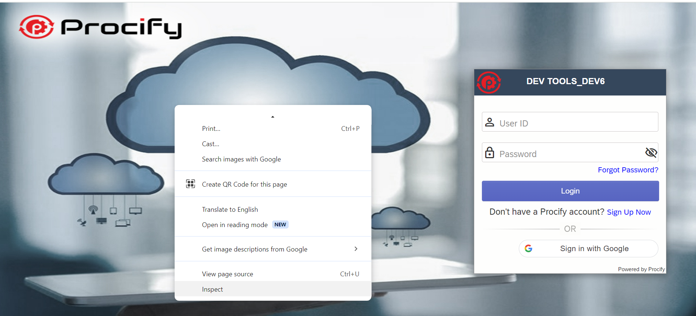

Or you can press the **F12 key**. That will open the developer tools.

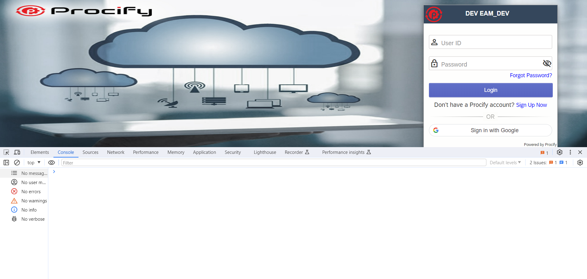

**Step 3:** Open the Application tab in the developers' tool.

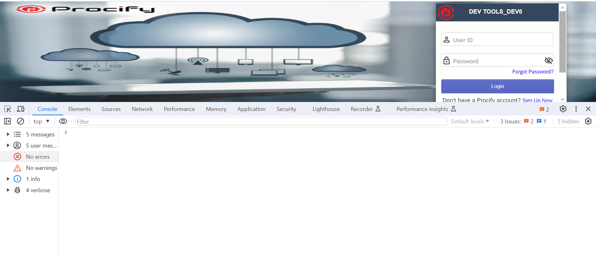

**Step 4:** Select the domain in local storage.

In the application tab, expand the local storage and click on the current domain.

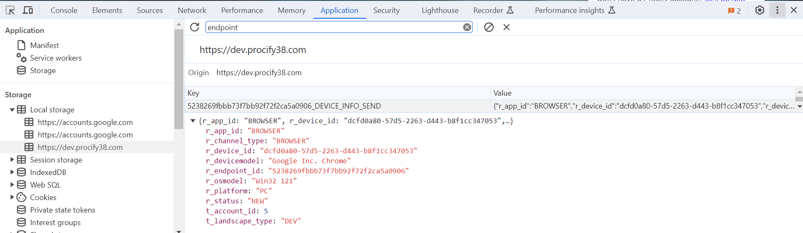

**Step 5:** In the filter search for the endpoint.

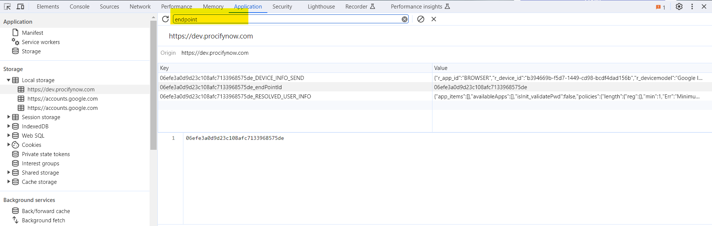

**Step 6:** Copy the endpoint.

In the below table, select the item which ends with an endpoint and copy the endpoint ID.

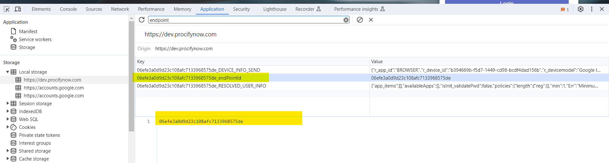

## IN Device

**Step 1:** Open the APK in a mobile device/tab

Download the APK from the [Procify Help Center](https://docs.google.com/spreadsheets/d/e/2PACX-1vSc10qshA3Uam4_Focsm35fupw4xWE-e4xOS1w4GxxrPLAOliO6Poj-G37_J7Fqp4BBC9nQQAZF-hSE/pubhtml?gid=0&single=true)

**Step 2:** Scan the application QR

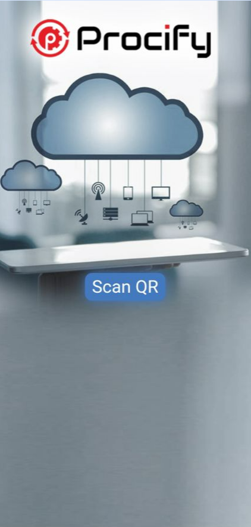

**Step 3:** Enable USB debugging and connect with the system.

In the mobile device, in developer options, enable the use of debugging.

**Step 4:** In the Chrome browser in a new tab open chrome://inspect/#devices

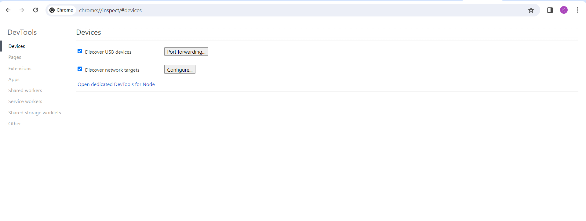

**Step 5:** click on the inspect in the remote target list.

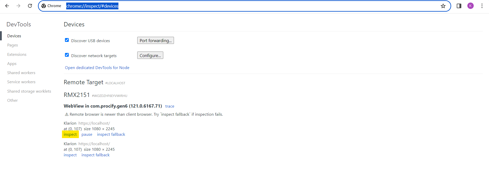

It will open the devTools window.

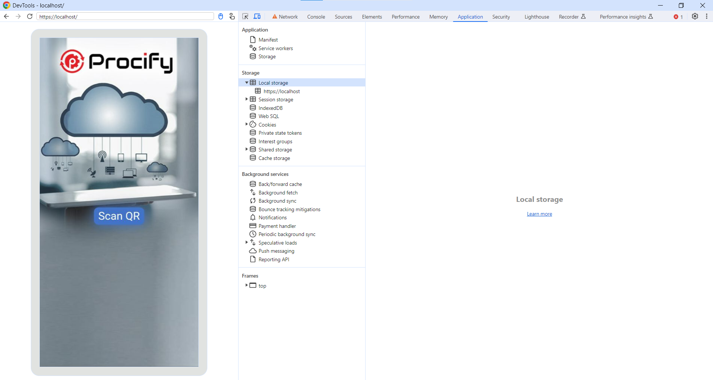

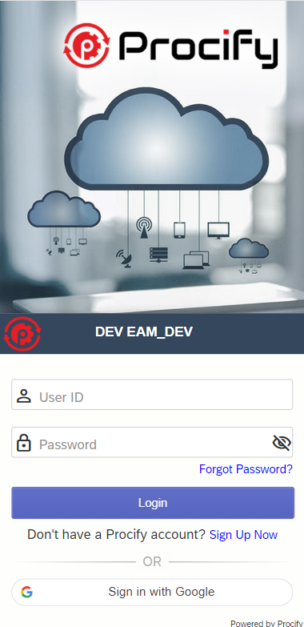

**Step 6:** Follow the same browser steps from Step 2 to Step 5.

## In Private Node

We can get the endpoint in the private node from the below file location

workspace/kloconfig/klarion.json

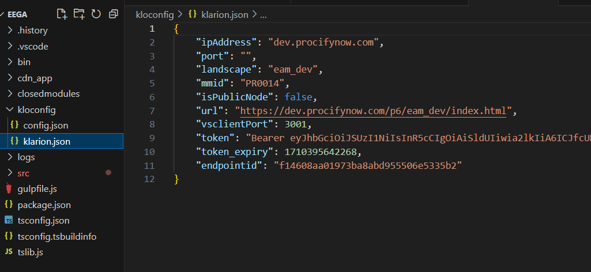
