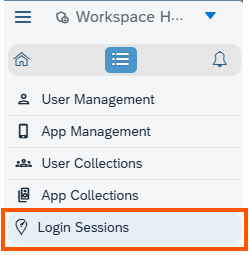
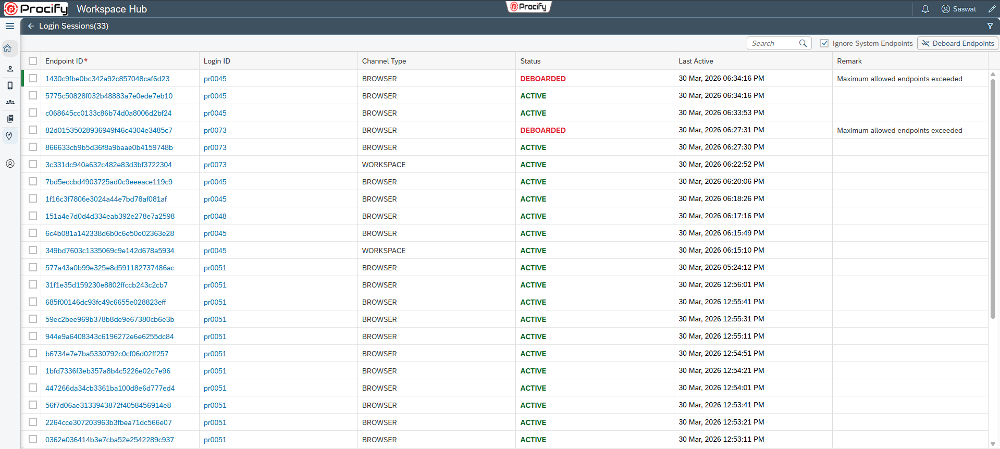
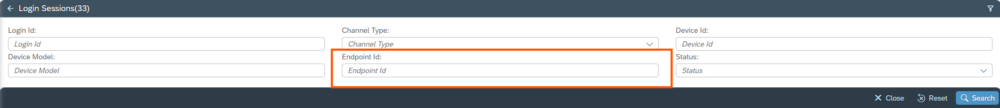
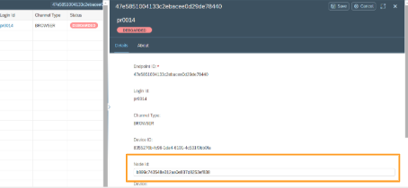
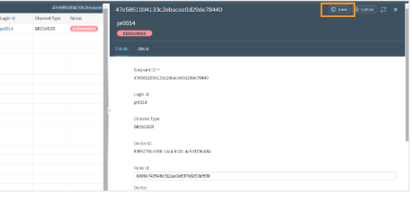

# Setting the Node ID to the Endpoint

**Step 1:** Visit the Login Sessions page in the Workspace Hub.

**Step 2:** Filter the endpoint using the advanced search.

**Step 3:** Navigate to the detail section and add the Private node’s endpoint ID to the **Node ID** field.

**Step 4:** Save the changes.

