# Create a new Version for the Application

Login to the [Workspace Hub - User Guide](https://docs.google.com/document/d/1KdP46c5_-BVEhWN5OgjVIcuHuZ_1Cf4-k7CZiMk5Tus/edit)

**Step 1: Select App Management under Workspace Hub**

In the Workspace Hub, use the menu **App Management** to see the list of apps available.

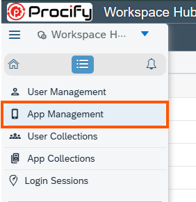

We will find the list of apps available.

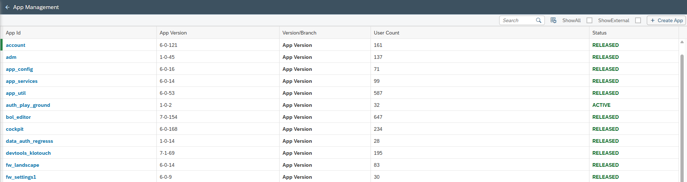

**Step 2: Create a new app version**

Click on the app for which you want to change the version. Go to the details section.

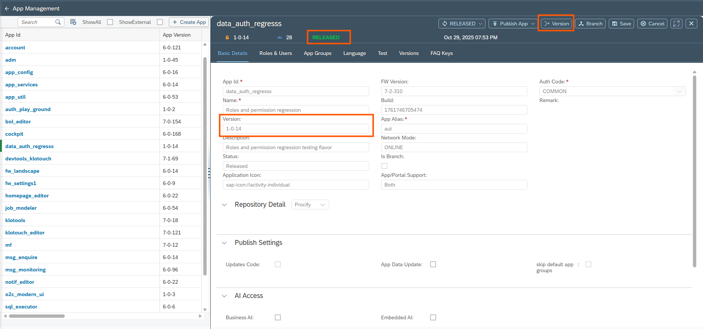

In the details section, when you make the screen editable, you will find the **Version** Action Button of a “Released” App. Click on that to create a new app version.

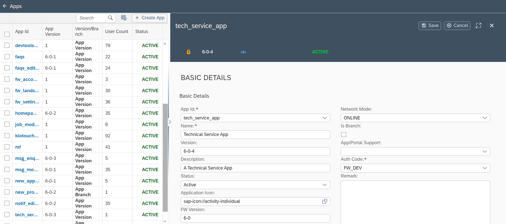

When a new version is created it will inherit all the adoptions that were made in the previous version. Also, when we add new features and make changes in the new version, those changes will reflect in the new version only, making the older version obsolete or deprecated.

This can be shown with a specimen below:

We have created an app named **tech_services_app**, and we have created a new version for this app. We have added all the basic details required.

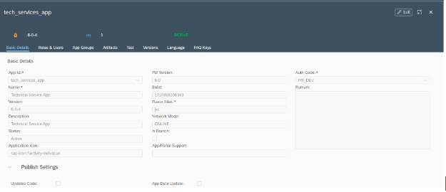

Next, we will go to the Language section. **Languages** will be adapted from the previous version only. If we need to add or remove any language in this section that can be done here.

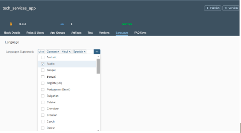

Similarly, the **FAQ keys** will be inherited from the previous version; we can add or remove any keys as per our need.

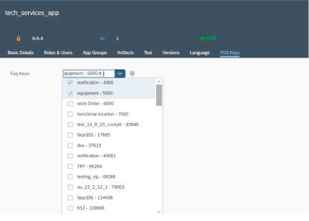

Furthermore, we will see that once we adapt to a new version (steps mentioned above), it will inherit all the features such as the created page, entity query, etc. from the previous version.

We can check this inheritance under **Artifacts**.

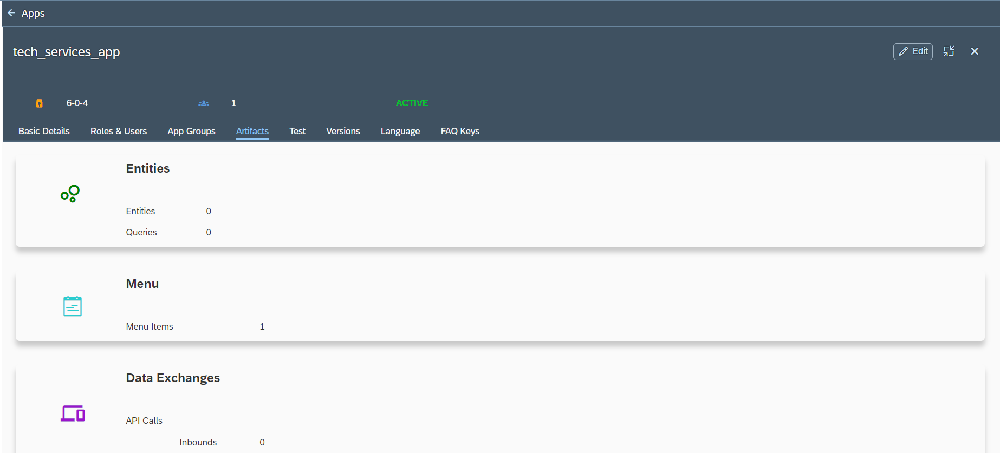

**Note:** The image above shows the Page from UI Objects that have been inherited. This is because only one page has been created in the previous version.

## Assign a New Version to Users

Once the new version is created, we will need to assign the same to the users according to their designation. Users from previous versions are added automatically. Rest you can add in the following way.

**Step 1: Add users to the upgraded app version**

To assign a new version to the users, click on the app that has had a version upgrade and go to **Roles&Users.** Under Application Roles click on the **Users** link.

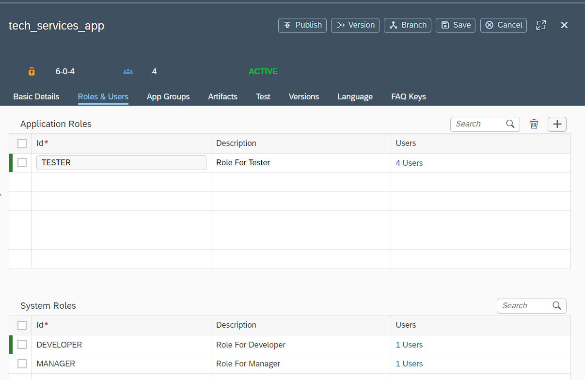

**Step 2: Add New users**

By clicking on the **Add** button under the Application User section, add new users.

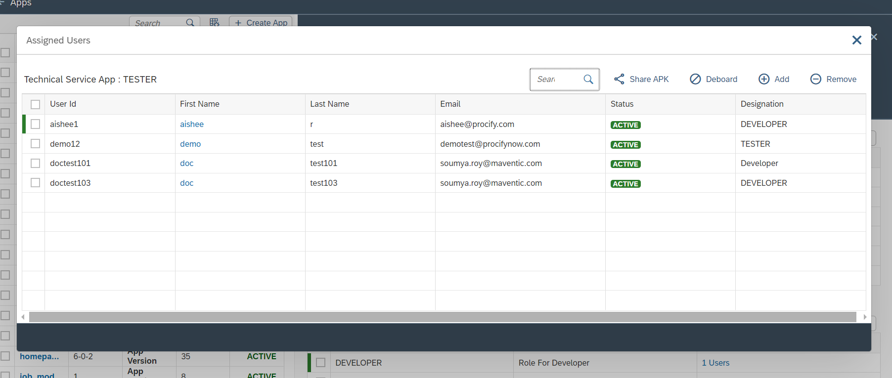

We will get a list of users in a popup. Select and add the required user name and **Save**.

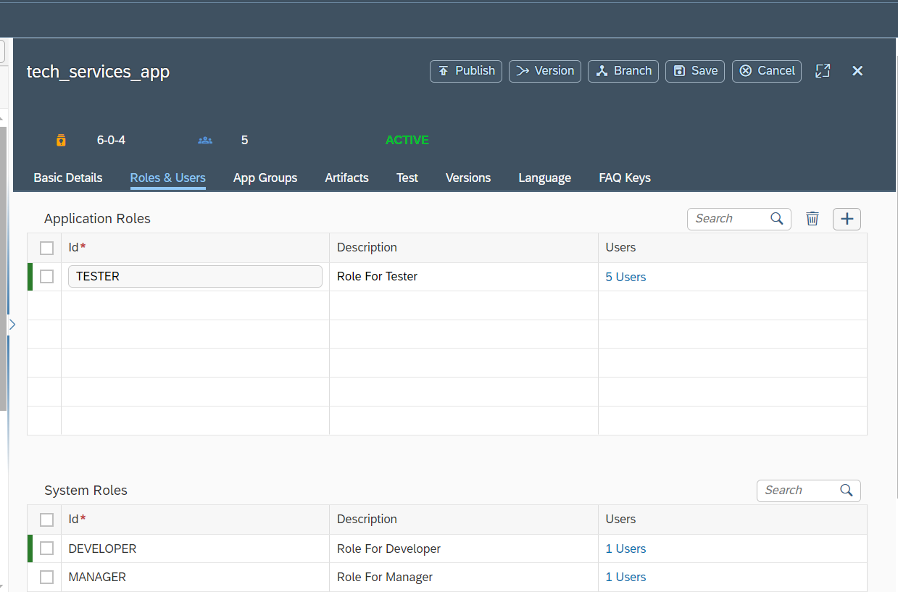

A new user will be added to our upgraded app.
