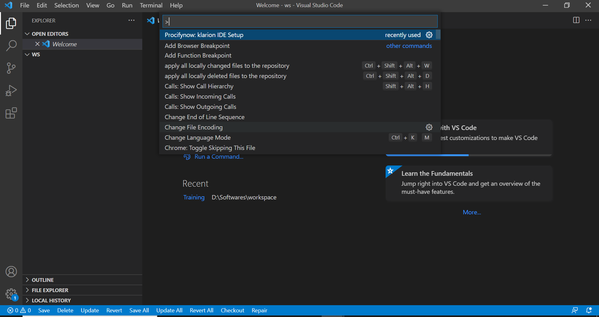
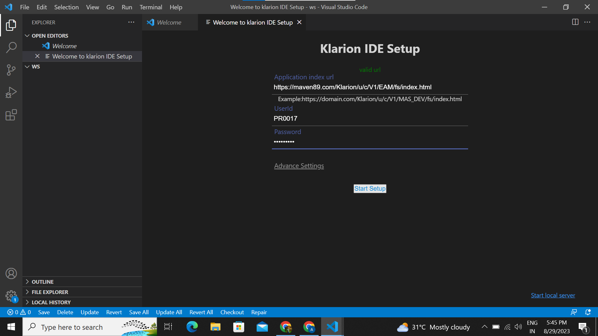
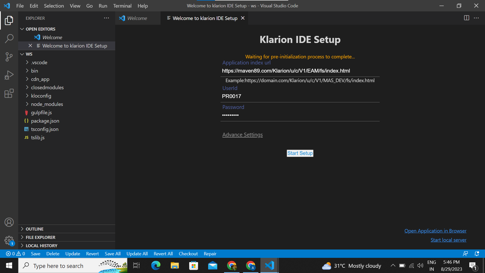
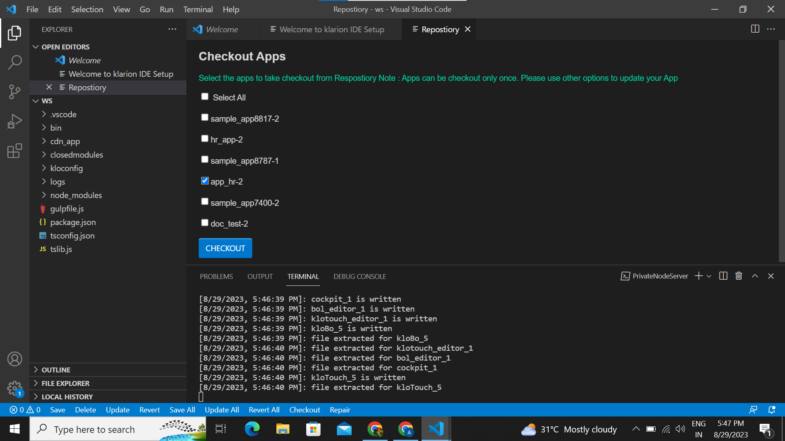
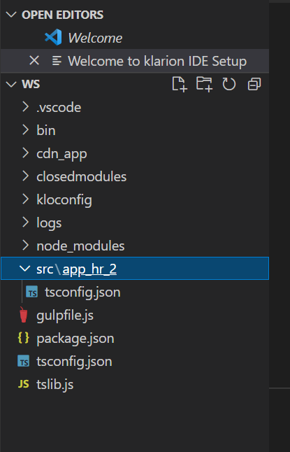

# VS Code Initialisation

The Initialisation process will pull all the app files and controller files assigned to the workspace of the private node server.

## The Initialisation Process

The Initialisation process is as follows:

**Step 1:** First create a folder of the workspace. Then go to VS Code, tap F1, and select **Procifynow: Klarion IDE Setup.**

**Step 2:** The registration page will open. Give the URL (example: [https://maven89.com/Klarion/u/c/V1/EAM/fs/index.html](https://maven89.com/Klarion/u/c/V1/EAM/fs/index.html)) and user credentials and **Start Setup**.

The Initialisation process will start.

**Step 3:** Once initialisation is complete a repository note will open. We will check our app.

Now our Initialisation process is complete and our app will retrieve all the necessary files.

