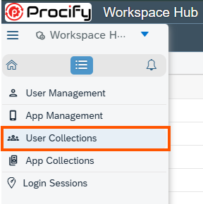
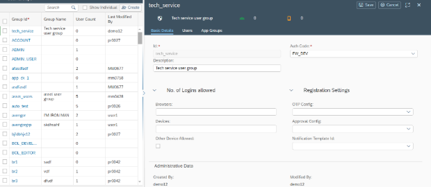
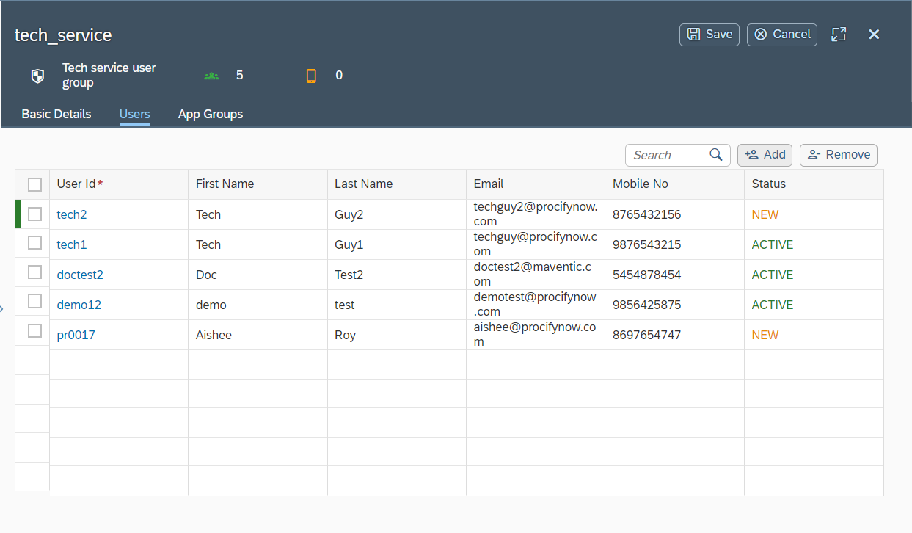
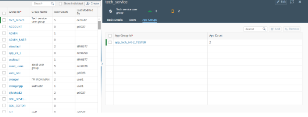
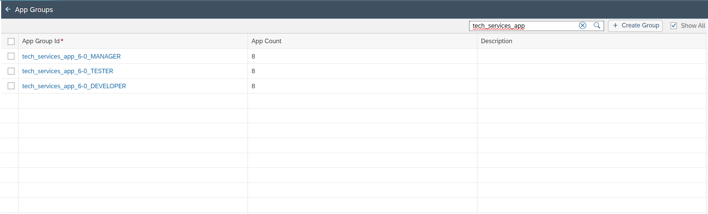
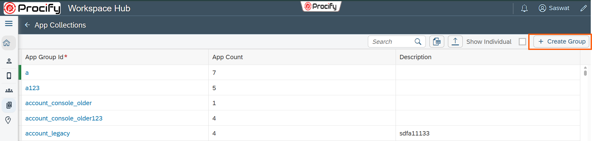
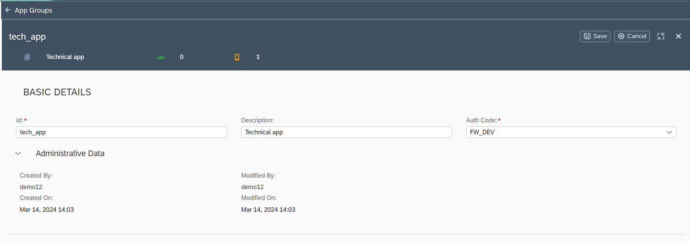
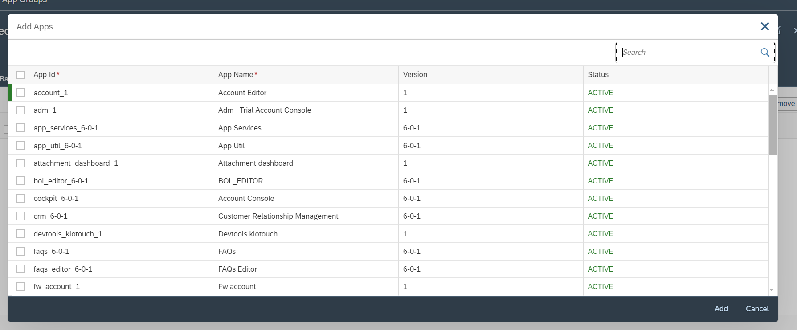
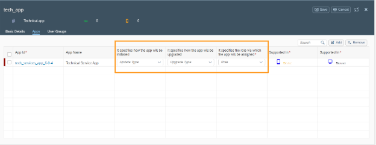
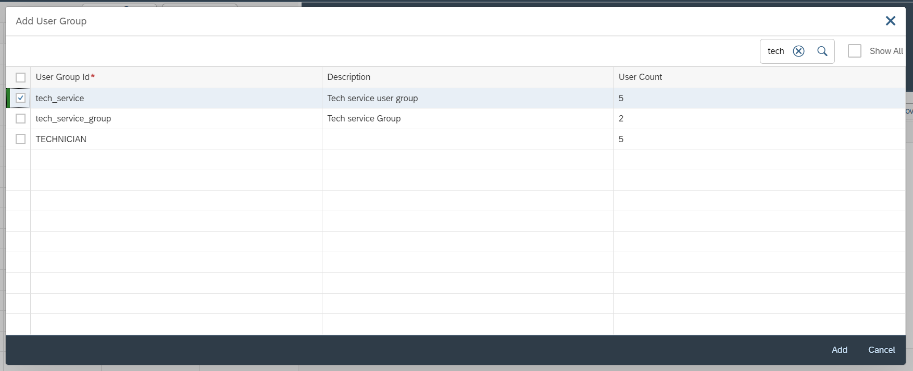

# Rolling the app to Assigned Users

When a new app version is created, that version will not immediately be made available to all the users. It will be made available to a certain group of users so that they can test and check whether the application is working properly. Once it gets verified and approved by those users, the app will be made available to the rest of the users.

## Process to assign users

### Via User Collections

To assign the app to a group of users, we will use User Collections in the Workspace Hub.

**Step 1:** Create a user group by adding the basic details.

**Step 2:** Go to users and add the number of users required for this trial.

**Step 3:** We will add the **App Groups** under this particular user group and save the entire process.

**Note:** Under the **App Groups**, individual groups related to a single app get created automatically. These groups can be seen in case we click on **Show All** as shown in the image below:

If you see the image, you will find **tech_services_app** has individual groups, one for the Manager, one for the Developer, and one tester. You can assign the required group to your user group or you can create an App group separately for your app and assign the user group respectively.

### Via App Collections

In case we want to create a separate App group follow the steps below:

**Step 1:** Go to **App Collections** and click on **Create Group**.

**Step 2:** Add the **Basic Details** and move to Apps.

**Step 3:** Click on the Add button. A popup will appear. Select the app or apps needed to add to the group and press the **Add** Button.

**Step 4:** Now we must select the Installation type and the Roles for the particular apps.

- **Update Type:** It specifies how the app will be installed.

- **Regular:** It installs the registered app normally for the user and creates initial sync, table generation, etc

- **On-Demand:** It helps to assign the app to the user but the user has to install the app through the Developer Page.

- **Default:** It is the same as regular installation type which helps the user to assign the app directly with table creation.

- **Upgrade Type:** It specifies how the app will be upgraded.

- **Immediate:** It upgrades the app with an immediate notification where the user will have the option of the **OK** button and it upgrades the app.

- **Postpondable:** It upgrades the app with an optional notification where the user will have the option of the **OK** and **Cancel** buttons and it will install the app later on.

- **Role:** specifies via which role the application will be assigned to the users of that group.

Once these are selected, we will move to User Groups and add our user group. The App Group is created and the User Group has also been added to the App group.

