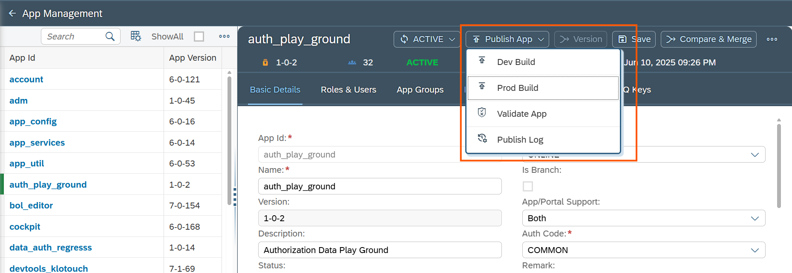

# Publish the New Version

## When do we Publish the new version?

When a new version of the app is created, it only inherits data from the previous versions. The other changes or new features need to be added by the users. Once that is done the app needs to be published. Doing so, the change will reflect on the relevant devices.

## How do we Publish a new version?

Publishing an app is the final step after all the changes and upgrades have been made in the new app version. Once all the page creation, entity creation, user, and role assignments are in place we can move ahead and publish the app.

For this:

Go to App Management, then select the app with its new version and click on the **Publish** button.

