# FAQs Editor — Procedure To Use FAQs Editor

1\. Go to the **FAQs Editor** menu and click on the sub-menu named FAQs Editor to open it.

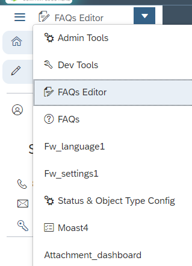

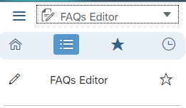

A screen will initially load with the FAQ Groups based on their sequence in ascending order.

> 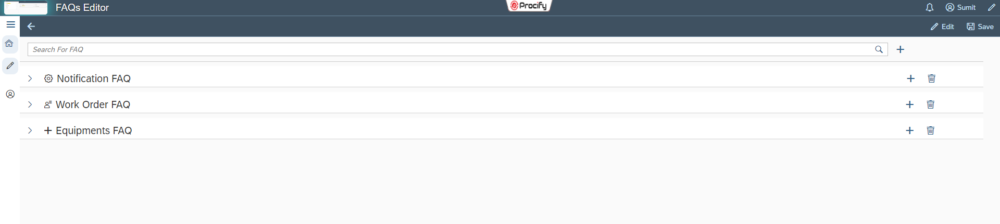

**Note:** Now the button is visible at the screen title toolbar.

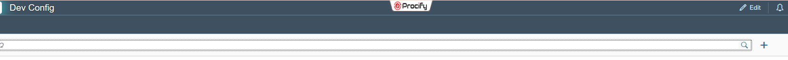

On click of the Procify logo, the screen title toolbar will collapse resulting in the buttons not being visible.

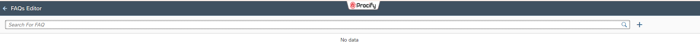

2\. Users can search for the FAQs based on their Group Title, Question, Key ID and Key Description. Users need to enter the relevant texts and click on the OK button to perform the search.

**Group Title:** This denotes the title under which one will find their relevant queries. Eg: If a user has a query related to **Work Order**, they can search for it under that very group.

**Questions:** This denotes any search by directly writing the question on the search bar.

**Key ID:** Key ID helps us get the element which we want. Each Flavor will be associated with one or more keys and based upon those keys, groups will be loaded for that flavor. Each key can be used in multiple flavors.

**Key Description:** It is a relevant and memorable description that we put for the key ID.

> 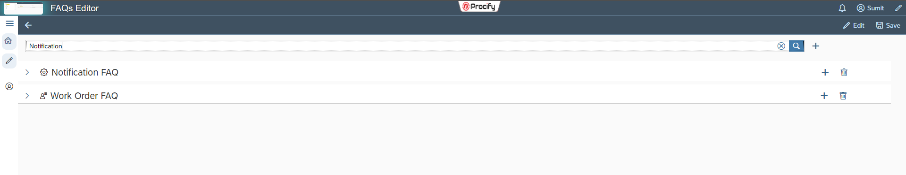

3\. Users can clear the search criteria by clicking on the cross button in the search bar.

4\. Users can expand any group to see the list of questions associated with that group by clicking on the dropdown.

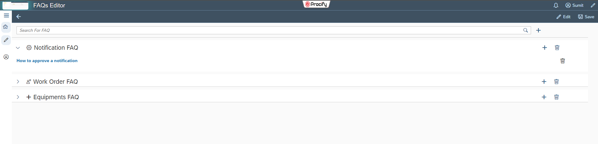

5\. Users can click on the add button beside the search bar to create a new group. After clicking on the button, a popup will appear and the user needs to select a key to which this group will be associated.

**Note:** These Keys are created and maintained in the [*Account Console*](https://docs.google.com/document/d/1KdP46c5_-BVEhWN5OgjVIcuHuZ_1Cf4-k7CZiMk5Tus/edit#heading=h.147n2zr). In case you do not find the key you are looking for, kindly go to the Account Console and create the relevant key.

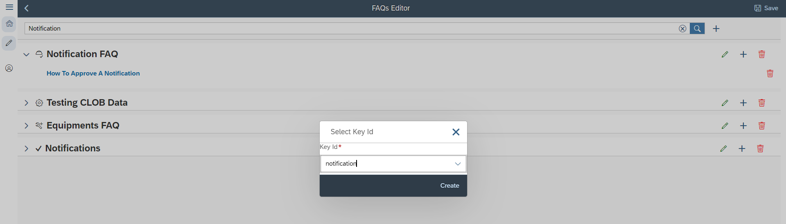

6\. Users then need to select a key and then click on the Create button. Users will be navigated to the detail section where they have to fill in the group title (mandatory), sequence, and icon and then click on the **Save** button.

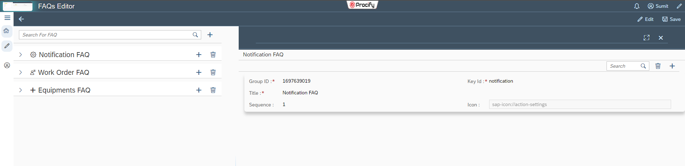

7\. Users can also edit the group details by clicking on the Edit button on the right side of that particular Group Title.

> 

8\. Users can then update the group details and then click on the **Save** button again.

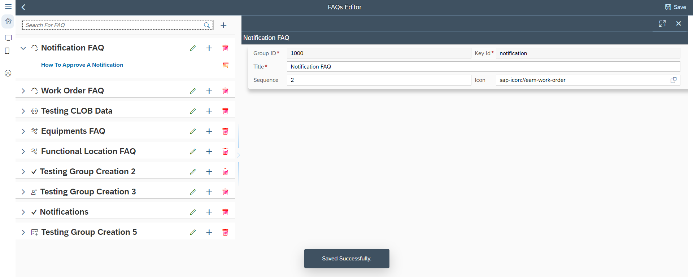

9\. Users can delete a group by clicking on the delete button on the right side of that particular group title. Upon clicking it will ask the user for confirmation.

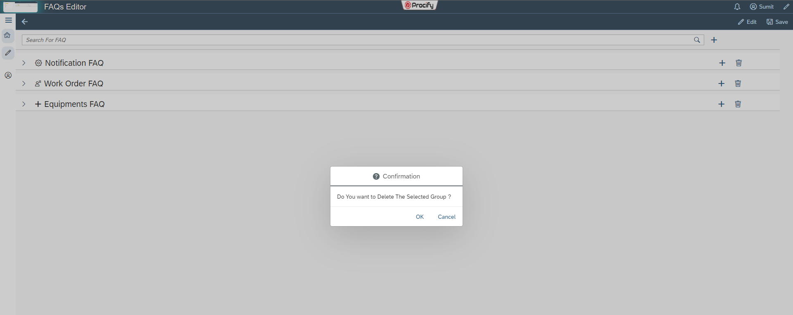

On giving the delete confirmation it will delete the group along with its entire associated question.

10\. Users can create a new question inside a group by clicking on the add button at the right side of that particular group title.

11\. Users then need to fill in the device type (mandatory), sequence, Question Title (mandatory) and answer and then click on the **Save** button. By default, the language will be set to English.

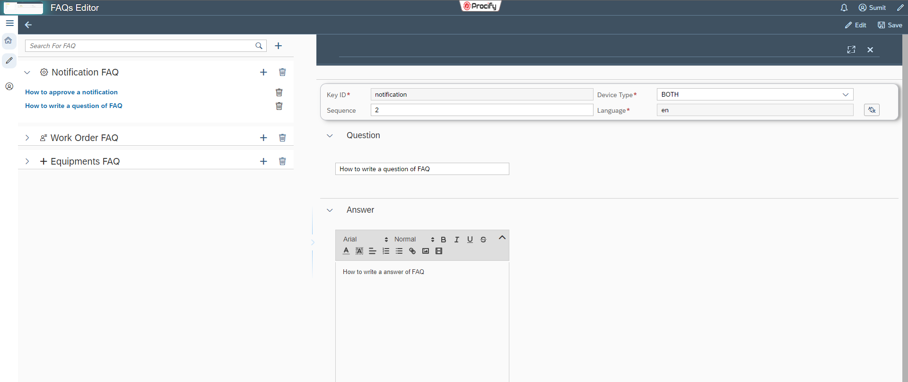

12\. Users can edit a question by clicking on that particular question link.

Users then need to make the changes and click on the **Save** button.

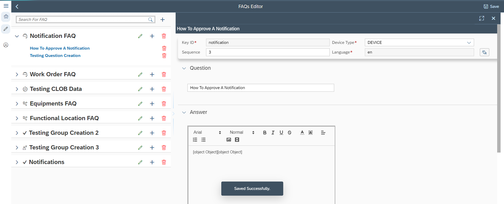

13\. Users can also delete a question by clicking on the delete button on the right side of that particular Question Title. It will ask the user for the confirmation.

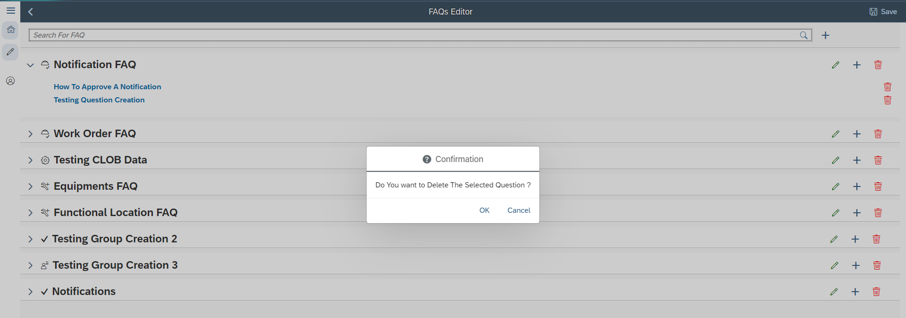

Upon user confirmation, it will delete the question.

> 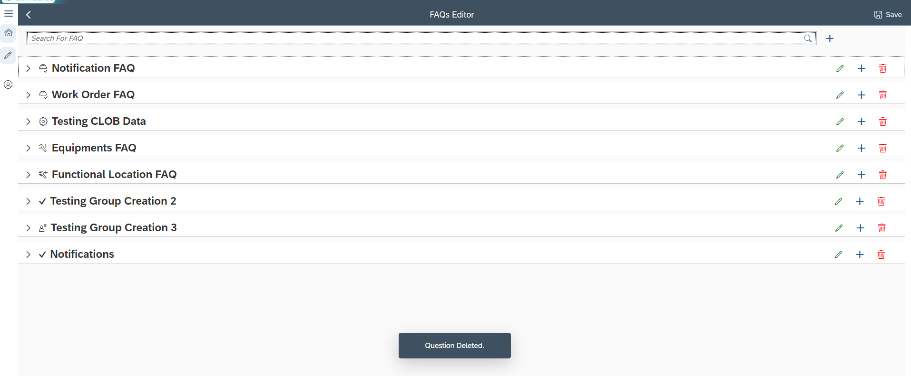

14\. Users can also create the language variants of a particular question by clicking on that particular question title and then clicking on the language button in the Question Detail section.

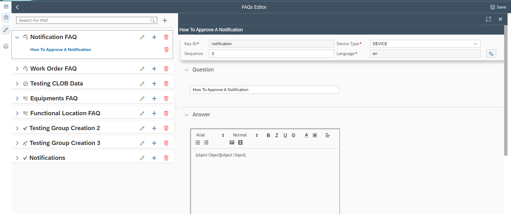

On clicking on the language button the user will get a language selection popup where they have to select the language in which they want their translation.

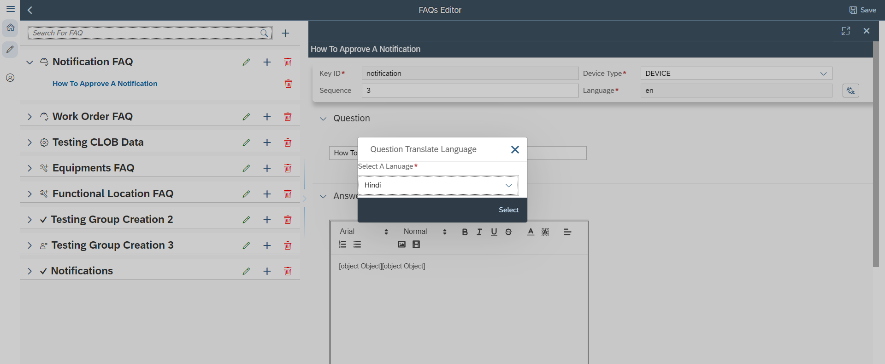

15\. After the selection of language a popup will appear where on the left-hand side the English variant of the question will be visible and on the right-hand side, the selected language variant will be visible.

**Note:** If the question in the selected language variant is already created then it will open in edit mode otherwise it will open in create mode.

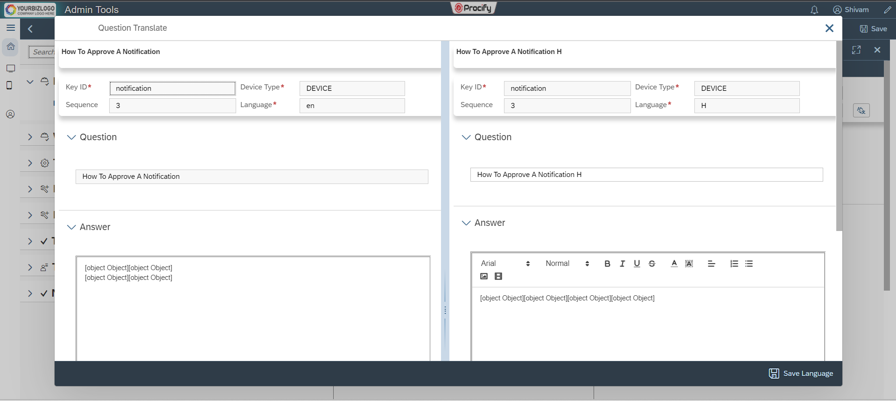

After filling in all the details, the user can click on the save language button to save all the changes.

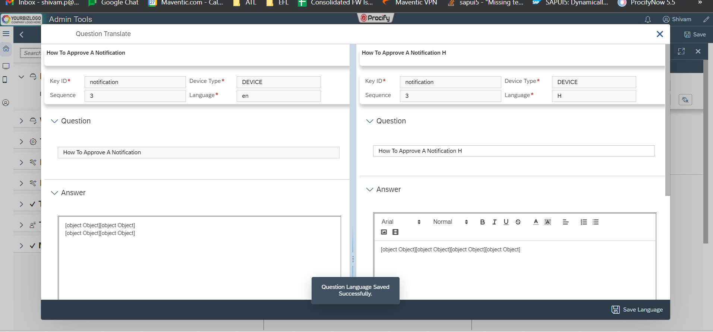

Users can click on the close button in the top right-hand side of the popup to close the language popup.

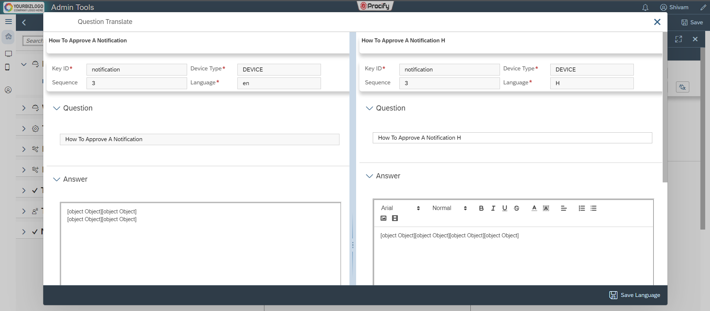
