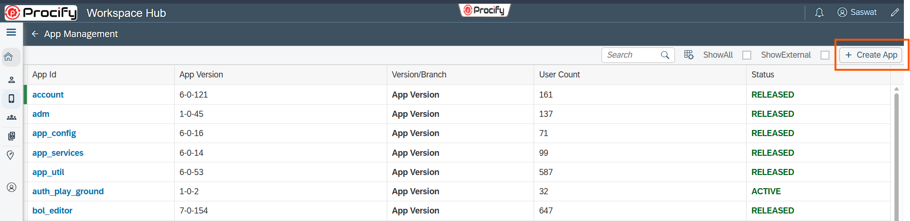
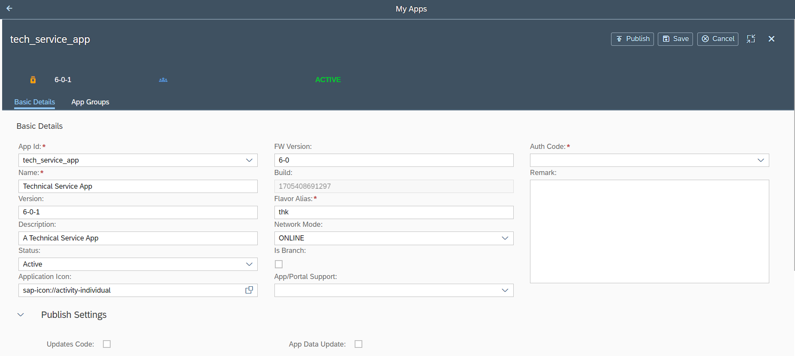

# How to use the feature

| **SN** | **Steps**                                                                                                                                                                                                                                 |
|--------|-------------------------------------------------------------------------------------------------------------------------------------------------------------------------------------------------------------------------------------------|
| 1      | In theWorkspace Hub, **App Management** Menu, you will create a new app by clicking on the **Create App** button.                                       |
| 2      | Put all the relevant details in the details asked in the details section.  |
| 3      | Here you will find the property named **Flavor Alias.**                    |

***Note:** when an app is created the flavor alias gets generated automatically, when you change the version or create a branch, it remains the same. The Flavor Alias only changes when you create a new app. It is automatically generated and need not be changed manually ever.*
