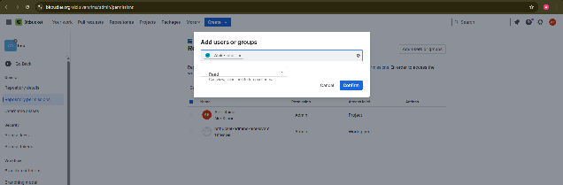
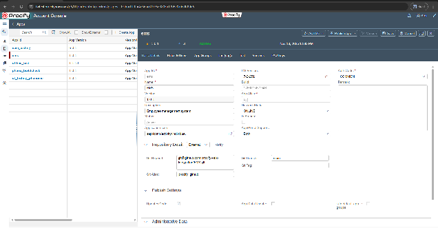
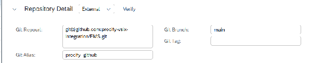
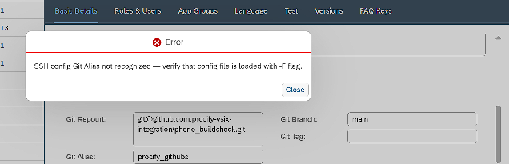
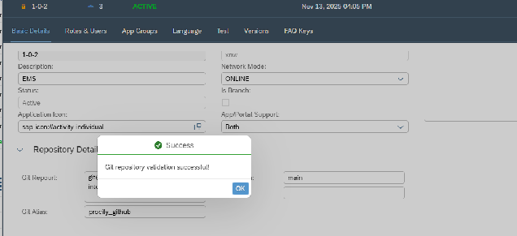
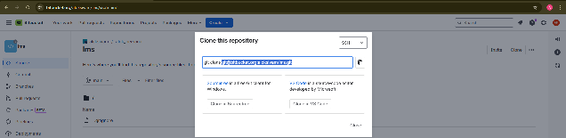

# Git Integration — Pre-requisites

*Basics of version control*

## **🐙 For GitHub**

### **1️⃣ Create a Repository under your Organization**

* Go to [GitHub](https://github.com/).

Click **“New repository”** → create it under your **organization account** (not personal).  
 Example organization: `procify-vsix-integration(only one time setup required by respective app manager)`

### **3️⃣ Invite the `procify_github` User**

* Go to your **organization → People / Members** section.

* Click **Invite member** → invite **`procify_github`**.  
  `Add procify_user to this organisation`  
  [`https://github.com/orgs/organization_name/people`](https://github.com/orgs/organization_name/people)

``

---

Give **read-only access** to the repository (permission \= *Read*).

 Example repo name: `EMS`

`Do select .gitignore with Node`  
``

`Then add these things in your .gitignore`

`# Build-generated directories`

`metadata/`

`entity_gen/`

`query_gen/`

`Tsconfig.json`

`Your .gitignore should look like this`

``

---

## **🧩 For Bitbucket**

### **1️⃣ Create a Repository under your Organization**

* Go to [Bitbucket](https://bitbucket.org/).

* Click **Create Repository**.

Make sure you create it under your **team/workspace**, not your personal space.  
 Example workspace: `procify_test`  
 Example repo: `rps`  
 → Path:

 `https://bitbucket.org/procify_test/rps`

---

### **2️⃣ Create a Branch**

In Bitbucket UI or terminal:

`git checkout -b your_branch_name`

`git push origin your_branch_name`

`Do commit a .gitignore with following contents`

`# Build-generated directories`

`metadata/`

`entity_gen/`

`query_gen/`

`Tsconfig.json`

---

### **3️⃣ Invite the `procify_bitbucket` User**

* Go to your **workspace → Repository settings → User and group access**.  
    
  Note:**before adding here you will need to add procify\_bitbucket to yourworkspace(one time)**  
* Click **Add user**.

* Add **`procify_bitbucket`**.

* Set **Access level \= Read** (read-only).

---

---

**How to enable the feature**

*For github:*

### **4️⃣ Copy the SSH URL (⚠️ Not HTTPS)**

* Go to your repo in GitHub.

* Click the **“Code” (green button)**.

* Select the **“SSH”** tab.

Copy the SSH URL ( will looks like this):

 `git@github.com:procify-vsix-integration/phenotest_app.git`

---

### 

### **5️⃣ Add Repo Details in Workspace Hub**

  

In your **Procify Workspace Hub**, fill these fields:

Note: There are two values for github fill procify\_github, for bitbucket fill procify\_bitbucket:

After filling alias repourl and Git Branch click on verify, if you get any error like this 

Then contact admin;

| Field | Value |
| ----- | ----- |
| **r\_git\_repourl** | `git@github.com:procify-vsix-integration/EMS.git` |
| **r\_git\_branch** | (your branch name, e.g., `main`, `test_branch`, etc.) |
| **r\_git\_alias** | `procify_github` |

✅ Then click Verify, you should get this response

Then click on save

Note:- for existing flavor first create **one private node and copy the whole flavor(where you want to integrate git)**, then fill repo details in Workspace Hub and also make sure all developers using this flavor should have write access of corresponding github/bitbucket repo & that branch

*For bitbucket:*

### **4️⃣ Copy the SSH URL (⚠️ Not HTTPS)**

* Go to the repo → click **Clone**.

* Select the **SSH** option.

Copy the SSH URL, e.g.:

 `git@bitbucket.org:procify_test/rps.git`

* 

---

### **5️⃣ Add Repo Details in Workspace Hub**

Fill the details like this:

| Field | Value |
| ----- | ----- |
| **r\_git\_repourl** | `git@bitbucket.org:procify_test/rps.git` |
| **r\_git\_branch** | (your branch name, e.g., `main`, `develop`, etc.) |
| **r\_git\_alias** | `Procify_bitbucket` |

✅ Then click Verify, you should get this response

Then click on save

Note: There are two values for github fill procify\_github, for bitbucket fill procify\_bitbucket:

After filling alias repourl and Git Branch click on verify, if you get any error like this 

Then contact admin;

Note:- for existing flavor first create **one private node and copy the whole flavor(where you want to integrate git)**, then fill repo details in Workspace Hub and also make sure all developers using this flavor should have write access of corresponding github/bitbucket repo & that branch
