# Git Integration — How to use the feature

| SN | Steps |
| :---- | :---- |
| 1 | Go to privateNode and after doing registration  you will get one popup to enter bitbucket\_details  *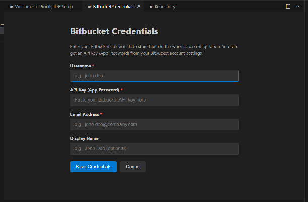*(Click on cancel it if you don’t have any repository with bitbucket configured. Otherwise fill in this way First create an apitoken from bitbucket [https\://id.atlassian.com/manage-profile/security/api-tokens](https://id.atlassian.com/manage-profile/security/api-tokens) There create token Select Create API token with scopes *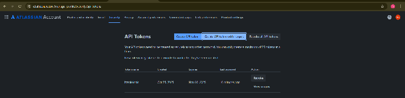  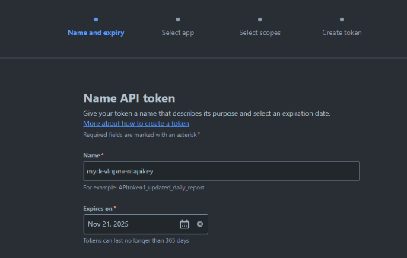 Set expires on date to next year In select app section select bitbucket 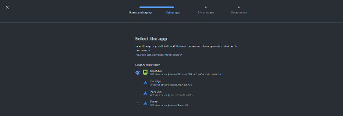 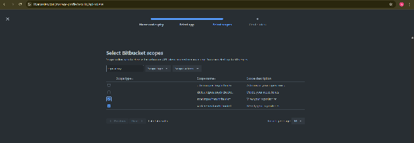 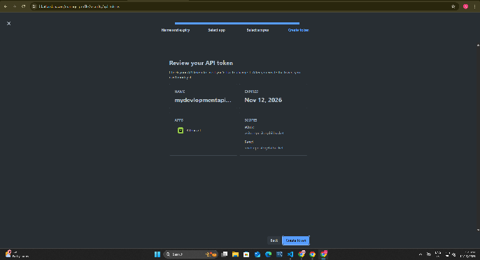 Click on create\_token  Copy this apikey and save it to same safe\_place and now come back to privatenode Note:- also copy your username which you can get here **https\://bitbucket.org/account/settings/** Fill it here in this manner 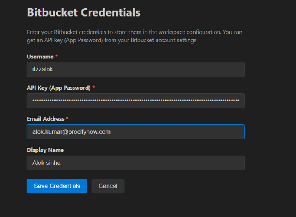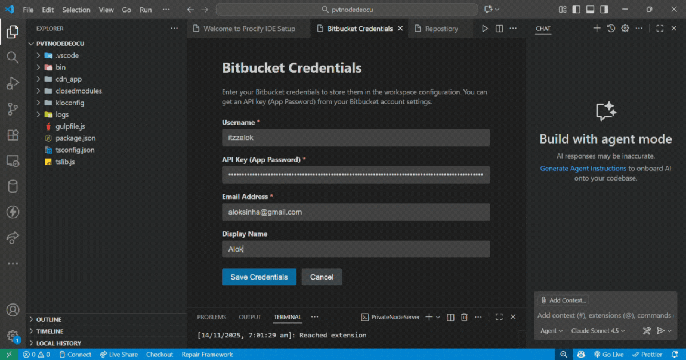 Click on save Credentials and then move to checkout(don’t checkout before if your flavor is git configured) Order should be first fill details then checkout,*  **GITHUB** *If you have **github configured:** Then go to command palette(for windows click F1 & for mac Command \+ Shift \+ P)) Then search for klobasegithub 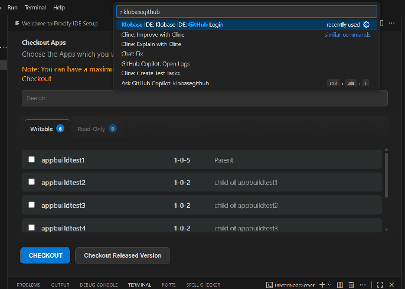 Click on that and then it will ask for allow 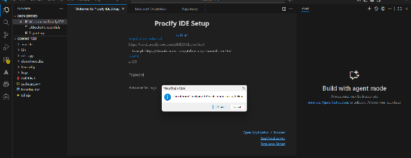 If you have already logged in through github then it will show there only, you can select, if not then choose select other account it will open in browser and there select github account 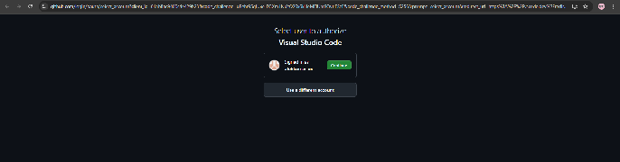*  |

#
