# Process to use the features

## Scheduled Tasks

- **Step 1:**To access the job Definition screen , navigate to the Application Settings Menu Header,and select Job definition

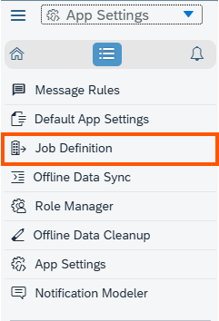

- The following screen will be previewed as shown below:

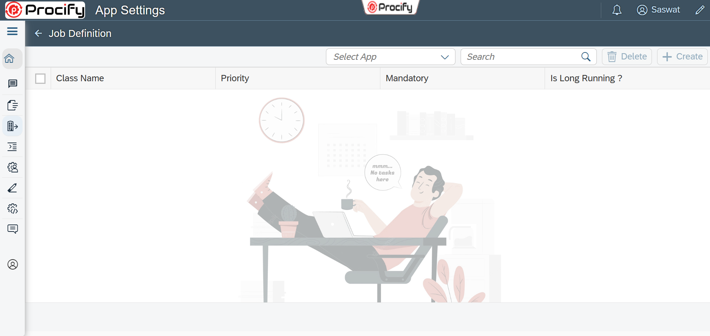

- **Step 2: Select the app**.

> Select the app in which you want to create a job definition.

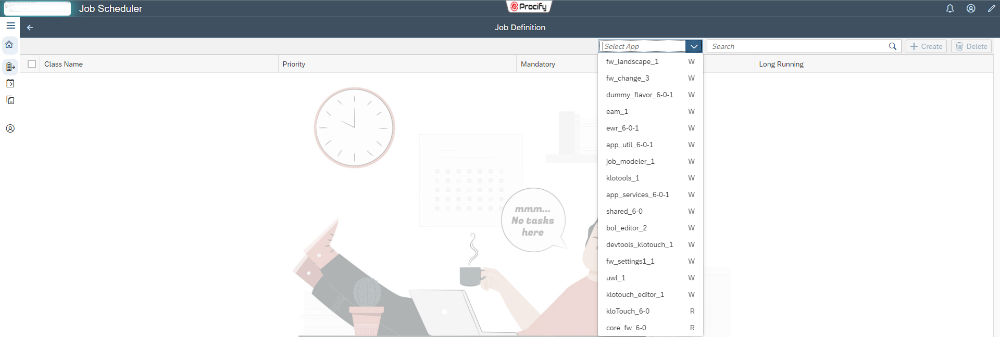

- **Step 3:**

> Edit is enabled for Writable Apps in Development.

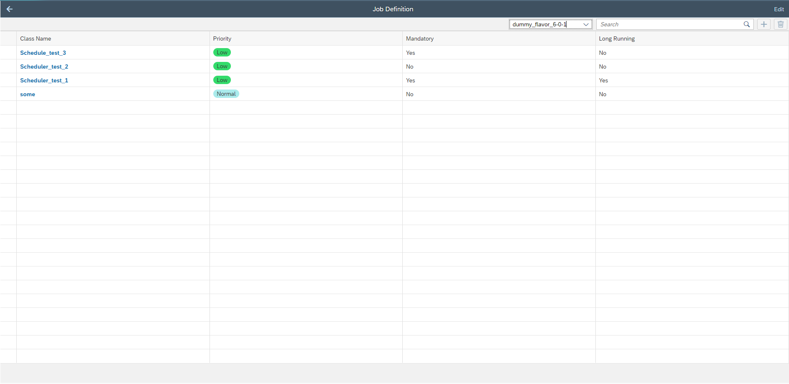

- **Step 4:**

> Edit is disabled for Readable Apps.

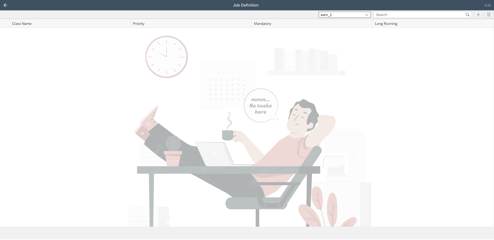

## Job definition parameters in detail;

**Scheduled Tasks**

| **Columns** | **Data Type** | **Default Value** | **Description** |
|---|---|---|---|
| Class name (scheduler_id) | String(32) |   | Class name defines the logic of the job to be executed.“Class Name” can hold multiple jobs with the same code implementation.This means a unique scheduler ID. Note:Class name is not case-sensitive, but follow CamelCase with the first letter capitalized, avoid starting with special characters, and users cannot use special characters except underscores. |
| params | String(1000) |   | Parameters provided will be accessible in the scheduler file. Parameters can be provided as a string or as an object. Users can pass an object with the value help provided which takes the parameters as key-value pairs and creates an object as a whole parameter. These are hardcoded values. **Note**: Global objects can't be passed, only string or json can be passed. Example: \\{"key":"Value"\\}, abc. |
| mandatory | Boolean | FALSE | Mandatory or Not;  For example, if a job was scheduled for 12 AM but the server stopped at that time due to unforeseen circumstances, the job will be executed once the server restarts, provided it is marked as mandatory. |
| priority | String(1) | C | Priority of the job  S-System \| A-Critical \| B-Normal \| C-Low Read this for more info: Job Priority |
| is_long_running | Boolean | FALSE | If is_long_running is not marked, then after 2 minutes, txn will be expired. |

- On giving a Class Name, Scheduled Tasks details and the Job (Job Frequency) for the Scheduled Tasks are visible as shown below;

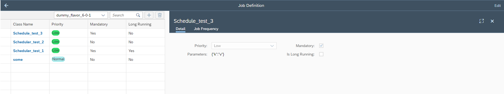

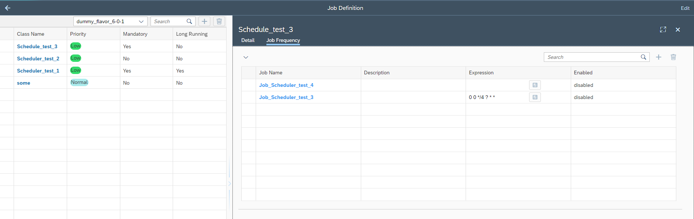

### Adding a Scheduled Tasks/Template

- Press the ‘**+ Create**’ button on the top right of the grid screen.

- Fill in the Unique Class Name. \[The developer has to create the scheduler file with this name\] 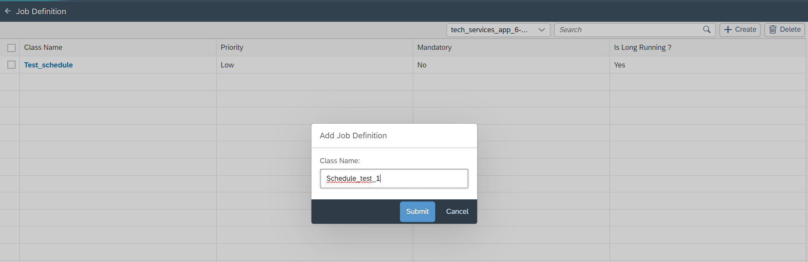

- The scheduler file should be created manually.

> **Folder Structure** **-** src/flavor_folder/scheduler/file_name(class_name)

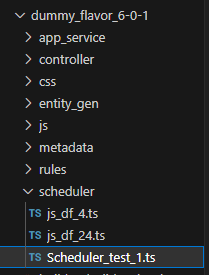

**Template**:-**Here as shown in the screenshot, the class should extend the KloScheduler**

import KloScheduler from 'kloBo/kloScheduler/KloScheduler'

export class js_df_4 extends KloScheduler\{

public async onExecute()\{\}

\}

- **Example** of a scheduler file (Scheduled Tasks) shown below;

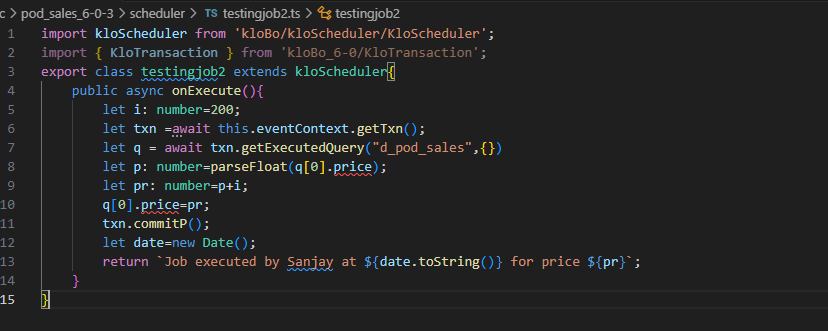

- Upon Submitting, the Job definition detail, Job’s properties will be editable.

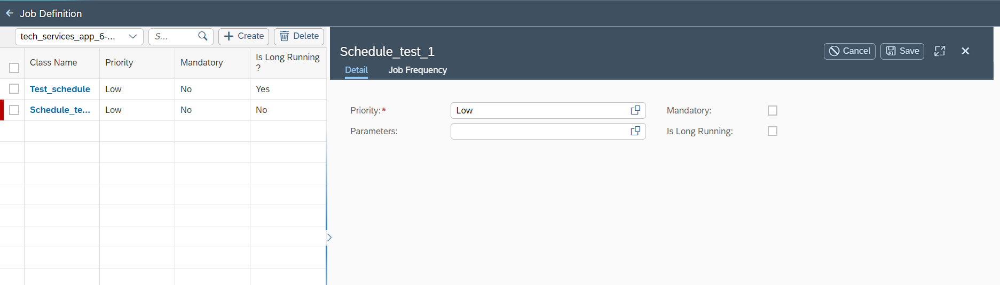

- Fill in the details as required.[(As explained above)](#job-definition-parameters-in-detail)

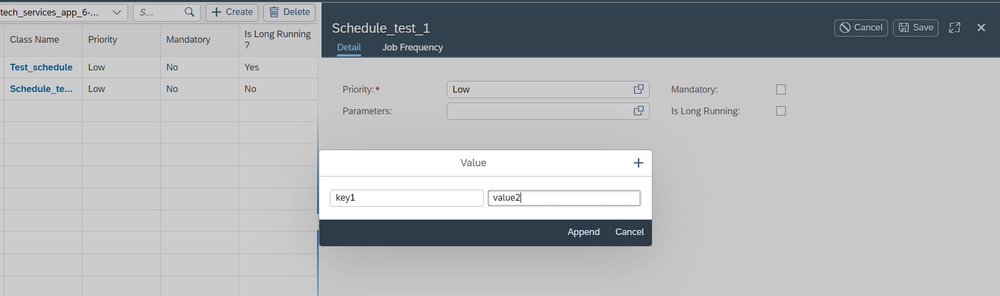

In a job definition, the **"key"** and **"value"** parameters are typically used to define specific settings or configurations for that job.

**Key** refers to the particular jobname or identifier of a particular parameter and the **value** includes the actual data associated with the key. The purpose of key-value pairs is to provide a structured way to define, manage, and customize job parameters, allowing jobs to run in a flexible and context-sensitive manner.

**Note:** Below shown is just an example for understanding and does not include any real value.

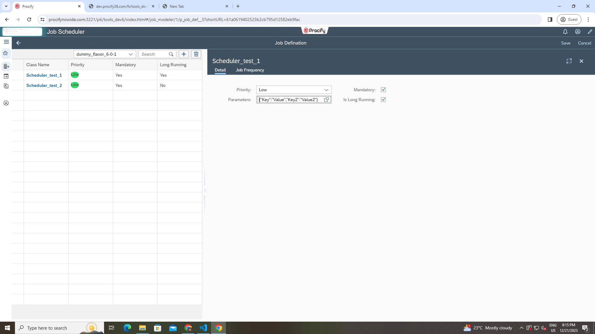

### Adding a Job to a Scheduled Tasks

- Press the ‘**+Create**’ in the Job Frequency section.

> **Note:** While giving a name you can use alphabets/numbers in upper or lowercase; do not use any other special characters except for underscore ( **\_** ).

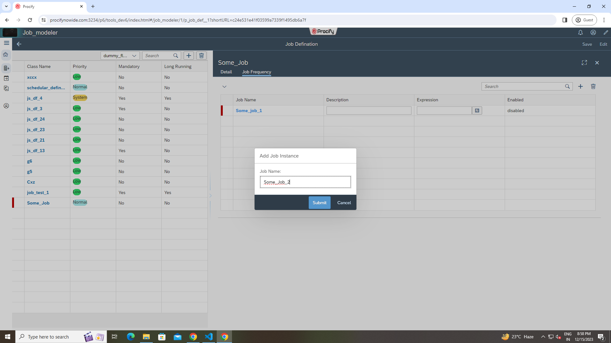

- A new Job will be created while still in Edit Mode.

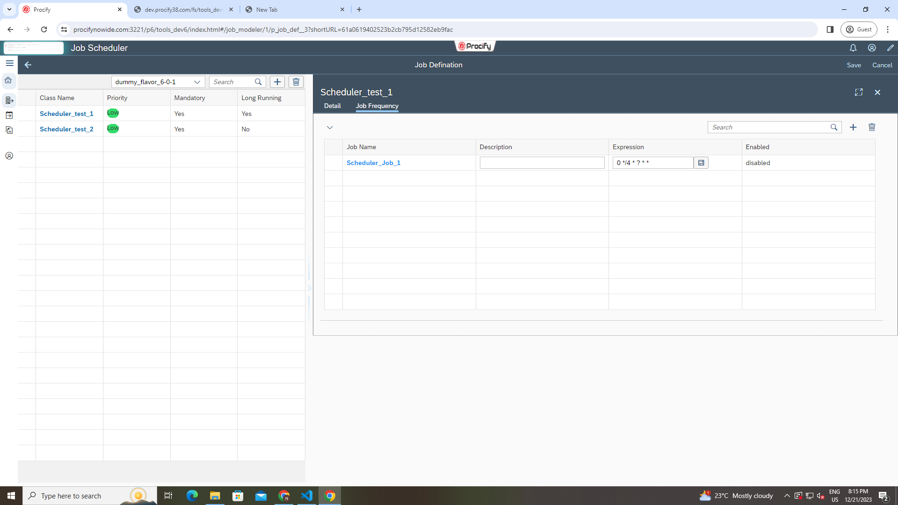

### Properties for Job Frequency

| **Job frequency**        |               |                   |                                                                                                                                                                                                                                                                                                                                 |
|--------------------------|---------------|-------------------|---------------------------------------------------------------------------------------------------------------------------------------------------------------------------------------------------------------------------------------------------------------------------------------------------------------------------------|
| **Columns**              | **Data Type** | **Default Value** | **Description**                                                                                                                                                                                                                                                                                                                 |
| scheduler_id(class name) | String(32)    |                   | Scheduler ID                                                                                                                                                                                                                                                                                                                    |
| job_name\*               | String(32)    |                   | Job Name                                                                                                                                                                                                                                                                                                                        |
| description              | varchar(255)  |                   | Description of the job                                                                                                                                                                                                                                                                                                          |
| fvid                     | varchar(36)   |                   | Flavor ID                                                                                                                                                                                                                                                                                                                       |
| expression\*             | varchar(32)   |                   | It is a mandatory property .It is used to specify a recurring date and time interval in which a scheduled task needs to be executed. For more information ([Read this](https://docs.oracle.com/cd/E12058_01/doc/doc.1014/e12030/cron_expressions.htm)) Eg: 0 0 12 ? \* MON-FRI Every Weekday at noon |

**Note:- Please provide a proper expression before saving, To check whether an expression is valid or not, Use [cron expression](https://www.freeformatter.com/cron-expression-generator-quartz.html) for now.
**

### Deleting a Scheduled Tasks or Job

- Select a Scheduled Tasks or a Job and select delete in that section to delete the Job.

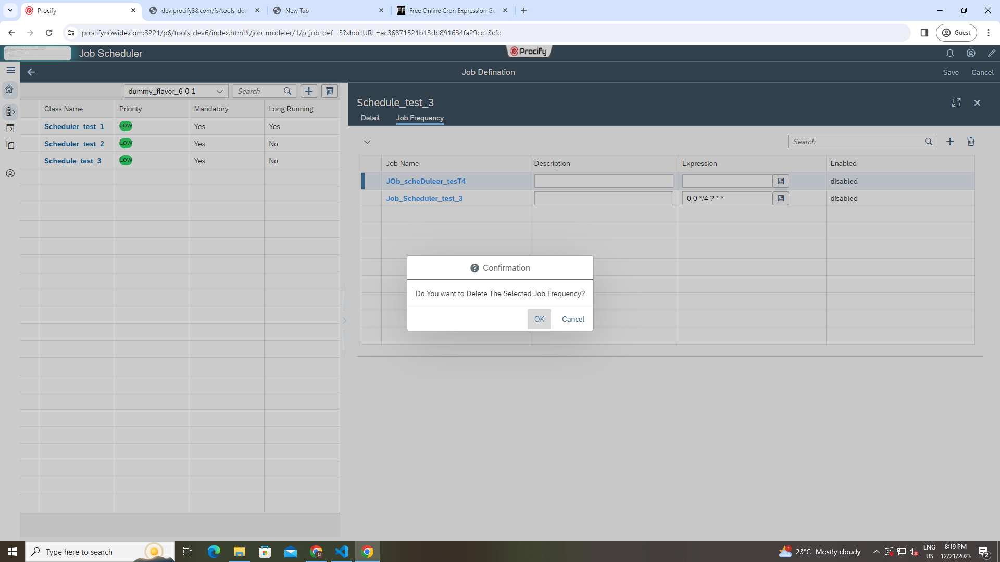

### Save/Cancel

- Job Name and Expression are mandatory fields.

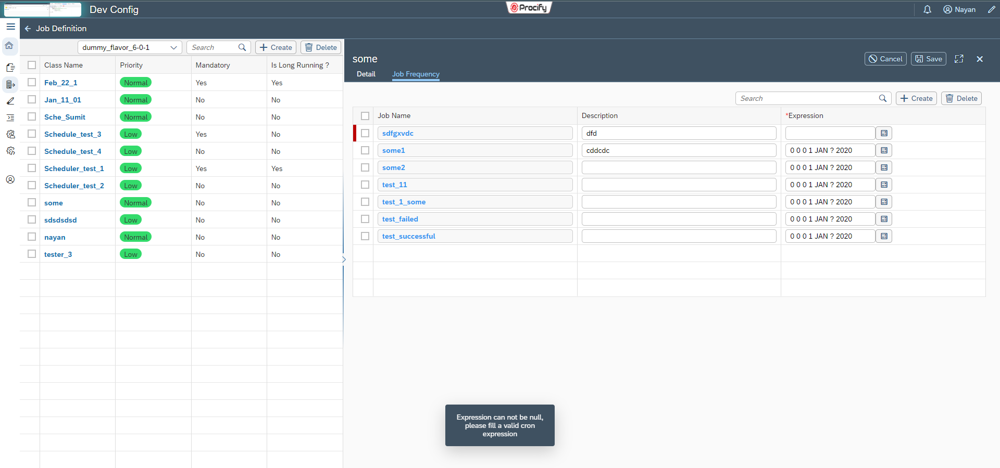

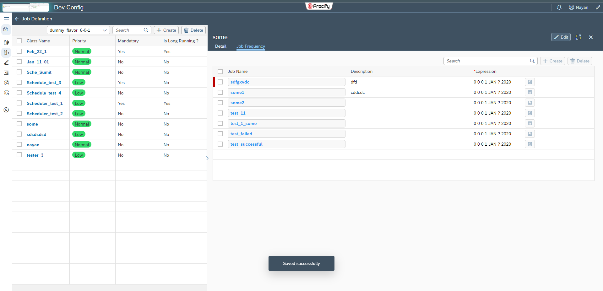

- Changes should be saved before changing the App or Navigating back from the page.
  > Warning will be shown if not saved.
  > Changes done can be reverted by selecting the cancel button.
  > **Cancel** will revert to the last save.

## Jobs

The jobs screen is used for Managing/Scheduling the background jobs. In Scheduled Tasks, Job attributes are set and kept. Here, those jobs are managed and scheduled.

- **Step1:**To access the Jobs/ Job Execution Logs screen, Navigate to the **Operations Monitor** menu header to get the **Jobs** and **Job Execution Log** screen.

> 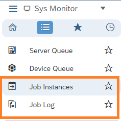

The following screen will be previewed as shown below:
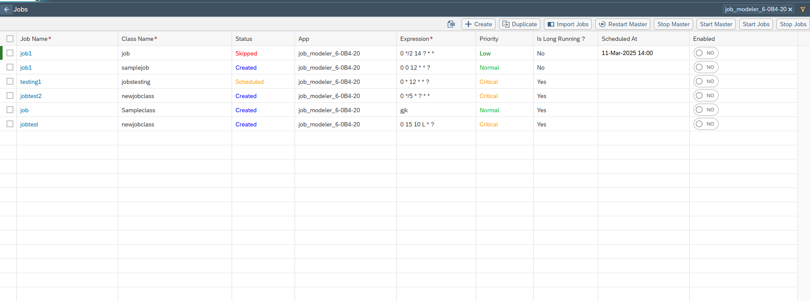

**Note:** System priority Jobs are not editable.
Example:- let’s say you want to create an entity every Monday Morning. You can schedule the

task using the Job scheduler.

### Jobs parameters in detail;

**Jobs**

| **Columns** | **Data Type** | **Default Value** | **Description** |
|---|---|---|---|
| job_instance_id | varchar(100)PK |   | Unique Job key |
| scheduler_id | varchar(32) - PK |   | This is the class name |
| job_name | varchar(32) - PK |   | Job Name |
| description | varchar(255) |   | Description |
| flavor | varchar(32) |   | Flavor |
| fv_id | varchar(36) |   | Flavor ID |
| params | varchar(255) |   | Parameters for the Job |
| mandatory | Boolean |   | Mandatory or Not  For example, if a job was scheduled for 12 AM but the server stopped at that time due to unforeseen circumstances, the job will be executed once the server restarts, provided it is marked as mandatory. |
| priority | varchar(1) |   | Priority of the Job  S-System \| A-Critical \| B-Normal \| C-Low |
| is_long_running | Boolean |   | if is_long_running is not marked, then after 2 minutes, txn will be expired. |
| expression | varchar(255) |   | It is a mandatory property. It is used to specify a recurring date and time interval in which a scheduled task needs to be executed. For more information ([Read this](https://docs.oracle.com/cd/E12058_01/doc/doc.1014/e12030/cron_expressions.htm)) Eg: 0 0 12 ? * MON-FRI Every Weekday at noon |
| is_disabled(Enabled) | Boolean | TRUE, (False for Enabled) | If Disabled the job won’t be executed for the upcoming scheduled time. |
| curr_status | varchar(32) |   | Shows the Current status of the Job. "scheduled" \| "inQ" \| "running" \| "over" |
| curr_taskid | varchar(32) |   | Current Task ID |
| next_schedule_at | Datetime |   | When the Job is Next Scheduled |
| suc_count | number |   | Success Count |
| fail_count | number |   | Fail Count |

### Creating a Job in Jobs Screen

- Press the Create Button on the Top of the Job list to create a new **Jobs**.

> 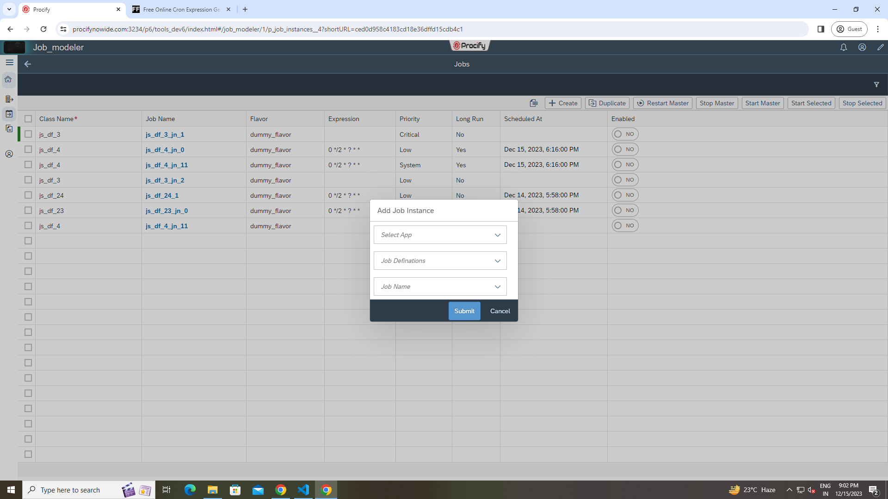

- Select from the Given options to create a new Job.

- Select App: It will give the option to select the flavor.

- Job Definitions: It will give the option to select a Job definition present in the selected flavor.

- Job Name: It will give the option to select a Job and present the selected job definition.
  > 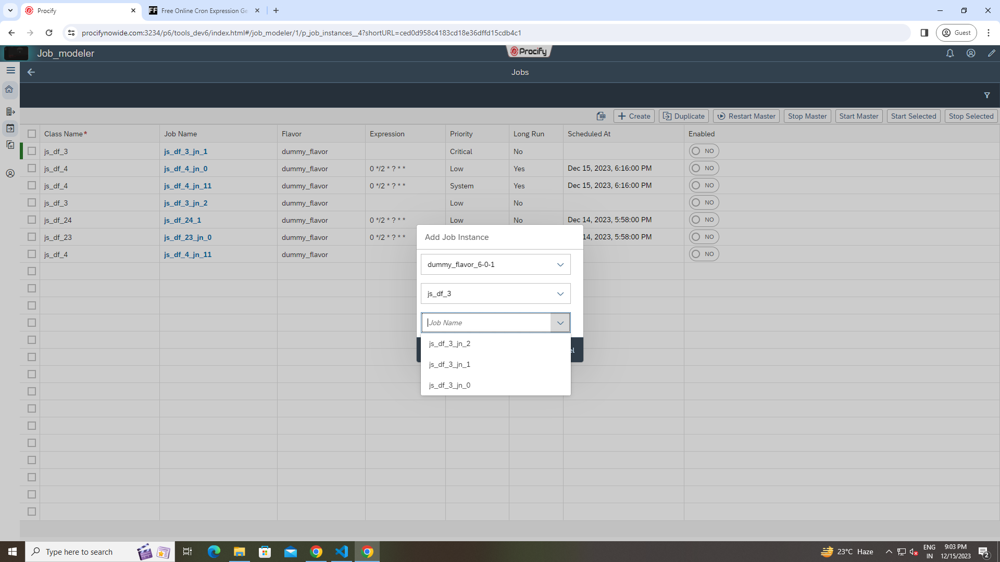

- Jobs can also be duplicated.
  > Select a Job and press on Duplicate(Only one Job can be duplicated at a time; By default, the lowest selected Indexed Job is duplicated).

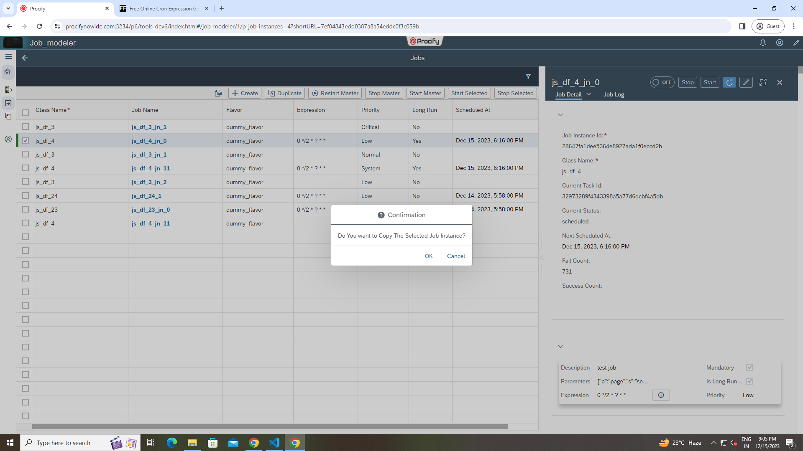

> **Note**:

1.  A job can not be deleted. It can only be disabled.Any new job created from the Jobs screen will be in a disabled state by default. To run the job, you must manually enable it by clicking the Enable button.

2.  Whenever a new Version of the app is created, and if any jobs are newly added or existing jobs are modified(either in code or metadata), the jobs must be imported from the latest version of the app.

During job transport, using the \[Import Job\] option, this will retain the job's original status. If the job was disabled before export, it will be imported as disabled; if it was enabled, it will be imported as enabled.

### Editing a Job

- A Job can be edited while it is Disabled and Next Scheduled is more than 2 minutes.

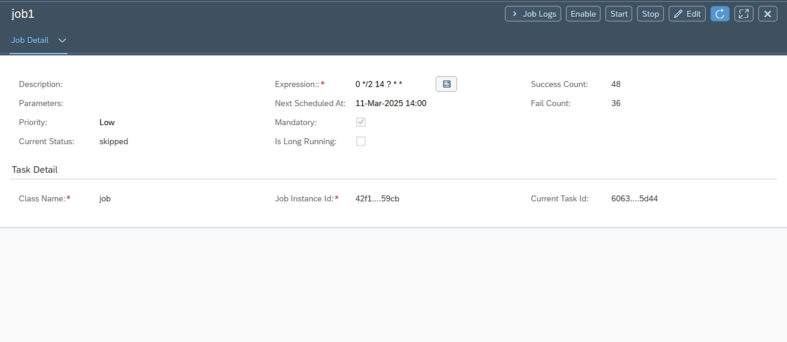

- It can’t be edited while enabled.Edit permissions are restricted to managers of the associated scheduled task.

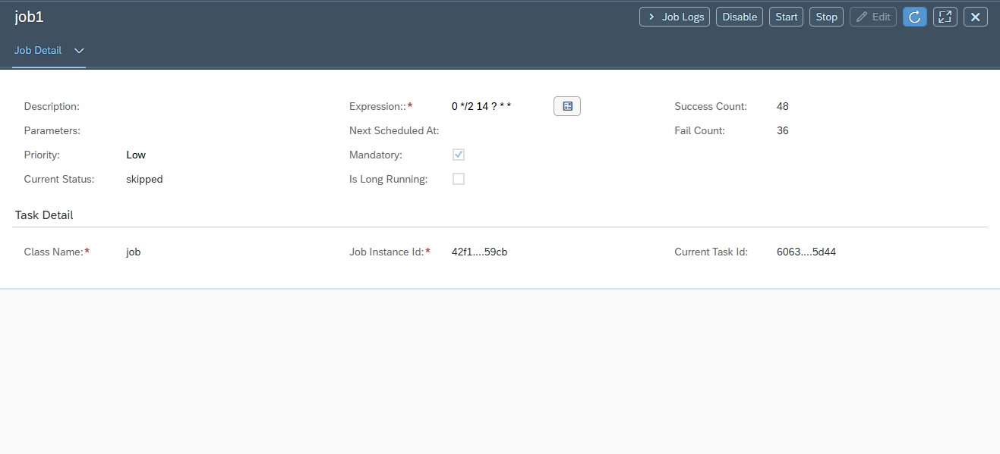

- Cron Expression needs to be present in order to save the job.

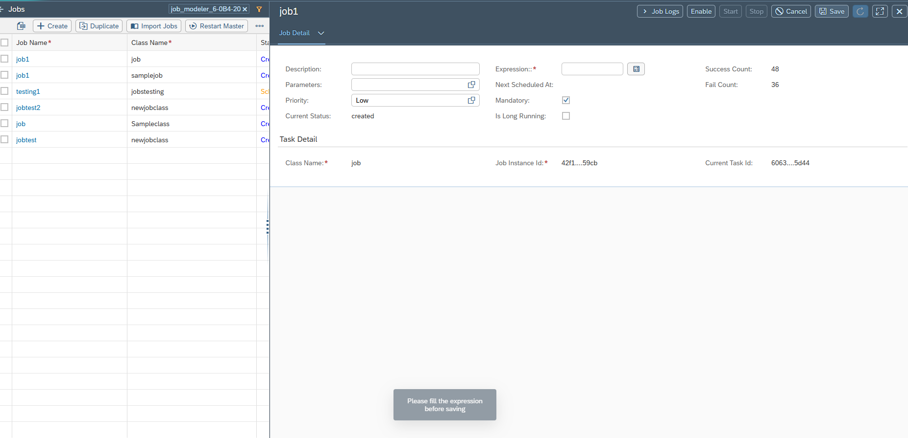

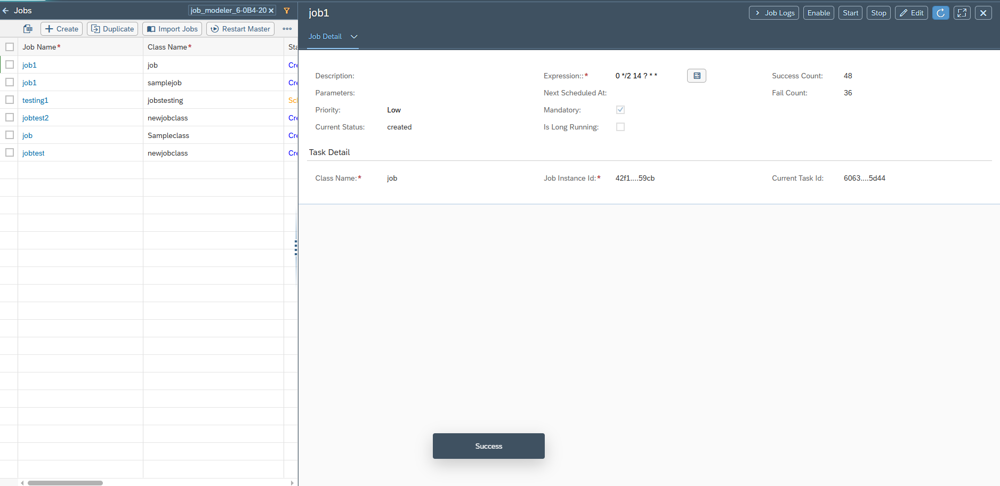

- Needs to provide a cron expression before saving.

The cron expression is a required property; if it is not included in the job definition, the import of the jobs will fail. Additionally, attempting to start the job without it will also result in failure.

If you don't wish to schedule a job, you can just disable the job.

Please provide a Valid cron expression, currently valid cron expression can be checked using this [site](https://www.freeformatter.com/cron-expression-generator-quartz.html). The provided site may not work in the future.

**Note**:-There is currently **no minimum limit** set for the scheduler task execution interval.

**Note:** We follow the FreeFormatter Cron Expression Generator, which uses Quartz-style 6/7-field cron syntax.
For example, the expression shown there for running a task **every second** is:

\* \* \* ? \* \*

However, this expression **does not trigger even once** in our implementation. This is because we use the later.js library with useSeconds = true, which expects **7 fields** in the cron expression. Missing the seconds field causes the expression to be parsed incorrectly, resulting in no execution.

There is no need to restart the master after enabling a job for it to be scheduled. However, if the master has been manually stopped, the newly enabled job will not be scheduled until the master is started again.

### Importing Jobs

- Press the import button.

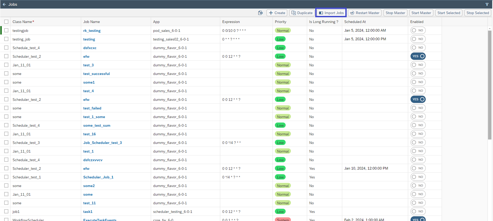

- A pop-up will open

> Select the App from the dropdown and submit.
>
> It will fetch the jobs created in the job definition for that particular app version.

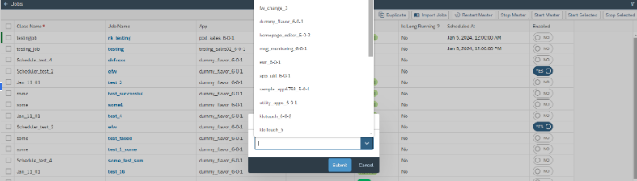

**Note:-** already present jobs won’t be imported but will be updated for that particular version. The old version jobs need to be disabled.
Use Case

A restart master is required after import for rescheduling the jobs with current expression.

### Controls in Job List (Grid)

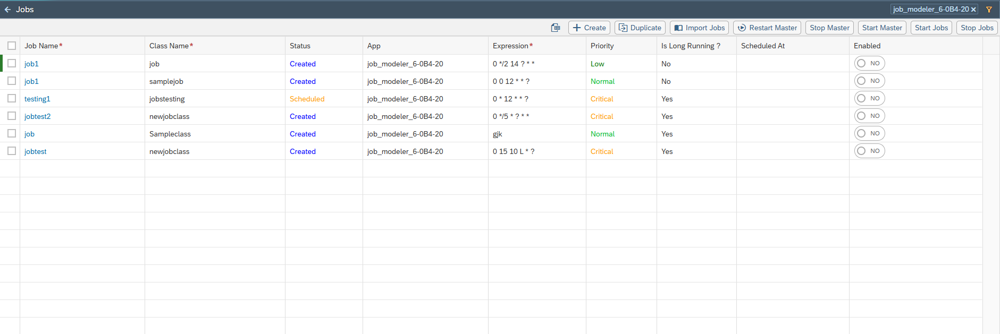

| **Elements** | **Description** |
|---|---|
| Create | Creates a new Job |
| Duplicate | Duplicates a Selected Job |
| Restart Master | Reschedules the Jobs with the changes. |
| Stop Master | Stops all the jobs for the next schedule. |
| Start Master | Schedules all the jobs according to cron expression. |
| Start Jobs | Initiates all the jobs that have been selected.  **Note**: Jobs that have already been executed will not be run again, but jobs that have not started yet will begin. |
| Stop Jobs | Stops all the selected(running) jobs. |
| Enabled(in the list) | Enables/Disables a particular scheduled job. |

Refer to Code to create the file.

### Controls in Job Detail

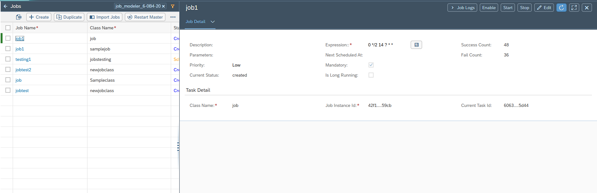

- **Enable** button is used to enable the scheduled jobs.

- **Disable** button is used to disable the scheduled jobs.

- Start:The "Start" button initiates the job immediately. If the job is already running, a warning message will appear: "The job is already running. Do you want to trigger a new instance?" Selecting "Yes" will start the job immediately, while "Cancel" will take no action.

- Stop: Stops the running job immediately.

- Refresh: Refresh the detail section to show current Data and logs related to the job.

- **"Job logs"** button will navigate to the Job Execution Log screen. In the Job Execution Log screen you can see the Job Execution Logs for specific Jobs.

Edit: Refer to [Editing a Job](#editing-a-job).

### Navigating to a Different Job

Navigating to a different job without saving, doesn’t save the changes done.
Filters Job Execution Log data for the particular job. (After opening a log in the Job Execution Log section it loads all the logs. Press the refresh button to reload jobs for that particular Job).

**NOTE:**

- **Restart master** is required after any changes in order to reschedule the jobs with new changes.

- **Enabling** a job also requires a **Restart master** in order to reschedule it.

- The scheduler can run max **2** jobs at a time in a particular landscape, other jobs will be stacked depending upon priority and cron expression. The scheduler will pick a third job after completion of any of the two jobs.

- If two jobs are having the same cron expression and same priority then the scheduler can run both of them parallelly and if any other job is already in running status then the scheduler can pick any one of them to execute.

- If one job is running and the server has stopped in between,it will not create an entry on the Job Execution Log and after restarting the server, it will check for the Mandatory field, if it is marked true, then the scheduler will start that particular job immediately else it will be skipped.

- If the onExecute() function is not found on the scheduler file,it will execute the function from the parent class and the Jobs will be returned with COMPLETED status.

- To ensure transactions are available 2 minutes after the job starts, enable the long-running option.

- If we want the Jobs status to be failed,we can call the throw(“string”) function in the onExecute() Function of the scheduler file.The String passed to the function will be displayed in the log.

- Difference between Restart Master**,** Start Master, Start Selected and Start in detail:

  - **Restart Master**: Used to apply changes to the scheduler. It restarts the scheduler to reflect new configurations, ensuring jobs run with the updated version.

  - **Start Master**: Starts the entire scheduler and executes scheduled jobs.

  - **Stop Master**: Stops the scheduler, pausing all jobs and attempting to stop running jobs.

  - **Start Jobs**: The "Start jobs" button triggers the start of all selected jobs. If any job is running, a warning will prompt, "Do you want to trigger new instances?" Selecting "Yes" will restart all jobs, and "Cancel" will prevent any restart.

  - **Stop Jobs**: Stops only the selected jobs.

> **Start/Stop (in detail)**: Used for immediate job execution or termination, typically for testing or debugging purposes, bypassing regular schedules..

Note:

## Jobs Logs

**Job Execution Logs** are used for checking the logs of the Jobs that have already been executed.

Below is the image of the Job Execution Logs Screen.

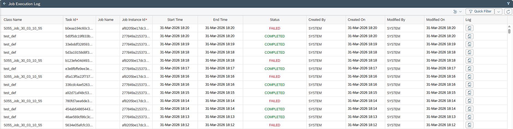

- Pressing on the Button on the list shows the Log of the job for a particular execution.

> This helps with Debugging.

- In the advanced search, the "Status" field has been updated from a simple input field to a value list (VH). Additionally, a date range filter is added, based on the start date.

- Every operation in the Job Execution Log is with respect to the start date.

### Job Execution Log parameters in detail;

| **Job Execution Log** |                |                   |                                                |
|-----------------------|----------------|-------------------|------------------------------------------------|
| **Columns**           | **Data Type**  | **Default Value** | **Description**                                |
| job_instance_id       | varchar(100)PK |                   | Job ID                                         |
| taskid                | varchar(32) PK |                   | Task ID                                        |
| status                | varchar(32)    |                   | Whether the job execution, failed or completed |
| log                   | varchar(255)   |                   | Result of the Execution                        |
| starttime             | Datetime       |                   | Start Time of the Job                          |
| endtime               | Datetime       |                   | End Time of the Job                            |
