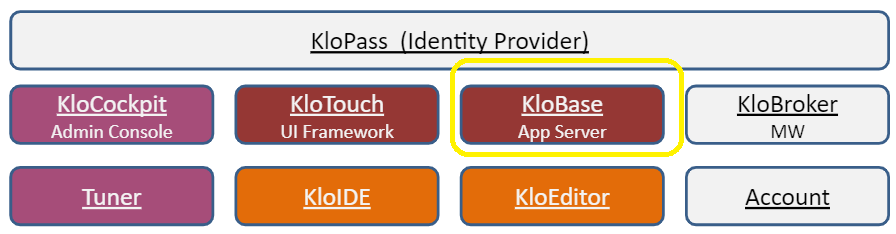
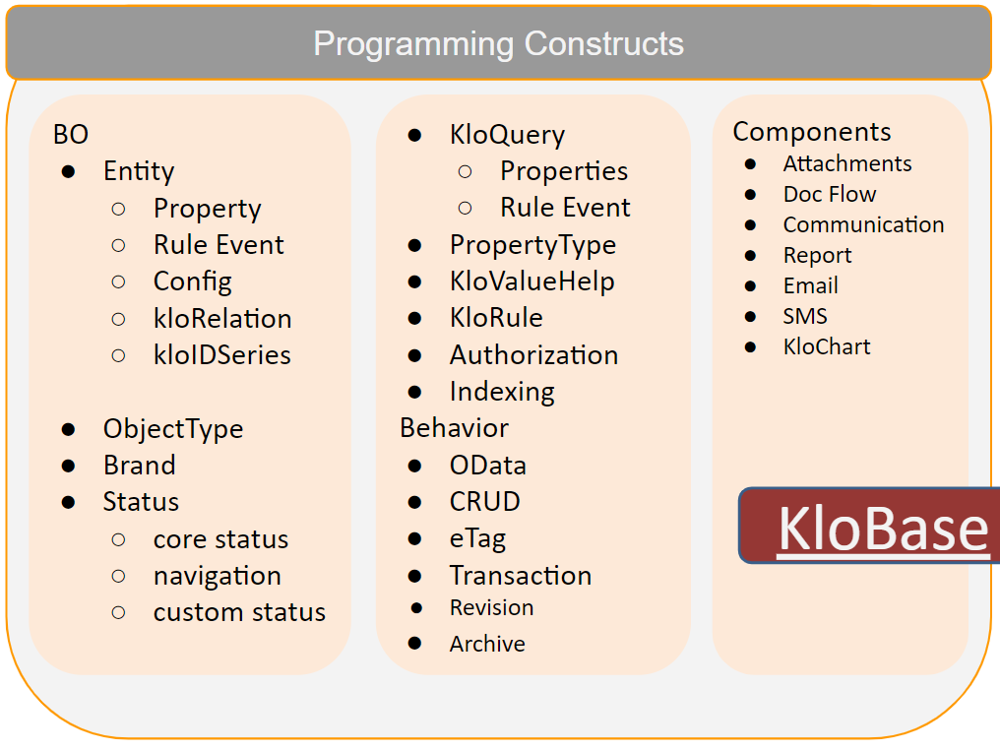

# Overview

In today's modern world omni channel application supporting multiple form factors and tolerance to network is a must. To support the diversity of device/hardware, OS, Servers, Clouds etc.. we end up creating one application multiple times. For any business application underlying data is a back bone. Unlike old 3 tier application architecture KloudBase promotes micro service with stateless models. This architecture gives tremendous portability and infinite scalability to meet modern needs. With in built klobroker it also enables distributed computing hence multiple system owners can easily exchange their data among themselves to form the network.

kloBO refers to mid tier in kloudBase architecture. It is based on the meta model. It accelerates the application development by providing configurability, override, run anywhere ( browser, android app, iphone app, windows mobile app). Developers can write the business rules in JavaScript and based on the deployment model kloBO runs it. kloBO is stateless hence provides infinite scalability and redundancy. kloBO also provides the authorization for security.

kloBO consists of a few core objects like Entity, Query, Rule, Transaction, Value Help and configuration etc.

Query as name refers are similar to database query. It is used for fetching data from a database. To understand it better let’s go with example I have an entity ( table) called “d_order”. It has multiple columns including a column named “state”. I want to fetch all the record where state == “open”

In db term I will write sql as “Select \* from d_order WHERE state = ‘open’” and execute to get the desired result.

Query also does the same with a few value added services like it gives the ability to fetch the data for offline applications similar to online application. Abstracts the multiple syntax of Odata, SQl, Json etc. so the programmer can concentrate on the business logic. It gives a few short hand optimization like pagination column select. Security features like authorization etc..

For general purpose understanding, we can see it like below. Following mapping only helps to kick start with assumptions.

- Db Table: Entity definition

- Db Table’s Column: Entity Property definition

- Data type of column: property type with domain

- Business logic: Rule

- Commit: Transaction.save

- Rollback: Transaction.refresh

- Db SQL query: kloQuery

- Execute Query: kloQuery.executeP()

- Result of SQL execution: EntitySet behaves as array of entity

- Row of sql result: entity

- Value of column in a result row: entity’s property

We can also visualize kloBO as ORM each entity represents a class capable of saving it’s own data, entity properties acts as class member rules acts as methods.

Behavior of kloBO varies as per environment. Given the same model ( meta model for application) behavior of query when it is executed ui ( device or browser) are different compared to when it is executed by kloRule as business logic.

Let’s see the working example for Order Object.

| Simple example of reading and writing Data |
|---|
| define( abc) Var Orderid = “1234” Var qMan = kloUIQueryManager.getInstance(); Var q = qMan.getEntityQuery(“d_order”); Q.orderid = myOrderID; q.executeP().then((es)=&gt;\{ If (es.length &gt;0)\{ Var ord = es[0]; Ord.qty = Ord.qty +1 Tr. save().then(()=&gt;\{ console.log() \}); \} \}); |
