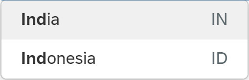

# VALUE HELP

In Application, ID/key is frequently used to store the related data. In the user interface descriptive explanation is required. To achieve it, the ID/key is represented by other single/ multiple data from the related table. Value help is also used to supply the choices available to fill ( combo, dropdown, auto complete) as selection data. Value help can impose the restriction for accepting the input value only from valid set.

Value Help (VH) is independent reusable object hence as a best practice always check the existing VHs for reuse before creating the new one. While creating a new one always categorize with entity name so later others can find it easily for reuse. It should be named .

Value help Type:

- 

Define Value Help:

- Value Help Name(32 char): unique id across all flavors. Space is not allowed.

- Entity Name

- Object Type

  - Query

  - Saved Query

  - VH Transaction

  - VH Language Dependent

  - Config

  - Config Language Dependent

  - System Fields

- Query Type

  - Runtime

  - Modeled

  - Native

- Description(255 char)

- Restrict Value

- Life Cycle

  - On Session

  - On View

  - Dependent

  - Live Change

- Parameter: query ID?

- Scope

- Dependent

- Key

- Display Text: can give multiple values?

- Icon

- Query Property change

- Live Change Threshold

- Data Sync Query ID

Naming convention:

- Length: 32 char

- Starts with ‘vh\_’

Assign VH:

Usage:

- Provide users with a set of possible values or suggestion items.

- Show text in UI.

- 

**VH Design:**

Associating VH:

Entity \<\>----\> Entity Property ----\> Property Type -----\> VH

Query \<\>----\> Query Property -----\> Property Type -----\> VH

VH can be used independently in UI and inside kloRule.

- Provide users with a set of possible values or suggestion items.

- Value help is provided by either by an entity or generic, hence it is grouped by an entity.

- Example: material master can provide a value help that gives material_id and material_description and can be used at multiple places like sales order or in procurement.

- Property type captures the value help id used for this entity property.

- Value help definition will be captured separately.

- One VH ID can be used at multiple places.

- Goes with offline preferred approach.

## VH API

**TYPES OF VALUE HELPS**

The type of ValueHelp to be used can be selected under **object_type** in BOL_EDITOR**.  
**The Following valueHelps are supported :

## QUERY

Queries are used to read the data from the table, so these queries can be used in valueHelps as well.

On Selection of object type, query type has to be selected, it could be one of the following :

- Runtime Query

- Native Query

- Modeled Query

On Selection of Runtime Query, query id is has to be set from the existing BO/Entity Names..  
On Selection of Native, query Id has to be set from the existing Native queries.  
On Selection of Modeled, query Id has to be set from the existing Modeled queries.

- App developer designes a query. Query id is provided as a part of value help definition, which will return a set of values, which will be used as suggestion items.

- BOL will simply fire the query to get the data.

**Key, Display Text and Dependents** has to be set based on the query type selected.

Key & Display Text:

Key and Display Text values can vary based on the query type selected.

- If Runtime Query is selected it contains the **entity properties** from the **selected Entity Name**.

- If Modeled query or Native Query is selected it contains the list of **entity properties** of the **return Entity **of the **selected Query.**

Dependents :

Dependents values can vary based on the query type selected.

- If the Modeled query or Native query is selected it contains a list of **query properties** based on the selected query .

- If Runtime Query is selected it contains a list of **entity properties** from the **selected Entity/BO** represented as **EntityName.PropertyId**.

**Example**:  
Let’s assume the valueHelp is grouped under “**d_material “ Entity** which has **material_id** and **material_description** as **two properties**

The **Key** is set to **material_id** and **Display Text** is set to **material_description.**

**Both Key and Display Text values can be displayed to the user concurrently or just Display Text can be showed and key is set internally.**

In The above Image **Key** is **IN** and **Display Text** is **India.**

**Dependent Example :**

Let's assume there are two comboBoxes which contains Country, State

In The query, we will create one query properties **country** and create the query as

**SELECT \* FROM States WHERE country =:country**

And assign the **dependent field** as **country.**

We will take the **country** from the **first comboBox** and fire the Query which gets required Data.

**\*Multiple Dependent Properties are Not supported.**

If Multiple Dependent Properties are required we can fire EntityQuery with multiple where conditions natively and assign the model explicitly.

## SAVED QUERY

Saved Queries are similar to queries which are fired during initial Sync, so these saved queries can be used in valuehelp as well.  
Each savedquery is associated with one of the following queries i.e BO, Entity, Advanced and Dynamic queries so these also work similar to QUERY.

Association of SavedQueries:

- SavedQuery ===\>BO Query, Entity Query, Advanced Query, Dynamic Query

We Start by selecting the **Saved Query** option under **object type**.  
After which we have to select the **saved query id**.

And for savedquery as well the key, Display Text and Dependent fields are enabled and works the same way they did for query these can be referred from [<u>here</u>](#_2nusc19).

- App developer designes a saved query and saved query id is provided as a part of value help definition

## Saved Query

- Predefined possible were conditions that can be used on a query.

- Multipurpose, used as a part of INITIAL SYNC, and Query

- \$Variable values supported.

- User can save a new search also as part of the Query API.

- m_saved_query

**QUERY**

**applySavedQueryValues(savedSearchID:string);**

Sets the where conditions from saved query to this query instance.

> saved query(savedSearchID:string)
>
> Saves a new saved query with given name or auto-generated from the applied where conditions (user specific? \[new table in txn db or same variant based table\])

Option on the query to save saved search user specific.

Apply the where conditions based on a saved search on the Query

Variant based and user based how to ? two tables and get the record merged from both.

In initial sync.

Queries directly

Save option on Query will save to …

Apply saved search (id). Internally lookup the saved search metadata and apply where conditions.

Constants supported

\$\{\$Variables

## CONFIG

By Default Framework provides a metadata table(**VH CTransaction**) from which values are fetched.  
The table looks similar to the one below.

| VHID     | Dependent Filter | ID  | Text      | Icon | Lang | …... |
|----------|------------------|-----|-----------|------|------|------|
| priority | \-               | 0   | low       | \-   | EN   |      |
| priority | \-               | 1   | medium    | \-   | EN   |      |
| priority | \-               | 2   | high      | \-   | EN   |      |
| priority | \-               | 3   | Very high | \-   | EN   |      |
| w_type   | \-               | 4   | WORK1     | \-   | FR   |      |
| w_type   | \-               | 5   | WORK2     | \-   | FR   |      |
| w_type   | \-               | 6   | WORK3     | \-   | FR   |      |
| w_type   | \-               | 7   | WORK4     | \-   | FR   |      |

Config has two subtypes

- CONFIG

- CONFIG LANG

Both of them use the same table to get the data.

- CONFIG:

In case of CONFIG we start by creating a valuehelp and providing a valuehelp name and by selecting the object type as **Config** and we provide the name in which the value should get filtered from the table as **parameter.**

**Ex:** From the above table to get the values of priority we start by giving the **valuehelp name** as **vh_priority or any name** And in the field of **parameter** we provide the value as **priority.**

- CONFIG LANG:

This is similar to CONFIG the only **additional field** we considered is **lang**, we start by **creating a valuehelp** and by selecting the object type as **Config Language dependent** and in the **parameter** field we provide the name in which the value should get filtered from the table

If the given lang is not present in the table, framework returns default system lang values.

**Ex:**From the above table if we want to get w_type values in french we start by creating the valuehelp i.e **vh_wtype or any name** And provide the **parameter** as **w-type, lang** is taken from the **browser default language** which in our case will be french

- Framework provide value help table which captures value help id, filter, description, icon, language code and translated description. This will be a metadata table

- When this type is identified, framework tries to get the set of values from this table based on given vhid and filter values. (to be continued)

## VH_TRANSACTION

By Default Framework provides a transactional table(**VH Transaction)** which are synced in the device and values are fetched from the same.

VH_TRANSACTION also works similar to config except for the fact that the values are fetched from the transactional table rather than metadata table.

The table looks similar to the one shown below.

| VHID     | Dependent Filter | ID  | Text      | Icon | Lang | …... |
|----------|------------------|-----|-----------|------|------|------|
| priority | \-               | 0   | low       | \-   | EN   |      |
| priority | \-               | 1   | medium    | \-   | EN   |      |
| priority | \-               | 2   | high      | \-   | EN   |      |
| priority | \-               | 3   | Very high | \-   | EN   |      |
| w_type   | \-               | 4   | WORK1     | \-   | FR   |      |
| w_type   | \-               | 5   | WORK2     | \-   | FR   |      |
| w_type   | \-               | 6   | WORK3     | \-   | FR   |      |
| w_type   | \-               | 7   | WORK4     | \-   | FR   |      |

VH_TRANSACTION is also divided into two types:

- VH_TRANSACTION

- VH_TRANSACTION_LANG

### VH_TRANSACTION:

In case of VH_TRANSACTION we start by creating a valuehelp and providing a valuehelp name and by selecting the object type as **VH Transaction** and we provide the name in which the value should get filtered from the table as **parameter.**

**Ex:** From the above table to get the values of priority we start by giving the **valuehelp name** as **vh_priority or any name** And in the field of **parameter** we provide the value as **priority.**

### VH_TRANSACTION_LANG:

This is similar to VH_TRANSACTION the only **additional field** we consider is **lang**, we start by **creating a valuehelp** and by selecting the object type as **VH Language Dependent** and in the **parameter** field we provide the name in which the value should get filtered from the table

If the given lang is not present in the table, framework returns default system lang values.

**Ex:**From the above table if we want to get w_type values in french we start by creating the valuehelp i.e **vh_wtype** And provide the **parameter** as **w-type, lang** is taken from the **browser default language** which in our case will be french.

- Framework provide value help table which captures value help id, filter, description, icon, language code and translated description.

- When this type is identified, framework tries to get the set of values from this table based on given vhid and filter values. (to be continued)

## SYSTEM FIELDS

Every Entity is associated with system properties like **s_object_type**,**s_status** and **s_brand** each of these are in turn associated with there own description, icon etc.  
Hence these system fields can be used as valuehelps.

The values for these are stored in the metadata tables

ex:

| object_type | Entity name | description |
|-------------|-------------|-------------|
| 101         | so_hdr      | header      |

- System fields like s_object_type,s_status and s_brand can have its on description and icon provided as a part of definition

- The usage of these values (l_satus_ivon,l_status,l_object_type) etc are provided by framework as valuehelps. (to be continued)

**SEMANTICS**

- When an entity property has value help (property type holds a value hep id), then a new property with name **\[\<property_name\>\_vh\]** will be provided by framework.

- This property will hold

  - **icon** : returns icon value provided

  - **description** : returns description

  - **suggetionItems** : returns set of suggestion items

- These **properties are bindable to sap ui5** controls and can be used in Rules also

- While using, make sure it is loaded completely, since this can go for a lazy load.

- **\<property_name\>\_vh.fetch().then(function()\{**

> **//ensures that the values are loaded.**
>
> **\})**
>
> **Fetch will return a promise. Fetch has to be used if value help is accessed other than in sap ui5 bindings.**
>
> **Example:**
>
> For **material_id**:
>
> **material_id_vh** will return
>
> \{
>
> icon:””,
>
> description:””,
>
> suggestionItems:\[\]
>
> \}
