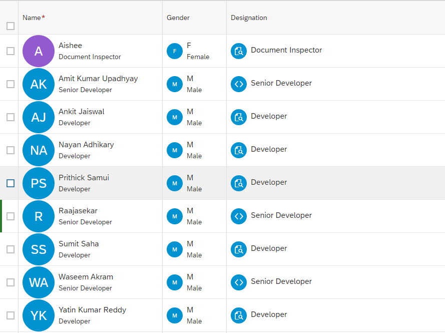
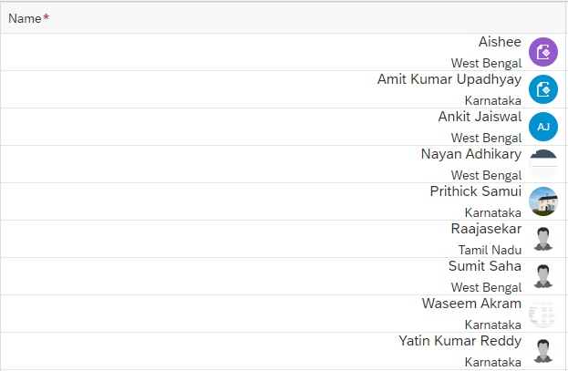
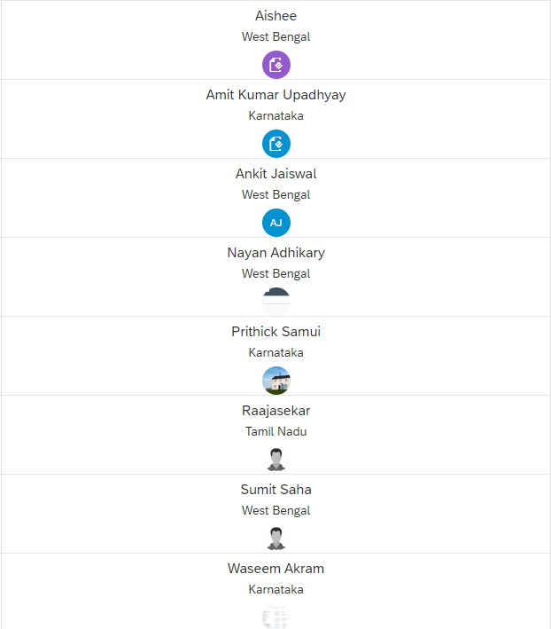

# Usage

The Usage of this control is to show an avatar which can be initials based on the title or sap icon or image.

By default the control shows Avatar, Title, Text but Based on mode the title or text or both can be hidden.

To use this control user needs to select the control type as **KloAvatar.**

**\*\*Note:** Precedence of avatarImage in highest no image it will render sap icon provided in **src** property. If none provided avatar will show initials based on avatarTitle.

