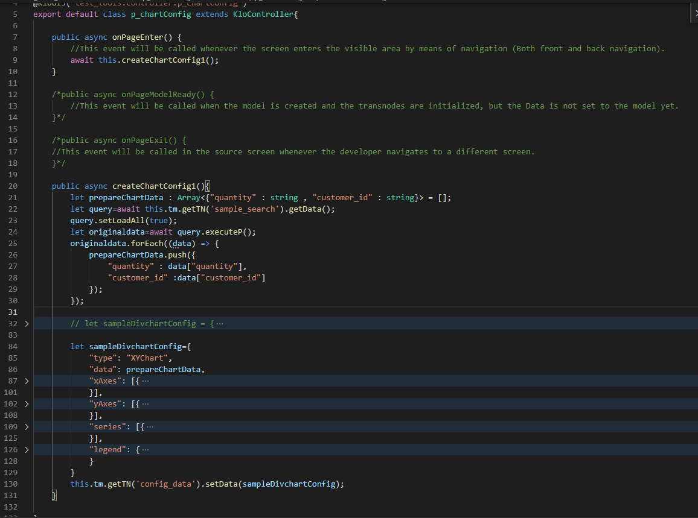
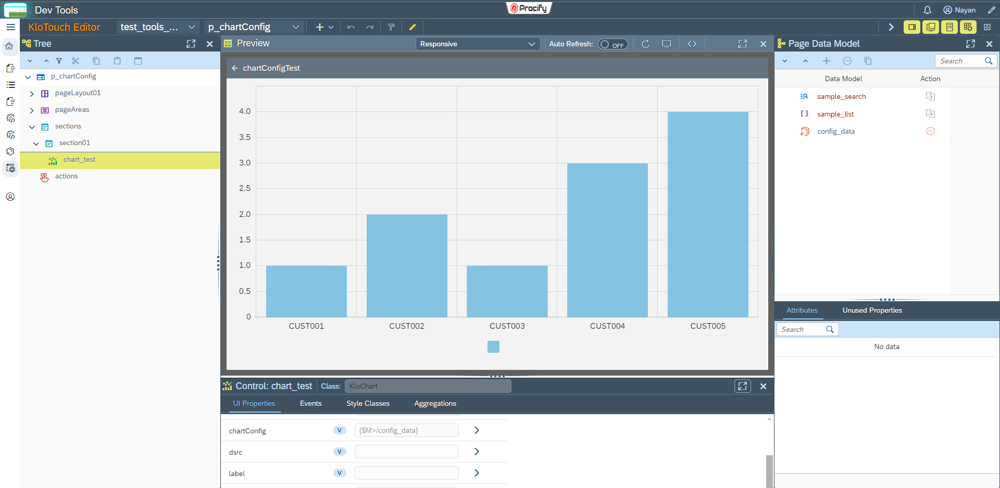
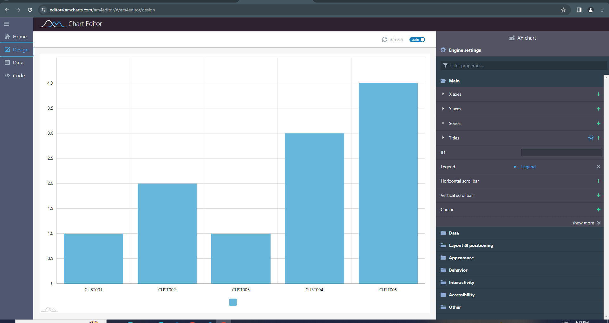
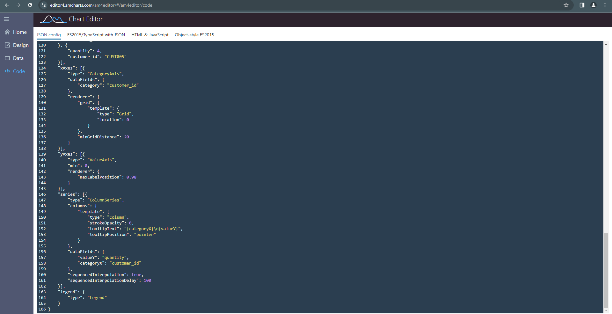

# How to use the feature

To create a chart **2 methods** can be used:

## Create a config for the chart manually which will allow features that are available for [amcharts 4](https://www.amcharts.com/docs/v4/)

For the above point, use the **chartConfig** property of KloChart:-

Create a chart configuration along with data and the other properties in the controller and set it to type **other** transnode.
Bind the **chartConfig** property of **KloChart** to the **other** type of transnode.

It will be reflecting as follows:

### Controller.ts

### Design Studio

**Example**:- Use [*amchart 4 editor*](https://editor4.amcharts.com/am4editor/#/am4editor/code) to create a chart configuration with data like yours and use that configuration in the controller.
Create a chart using [*Amchart 4 editor*](https://editor4.amcharts.com/am4editor/#/am4editor/code) with your data(sample)

Take the Json and modify the data property with your data.

### Note :-

If chartConfig is used, only height and width properties can be used, other properties won’t work for now.

chartConfig can also be set using setChartConfig() after taking the control itself.
E.g.- import type KloChart from "kloTouch/KloControl/KloChart";
(\<KloChart\>this.getActiveControlById(control_id, section_id))?.setChartConfig(created config).

## Providing mentioned [properties](#static-properties) except for chartConfig property
