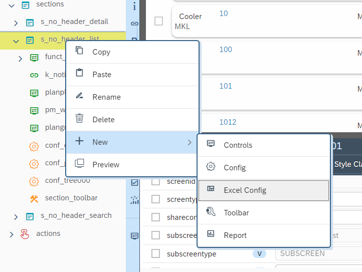
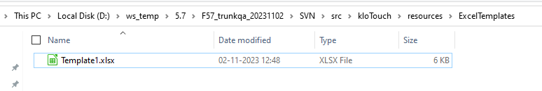
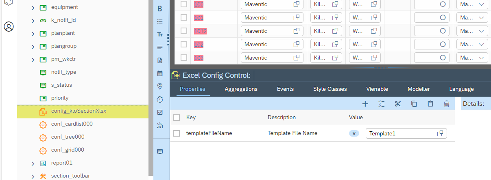
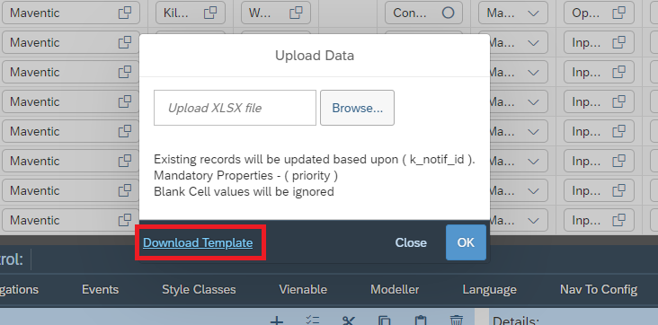

# Sample Code or Usage

**Fig:** Add the Excel Config via the context menu for the grid/cardlist section

You can provide the fileName in which you want the xlsx file to be downloaded.

You can maintain the xlsx file in the path **kloTouch/resources/ExcelTemplates** and provide the **templateFileName** in the **KloSectionXlsx** config to **download the template file.**

**Note:** You need to provide the required Excel templates to the infra team, they will place it in the path **kloTouch/resources/ExcelTemplates**.

If no excel template is provided in the above mentioned path, an excel template based on the visible columns in the screen will be created and downloaded.

If the excel template should contain all the columns, then please set the property “**allColumnsUpload”** in the excel config as true.

