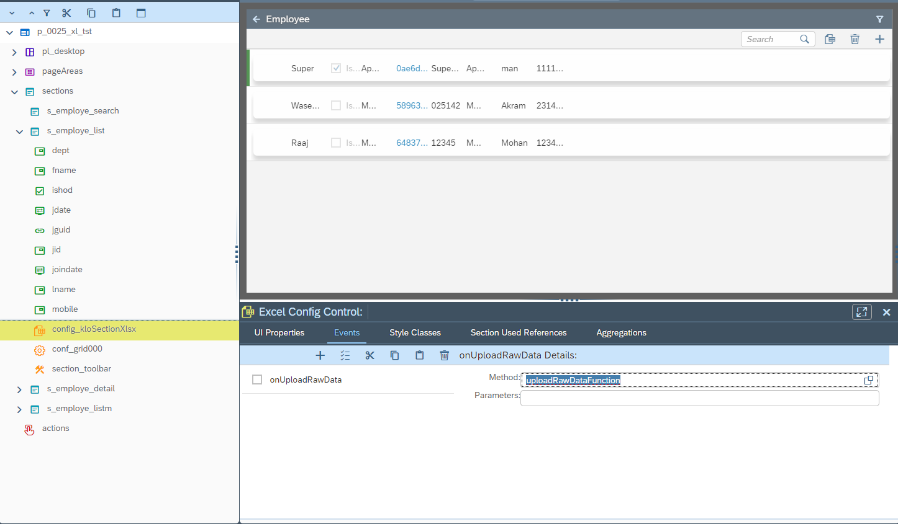
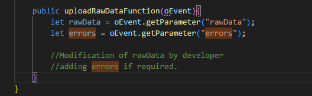
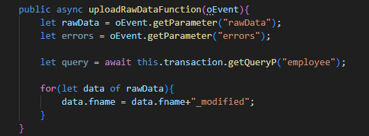
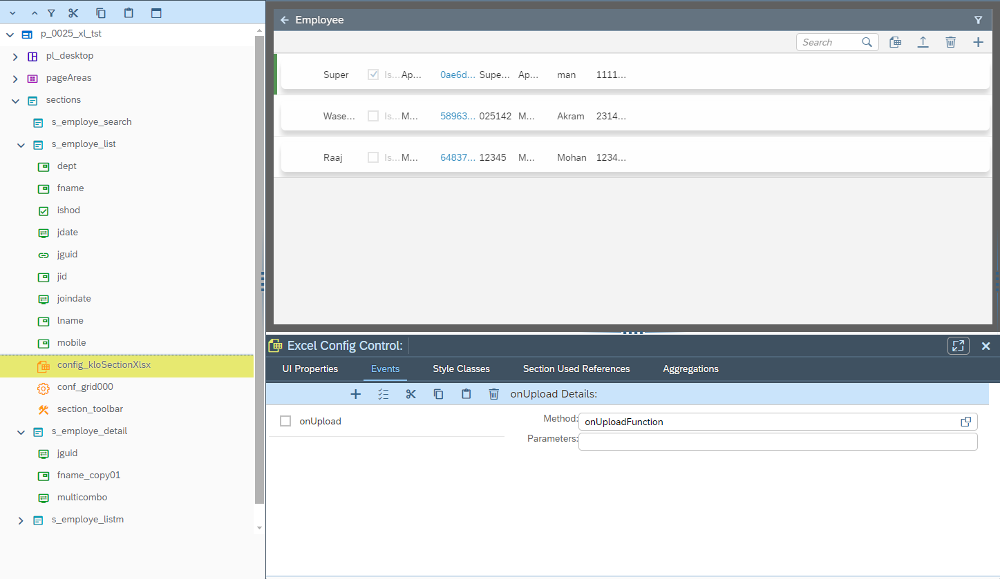
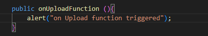

# Events

Events for KloSectionXlsx can be accessed from the events tab after adding excel config in Procify Page Builder. Currently there are two events available to the application developers:

## onUploadRawData

This event will be triggered when the excel data has been converted to raw JSON data. The application developer can access this raw data and perform modifications based on their needs. The modified data (or lack thereof) will then be sent to the server for further validation and creation/modification of entities.

### Parameters

| **NAME**    | **TYPE** | **DESCRIPTION**                                                             |
|-------------|----------|-----------------------------------------------------------------------------|
| **rawData** | Object   | Raw excel data in JSON Format                                               |
| **errors**  | Object   | Errors (if any) can be passed that will then be displayed in the error log. |

### Sample Code Usage

**NOTE: This is a synchronous event. It does not support asynchronous await calls inside the function. If await is used, the event will continue with its execution without waiting for the results of the async function. If data is modified after the await call, modified data will not be sent to the server for processing. If errors are attached after the await call, attached errors will not reflect in the error log.**

**Incorrect Usage Example:**

In the above example, due to the await call to an asynchronous function, the data will be sent to the server for processing before modifying the data.

## onUpload

This event will be triggered after the processing of the excel file is done and the OK button of the excel upload dialog box is clicked.

### Sample Code Usage

