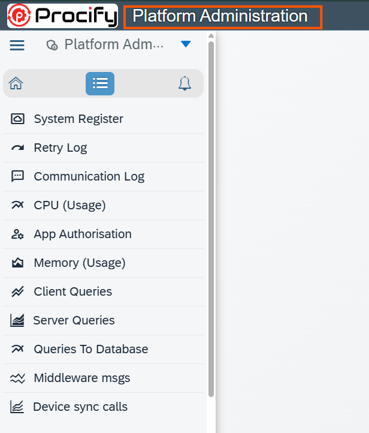

# Overview

- KloSystem is the sub-system of the kloregistry system. Klosystem helps us know how many klosystems are running and also we get all information regarding the klosystems example: URL, responsible person, Mac ID, and expiry date for our software in the klosystem.

- The kloregistry system URL must and should be publicly exposed and outbound needs to be enabled for accessing the klosystem URL.

- The klosystem URL also should be available to be accessed from the kloregistry system.

## Pre-requisites

**msg_enquire** app should be assigned to the users to access this app.

## Navigation to KloRegistry

In the menu, go to the **Platform Administration** menu head, you can use the three menus under this menu head for KloSystem.

