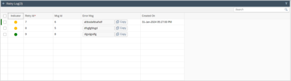

# Retry History

| **Parameters** | **Description**                                           |
|----------------|-----------------------------------------------------------|
| Indicator      | Green if the message is sent successfully, Red if failed. |
| Retry ID       | Unique ID for the retry logs.                             |
| Msg ID         | It is the ID to know which messages are going to retry    |
| Error Msg      | It shows the failed error retry message                   |
| Created on     | It is the date when the retry logs are generated.         |
