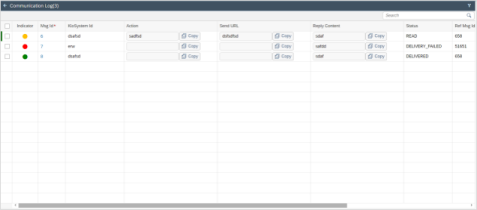

# Integration Logs

| **Parameters** | **Description**                                                               |
|----------------|-------------------------------------------------------------------------------|
| Indicator      | Green if the message is DELIVERED, Red if DELIVERY_FAILED and Amber for READ. |
| Msg Id         | A unique ID is generated for each message.                                    |
| kloSystem Id   | ID to know about the logs generated for which system registry.                |
| Action         | Communication Payload                                                         |
| Send URL       | It represents the kloSystem URL                                               |
| Reply Content  | It is the content to know more about the replies messages content.            |
| Status         | READ, DELIVERED, DELIVERY_FAILED.                                             |
| Ref Msg Id     | It represents the messages belonging to the same messages                     |
| Created On     | It is the date when the communication logs are generated.                     |
| Replied On     | Last replied content date or modified on.                                     |
