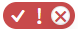
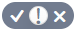

# Overview

**This document is a guide to “KloTriState” control.**

TriState control is for searching attachment. It has three states as follows:

- ON: attachment_id is not null

- OFF: attachment_id is null

- NA: do not add as search param (DEFAULT)

**On state. (Indicates attachment “IS_NOT_NULL”)**

**Off state. (Indicates attachment “IS_NULL”)**

**Neutral state. (Indicates no search params set)**

## Properties

<table>
<colgroup>
<col style="width: 27%" />
<col style="width: 11%" />
<col style="width: 20%" />
<col style="width: 40%" />
</colgroup>
<thead>
<tr class="header">
<th><blockquote>

<strong>NAME</strong>

</blockquote></th>
<th><blockquote>

<strong>TYPE</strong>

</blockquote></th>
<th><blockquote>

<strong>DEFAULT VALUE</strong>

</blockquote></th>
<th><blockquote>

<strong>DESCRIPTION</strong>

</blockquote></th>
</tr>
<tr class="odd">
<th><blockquote>

<strong>state</strong>

</blockquote></th>
<th></th>
<th><blockquote>

null

</blockquote></th>
<th><blockquote>

<mark>Default state of the control.( null, true, false)</mark>

</blockquote></th>
</tr>
<tr class="header">
<th><blockquote>

<strong>type</strong>

</blockquote></th>
<th></th>
<th><blockquote>

attachment

</blockquote></th>
<th><blockquote>

<mark>Type of state check. (Ex. attachment, boolean)</mark>

</blockquote></th>
</tr>
<tr class="odd">
<th><blockquote>

<strong>defaultStateIcon</strong>

</blockquote></th>
<th><blockquote>

sap.ui.core.URI

</blockquote></th>
<th><blockquote>

sap-icon://question-mark

</blockquote></th>
<th><blockquote>

<mark>To set the default/null state icon.</mark>

</blockquote></th>
</tr>
<tr class="header">
<th><blockquote>

<strong>falseStateIcon</strong>

</blockquote></th>
<th><blockquote>

sap.ui.core.URI

</blockquote></th>
<th><blockquote>

sap-icon://accept

</blockquote></th>
<th><blockquote>

<mark>To set the false state icon.</mark>

</blockquote></th>
</tr>
<tr class="odd">
<th><blockquote>

<strong>falseStateIcon</strong>

</blockquote></th>
<th><blockquote>

sap.ui.core.URI

</blockquote></th>
<th><blockquote>

sap-icon://decline

</blockquote></th>
<th><blockquote>

<mark>To set the true state icon.</mark>

</blockquote></th>
</tr>
</thead>
<tbody>
</tbody>
</table>
