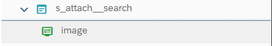
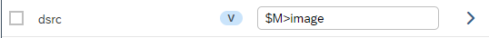
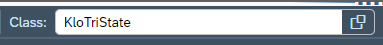
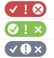

# How to use the feature

<table>
<colgroup>
<col style="width: 6%" />
<col style="width: 93%" />
</colgroup>
<thead>
<tr class="header">
<th><strong>SN</strong></th>
<th><strong>Steps</strong></th>
</tr>
<tr class="odd">
<th>1</th>
<th>
<strong>Create a search section and add a property with “Attachment” qualifier.</strong>

</th>
</tr>
<tr class="header">
<th>2</th>
<th>
<strong>Change it’s class to KloTriState from the control class list.</strong>

</th>
</tr>
<tr class="odd">
<th>3</th>
<th>
On click of the whole control the states will change along with the icons. Based on the state on search it returns the results.

</th>
</tr>
</thead>
<tbody>
</tbody>
</table>
