# Landing Page Settings — How to use the feature

| SN | Steps |
| :---- | :---- |
| 1 | **Assign the *homepage\_editor* as a *TESTER* to yourself**  Go to Procify Workspace Hub and assign the latest version of homepage\_editor flavor to yourself as a tester.   |
| 2 | **Go to the *Landing Page Settings*** Once assigned, you will get the Upgrade Banner.  Once you get the upgrade banner and registration is complete, Click the Hamburger menu and select *App Builder* Menu Header. Select Landing Page Settings from the Menu. You will be Navigated to the Landing Page Settings.  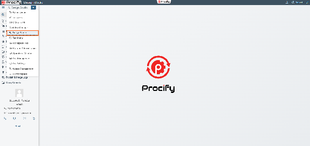  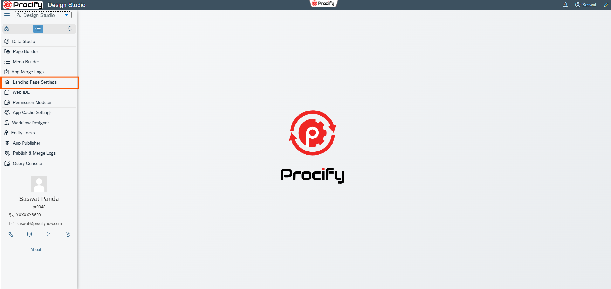  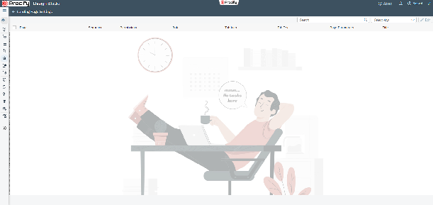 Note: The Edit button will be disabled if no flavor is selected from the drop down.  |
| 3 | **Make sure you are in bolversion 7-2-227 or  Higher** Note: You can check this from the about page |
| 4\.  | **Select the flavor to create/see the homepages in that flavor.**   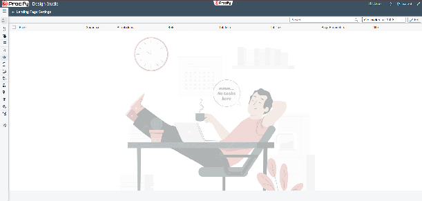 Once you select the flavor, the edit button will be enabled. If there are homepages in that flavor that will appear in the list. Once you have selected the flavor, it will persist even if you refresh and homepages in that flavor will be persisted |
| 5\. | **Click the Edit button to go into Edit Mode  ** Once you Click the Edit button, the page will go to Edit Mode. You should now be able to see Add, Delete, Save and Cancel Buttons. |
| 6 | **Click On Home Icon below the Hamburger Menu in the sidebar to navigate to Home Page  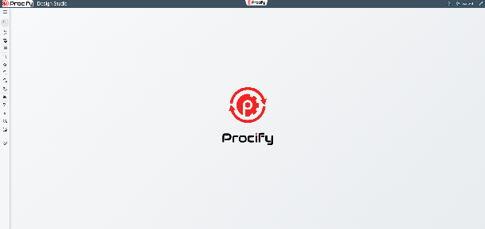**   If you have not added any Homepage entries in the Landing Page Settings, then Procify Logo with Procify text is shown below it   |
| 7 | **Click on \+ Add button  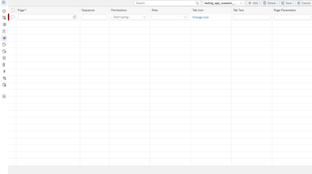** A new homepage entry will be created 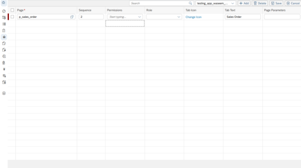 Fill in the screen id in the page column by clicking the Value Help Icon and selecting the screen you like. Fill in the sequence and Tab Text. Click on Save. Once Save is successful the page will reload and You can click the Homepage button again to see the added Home Page.  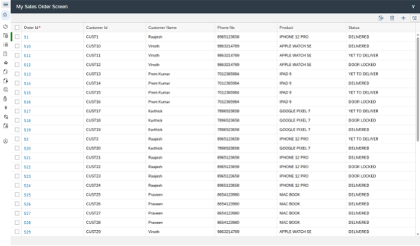 If one Homepage entry is added, then that homepage is shown in the screen.     |
| 8 | **Add another Homepage in another flavor 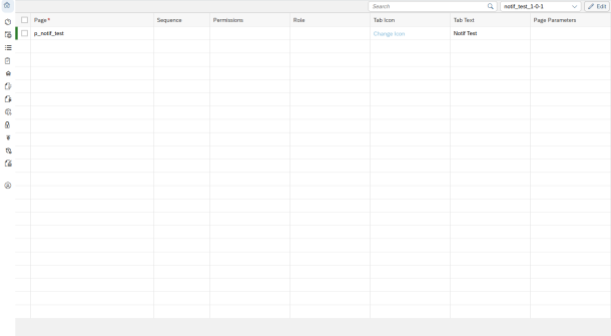** Go to Landing Page Settings and Select a different flavor, Click on Edit to Go Into Edit mode. Click on \+Add button. Fill the screen id and changed the Tab Text if you want. **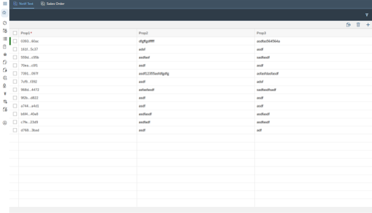** Go to the homepage. If there are more than one entries in homepage, then You will see a tab with icon and title (icon filled from the tab\_icon and title will be filled from the tab\_text fields of the Landing Page Settings)   In Mobile, back button is removed and  the title in the screen titlebar will be dynamically updated based on the currently selected tab and filled from the title property of the Landing Page Settings, if not provided then picked from the Tab Text otherwise screenid. Precedence: Tab Text=\> Screen Title  \=\> Screen Id Precedence: Title \=\> Tab Text \=\> Screen IdIf no homepages are added then the title “Home” is shown in the screen title bar.  |
| 9 | **Now in the roles field, select the role other than the role currently assigned to the user  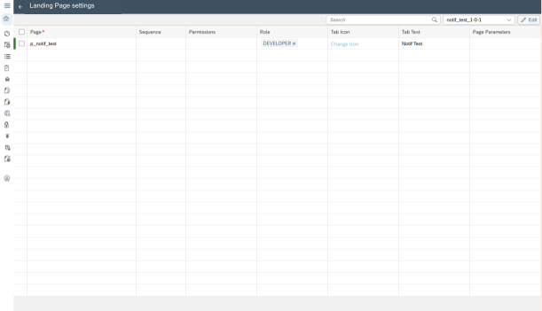**  Here the app is assigned as TESTER to the user but we are selecting as manager  Since the role doesn’t match, the screen is not shown to the user i.e., it is hidden from the user. |
| 10 | **Add permissions to your entity  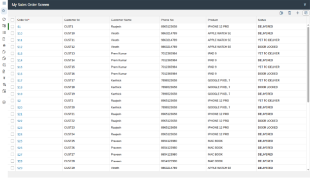  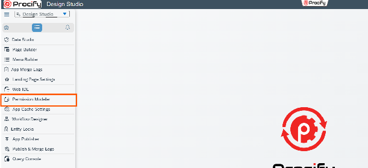** Create a permission group in *Role Permissions* if it doesn’t exist  **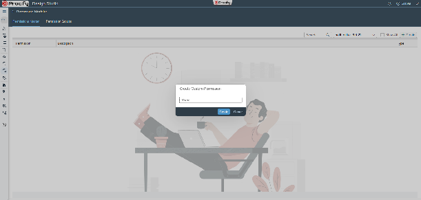  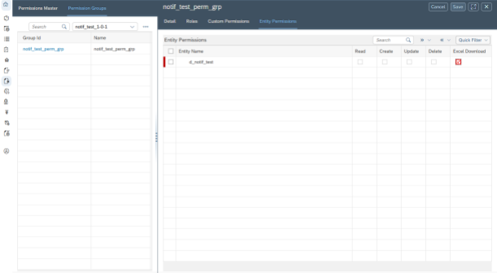** Enable Excel Download permission for testing purpose. Then Go to Landing Page Settings and In Edit Mode, Select the required permission from the Permissions dropdown. Then if the permissions is valid, then the Homepage is Visible otherwise it won’t be visbile **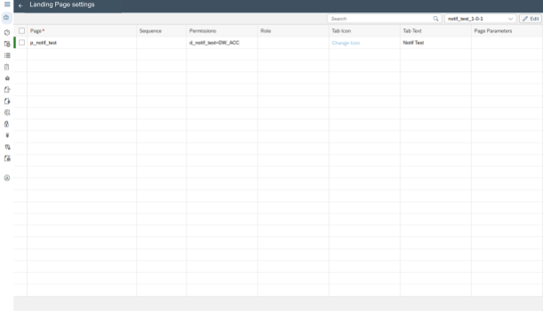   NOTE: Make sure that all the permissions are assigned for all the users by default, even after assigning the permissions to the homepage and permission not given and homepage is still showing up then remove the permission group “[flv\_master\_grp](https://fwtest.procifynow.com/p6/UT/index.html#)” from the *Role Permissions* screen for your user role.** |
| 11 | **You can trim the subscreen by passing Page Parameters.** Eg: {"trimSubscreen": "s\_notif\_t\_detail"}. Here s\_notif\_t\_detail is the detail section’s subscreenid     **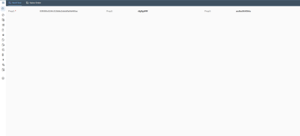**   |
| 12 | **We can change the Icon which is shown in the Tab of the HomeScreen. 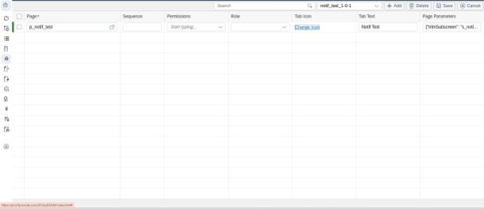  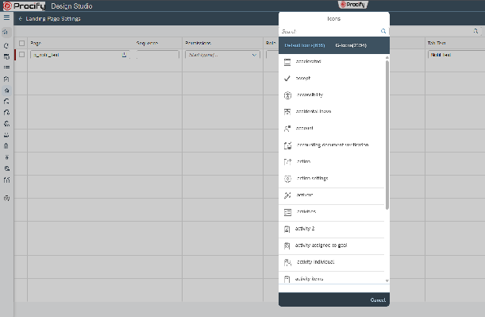  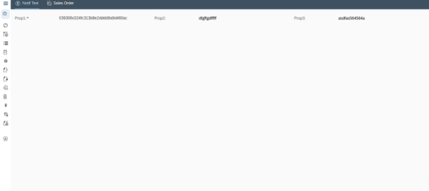**  |
