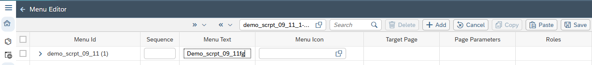
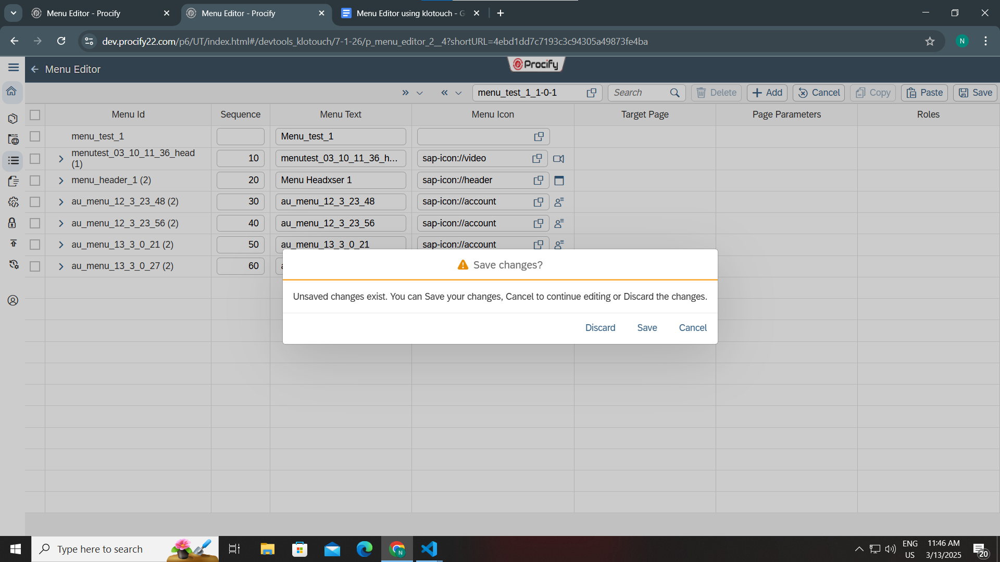
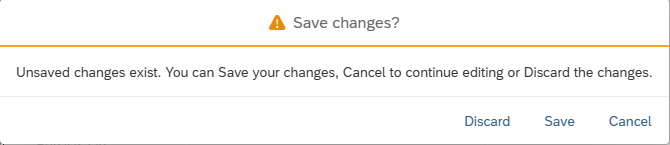

# Menu Builder — Save

Once the entire process is complete, click the save button on the top-right-hand side of the screen. This action will save the entire process of changes that have been made. Wait until the busy Dialog closes to see the menu changes reflect.

When you navigated back while having unsaved changes, a popup screen will appear as shown below;

