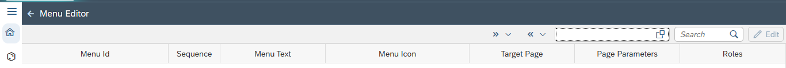
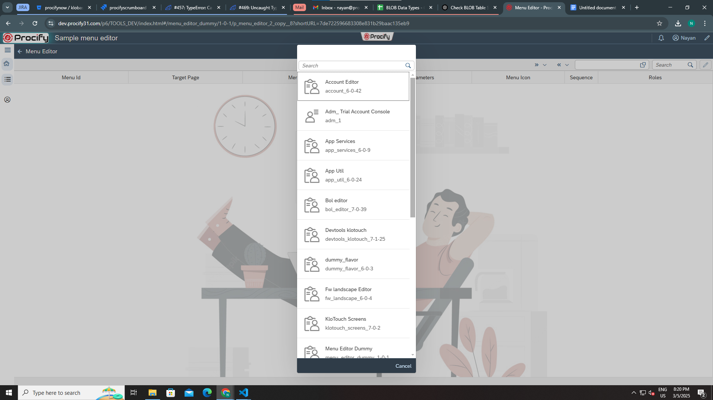
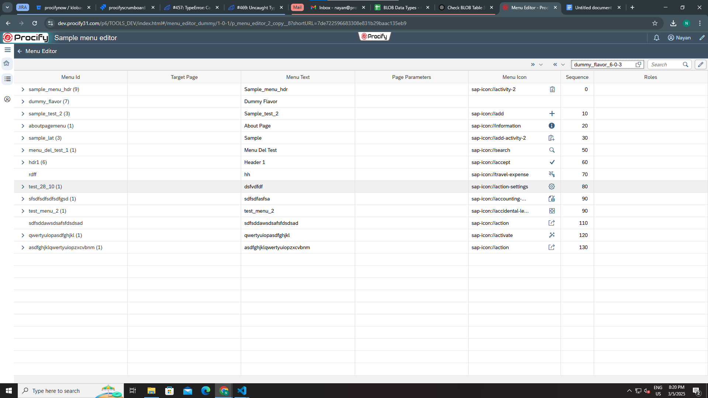
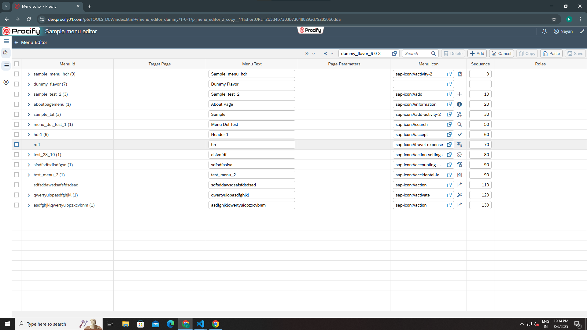

# Menu Builder — Menu Builder Page

On the Menu Builder page, you need to first select the flavor/application inside which the menu needs to be created. The App option is available on the top left where the Menu Builder header is..

Select the app from the drop down menu in the search option.

Click on the edit button () at the right-hand side of the App selection to make the fields editable.

On selecting the edit button a menu table with selected flavors/applications will appear.

The Menu table consists of eight components, namely:

[TABLE]
