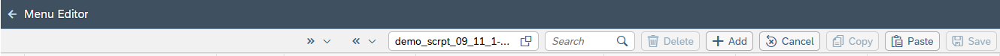
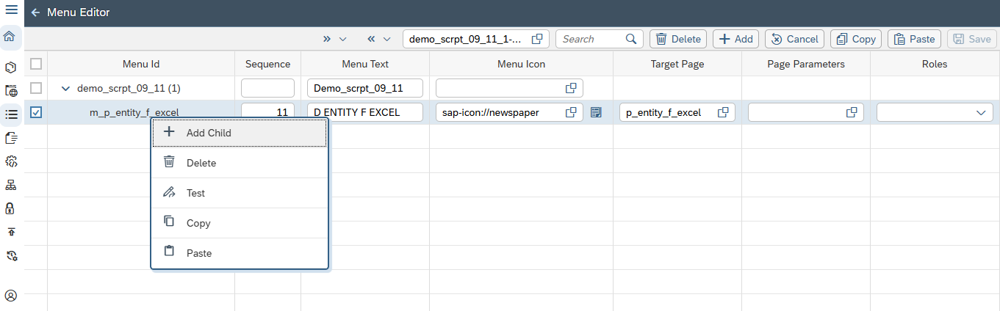
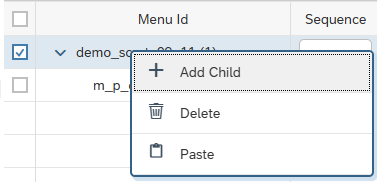

# Menu Builder — Edit Buttons and Functionalities

There is a panel of buttons on the top-right-hand side of the Menu Builder table screen as highlighted in the image below:

The following are the functionalities of these buttons:

[TABLE]

**Note:** The test option is available when you right-click on any menu item. This option is not available on the top right panel.

Apart from the panel, another way to get these editing options is by right-clicking on any menu item. This will show you a context menu for **add, delete, copy, paste,** and **test** the particular menu you clicked on. We will learn about this in detail in the next section.

> 
