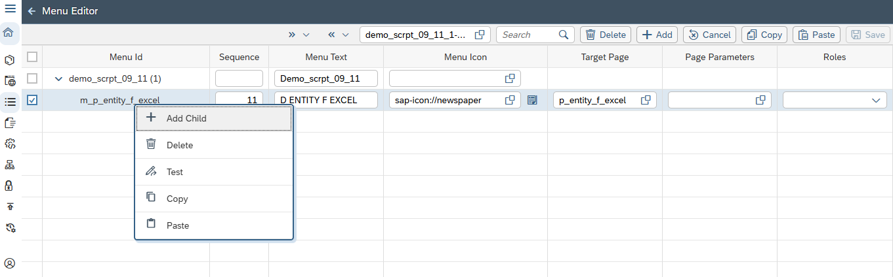

# Menu Builder — Menu Context and Functionalities

The context menu appears when you right-click on any line item. It contains some edit buttons like **Add Child, Delete,** **Test, Copy, and Paste**.

**Note:** Menu Items can have three levels/ subparts. In this section, we will see how the menu context works in each part.

**Step 1-Add Child from the context menu**

On the context menu, the **Add Child** button will add the child to the particular selected menu. The Add Child button can be used to add a child to the second level of the menu.

> 

**Step 2- Use of copy and paste**

We can use the option of **copy** and **paste** in the second level of the menu.

> 

For the third level of the menu, we cannot **add a child**. Also, we cannot **paste** menus. However, we can copy, delete, and test the menus in the third level.

> 

##
