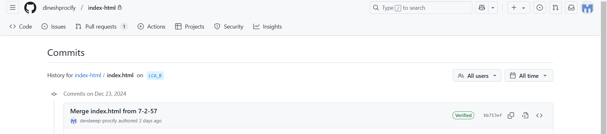

# Verify the Merge

- To verify that the changes were successfully merged, check the **commit history** of the specific sub-branch.

- Navigate to the repository on GitHub, select the sub-branch, and go to the **Commit History** section. Ensure that the merge and changes to **index.html** are reflected there.

> 
