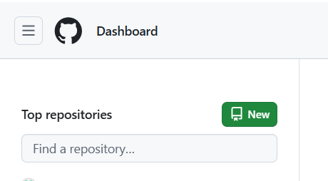
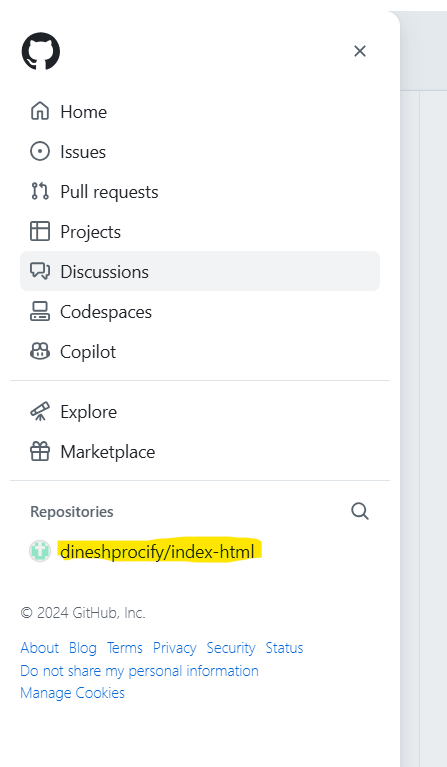

# Request Repository Access

- Contact **Dinesh Kumar** to gain access to the repository, where you will be merging the **index.html** file.

- Once you've obtained permission, click on the three lines in the top-left corner and choose the repository.

> 
>
> 
