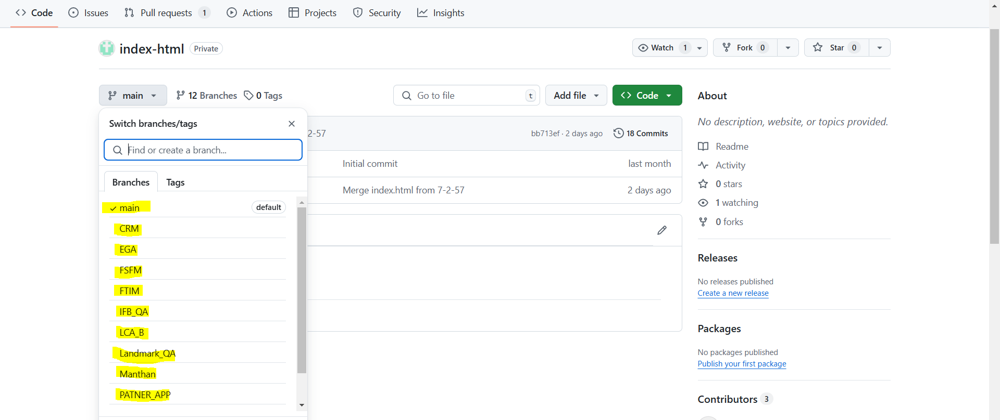

# Repository Structure

- The repository contains a main branch, along with several sub-branches, each corresponding to a different project.

> 

- The task involves merging the **index.html** code into all other sub branches.
