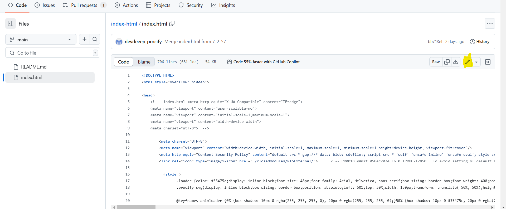

# Merge Latest Code into the Main Branch [Infra Team]

- First, ensure that the latest code changes are merged into the **main branch**. This should be done before proceeding with merging into individual project branches.

- To edit, click on the highlighted section as shown below.

  - Please note that index.html from jenkins should be opened in VS Code text editor only.(Don’ t use Notepad++ or other text editors)

> 

- While merging by copying and pasting into the main branch, provide a **unique description** (e.g., "Merged latest changes to index.html for project update" or mention the sprint/Hotfix release number as description ) to track the edit history effectively.
