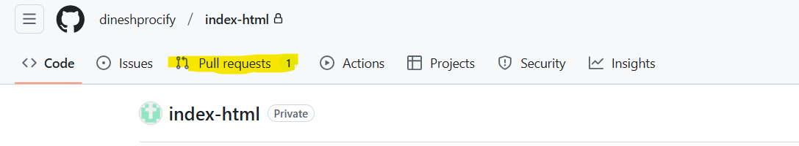
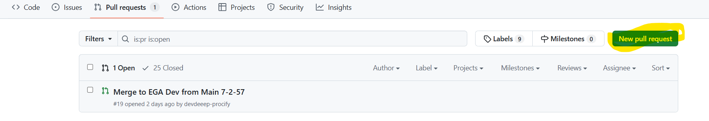
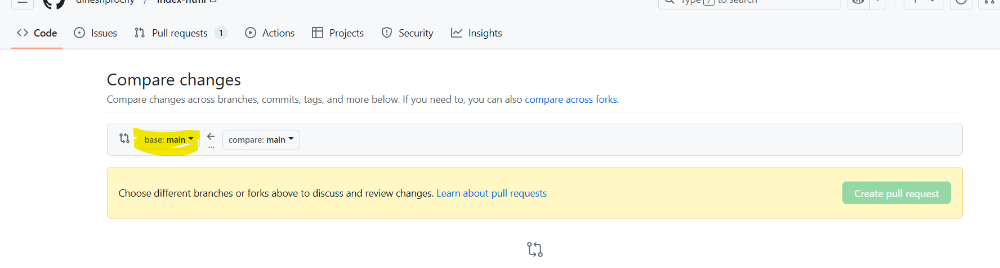
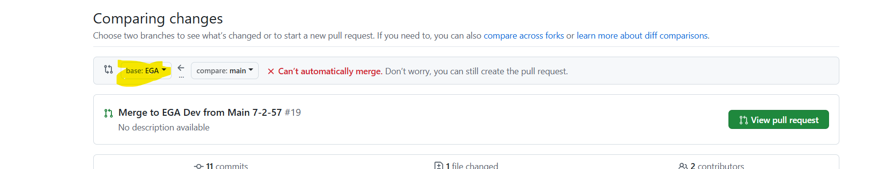
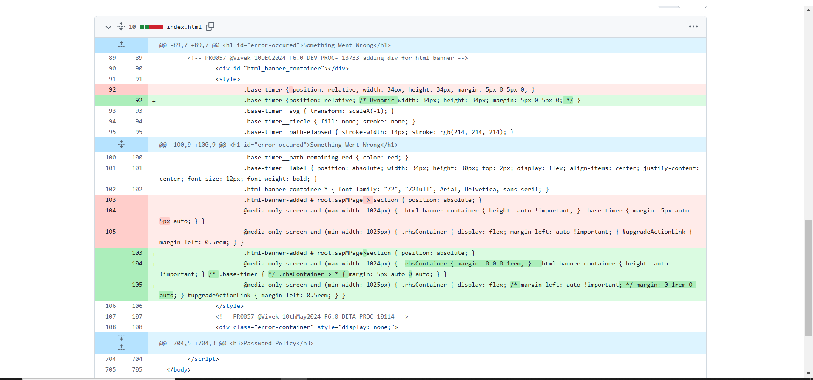
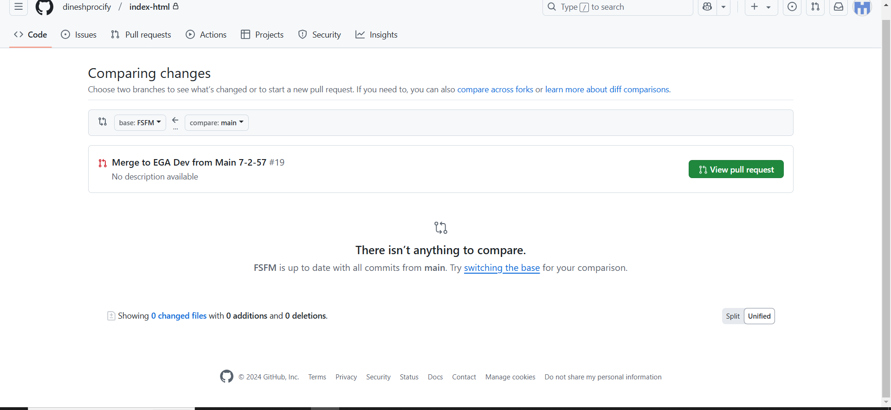

# Create a Pull Request from Main to Sub-Branches

- After merging the latest code into the **main branch**, create a **pull request** from the **main branch** to the respective sub-branch (one for each project). This will add the latest changes in **index.html** to the specific project, allowing for project-specific updates.

- For Merging click on **Pull Request**,

> 
>
> Now click on **New pull request,**
>
> 
>
> Select the branch where you want to merge the code from the main branch.
>
> 
>
> 
>
> If there are any code differences, GitHub will display them and indicate the exact locations where the merge will occur.
>
> 
>
> If the merge has already been completed, it will be displayed like this as shown below;
>
> 

- While creating the pull request, provide a **unique description** to track the changes (e.g., "Merged updated index.html with FW version into Project X").
