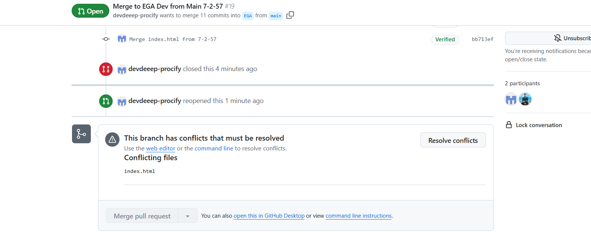

# GitHub Code Review

- After creating the pull request, GitHub will automatically check for any code conflicts between the main branch and the sub-branch.

- If conflicts are detected, they must be resolved before the merge can proceed.

> 
