# Message Monitoring — Message Monitor

Middleware (Message Monitoring) is an application that is used for fetching all the information about the entries that are present in the **device Info** or **tenant Info**. We can also reprocess the failed messages present inside the error\_q of the tenant.

**Device Info:**

When we are sending any data/action from server to device we store the message in the device info to know its information and state. In device info, every message is an outgoing message. So, the successfully sent messages are shown here. So, It goes from In queue to success. 

**Tenant Info:**

When we are sending/fetching any data/action from server to SAP LOCAL or sending data from device to server. We store the message in tenant info to know its information and state. 

All the messages from Device to Server and SAP Local to server are visible in **Inbound MessagesServer Queue Monitor** screen. All the messages from Server to SAP Local will be visible  to the **Outbound queue** screen and all the messages from server to device or SAP Local to device will be visible  in **Device OutboundDevice Queue Monitor** screen.

### Purpose of Message Monitoring {#purpose-of-message-monitoring}

Message Monitoring is used to show information about messages (UPGRADE, DEBOARD) and the state of the message whether it's in the in-queue, Success, or failed. Every message has a state out of the three states mentioned below :

**In-Queue:** The message is ready for processing.

**Success:** The message has been processed successfully.

**Failed:** Message processing has failed.

We can also reprocess the Failed message. The reprocess function is **only available for tenant\_q.**

When we are sending/fetching any data/Action from server to device or server to SAP local, we store it in terms of messages to know its information and its state. 

### Navigate to Message Monitoring {#navigate-to-message-monitoring}

**Step 1:** **Go to the Operations MonitorSystem Monitor option**

Go to the menu options and select **Operations MonitorSys Monitor.**

**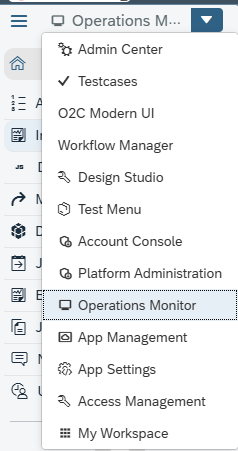**

**Step 2:** **Click on the required option**

Click on either **Inbound MessagesServer Queue Monitor** (Tenant Info**)** or **Device OutboundDevice Queue Monitor** (Device Info**)** according to your requirements. 

**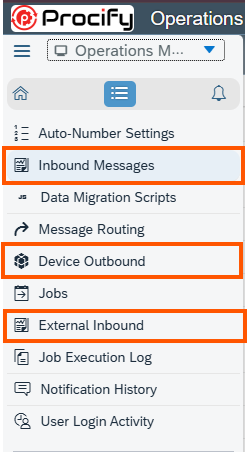**

### What type of data will be stored in message monitoring tables: {#what-type-of-data-will-be-stored-in-message-monitoring-tables:}

It will store the messages for all the transactional data changes.

NOTE: Metadata changes will not be reflected in the message monitoring screens.

## 1.1. Device Info {#1.1.-device-info}

When we are sending any data/action from server to device, we store the message in the device info to know its information and state. In device info, every message is sent or is in the process of being successfully sent. So, every message is outgoing and never fails. Hence, It goes from in-queue to success.

### 1.1.1. Screen {#1.1.1.-screen}

The below image shows the filter:

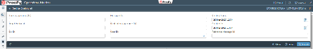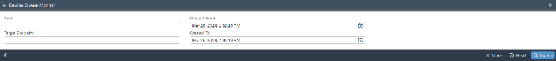

| Fields | Description |
| :---- | :---- |
| **Target Endpoint** | This implies a destination Endpoint. |
| **App** | This implies a destination app. |
| **Created from and Created To** | This takes the date range from which we want the entries to be loaded till a particular range that we have selected in our application. |

 The search result  will be shown as:

 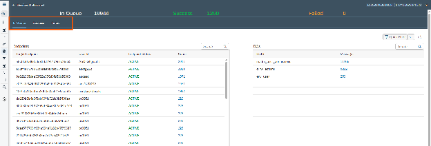

The Device Info screen has three preview sections i.e. **Success, In-Queue,** and **Failed**. These are described as follows: 

| Fields | Description |
| :---- | :---- |
| **Success** | This section shows all items that were successfully processed. |
| **In-Queue**  | This section shows all the data that are currently present in the device\_q and which are not processed yet. After processing, either the entries will move to device\_log\_q (success) or device\_error\_q (failed). |
| **Failed** | This section shows all entries that failed while processing. |

The section at the top shows:

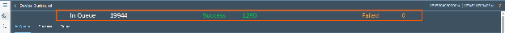

| Fields | Description |
| :---- | :---- |
| **In-Queue** | The count of new or in-queued messages. |
| **Success** |  The count of processed messages. |
| **Failed** | The count  of error messages |

The below section shows the count of the target endpoint and endpoint status present on the selected tab (Success, In-Queue or error).

For Endpoints, Fuzzy search will work for:

* Target Endpoint in **Device Outbounddevice queue monitor**.  
* Target Endpoint and source endpoint in **tenant** queue monitor.

Endpoint details in the popover;

	On hover over the target endpoint, endpoints details will be shown in the popover. On click of more info it will navigate to the endpoint screen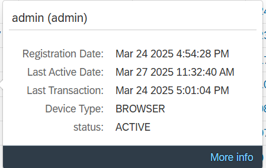

The following section shows the count of the BO-ID objects present on the selected tab (Success, In-queue or error).

For BOs section, Fuzzy search will  work only for Bo ID for **both** screens (device and tenant queue monitor).

Now,

After navigating to the messages, The **device info** page is as shown here:

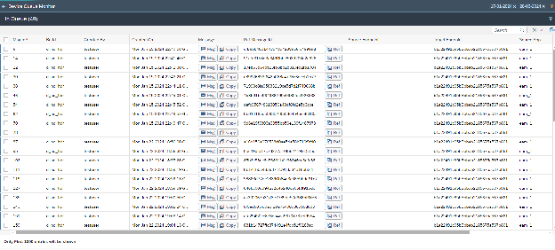

| Fields | Description |
| :---- | :---- |
| **Msg ID** | It is the unique ID of each entity.  |
| **Bo ID** | Business Object ID |
| **Created By** | Transaction created by |
| **Created On** | Transaction created on |
| **Message** | It implies the message body. |
| **Ref Message ID** | It is full of details of any message as the ref data of any entry is never changed. |
| **Src user** | It is the user from whom the message is delivered. |
| **Target Endpoint** | This implies the destination Endpoint of the transaction. |
| **Source App** | This implies the Source App of the transaction. |
| **Destination App** | This implies the Target App of the transaction. |
| **Picked On** | Date when a particular msg is selected for processing. |
| **Finished On** | Date when a particular msg finished its processing. |
| **No sequence** | Sequence for processing the message. |

### 1.1.2. Quick Filter {#1.1.2.-quick-filter}

There is a menu button for quick filter : 

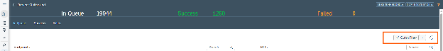

Here we can filter data only by choosing the options:

Suppose one is clicking on “Last 12 hours” then it will show the data for the last 12 hours.

### 1.1.3. Refresh button {#1.1.3.-refresh-button}

It will refresh the data, summary count, the endpoint and boid count.

The refresh button will be enabled only when data is searched at least once  for the particular tab.

## 1.2. Message {#1.2.-message}

The message body for any particular entity.

### 1.2.1. Check message body for any entry: {#1.2.1.-check-message-body-for-any-entry:}

**Step-1- Check for Complete Message Body**

We can check the complete message body of any particular entity by clicking the button under the Message Type column and can copy the message body from the copy button.

**Step 2- Read the data from the dialog**

This will open a dialog under the name **Data** that provides data such as the Header and Body of the message. 

The icon on the extreme right side of the dialog can be used to expand all the collapsed sections like header, body, etc, and can also be used to collapse the same. 

The image below shows the expanded view. We can use the same icon to collapse the expanded view.					

## 

## 

## 1.3. Ref Data  {#1.3.-ref-data}

When we are creating a new message or reprocessing any existing message we are generating a message with a new ID, created date, and reprocess date but the ref data of any entry is never changed. Ref data has full details of any message. 

### 1.3.1. Check ref data for any entry: {#1.3.1.-check-ref-data-for-any-entry:}

**Step-1- Check for Complete Message Body**

We can view all entities with the same Reference Message ID by clicking the button under the Reference Message ID column. 

**Step 2- Read the data from the dialog**

**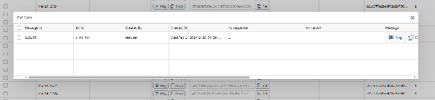**

## 1.4. Tenant Info {#1.4.-tenant-info}

When we are sending/fetching any data/action from server to SAP LOCAL or sending data from device to server. We store the message in tenant info to view its information and state. 

**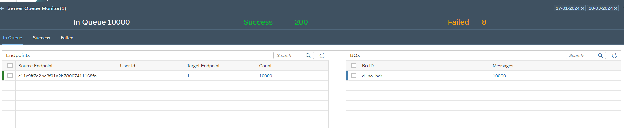**

						

**Tenant Info** also takes similar fields to what we saw in Device Info. 

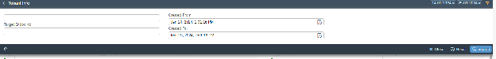

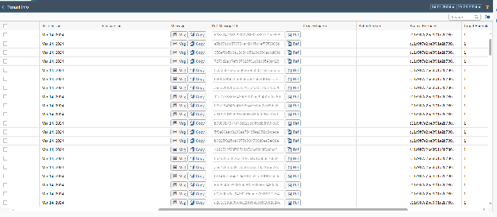

Tenant Info also lists down the error messages listing down the reason for the failure from reprocessing. Similar to the Device Info, we can get the complete message body as shown in the [Message](#1.2.-message).

### 1.4.1. Reprocess Failed Entry {#1.4.1.-reprocess-failed-entry}

Any failed entry can be reprocessed by following the steps given below :   

**Step-1- Select the message that needs to be reprocessed**					

Select the message you want to reprocess by clicking on the checkbox of the message. 

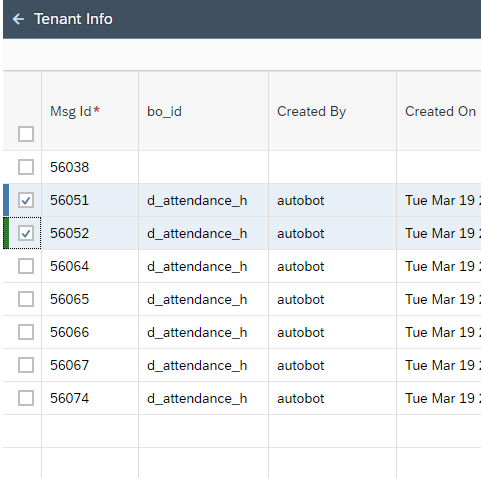

**Step 2- Click on the Reprocess Button**

Click on the reprocess button on the right side of the screen to reprocess the selected message.

One can view and copy the error message for the Error Message and can view the error code also.

## 1.5.Upsert {#1.5.upsert}

An **Upsert** operation refers to the combination of **update** and **insert** actions, where data is either updated if it exists or inserted if it doesn't.

When syncing messages, an **Upsert** scenario behavior typically involves checking if a message already exists in the destination system or database. If it exists, the system will update it; if it doesn't, the system will insert it as a new record.

### 1.5.1.Upsert Behavior in Middleware for Syncing Messages: {#1.5.1.upsert-behavior-in-middleware-for-syncing-messages:}

* **Data Creation and Update:**

  * If the data is new (does not exist in the system), a new entry will be created.

  * If the data already exists, the existing record will be updated instead of creating a new one.

* **Upsert for Root Business Objects (BOs) and Primary Relations:**

  * Upsert is only applicable for Root Business Objects (BOs) and their primary relations.

  * For non-primary relations, the Upsert operation will work only if the relation is established using primary keys.

* **Parent-Child Relationship:**

  * If a parent is new, but the child data related to the parent already exists, this is considered an unexpected scenario. The user must handle this manually, as it is not automatically managed by the middleware.

### 1.5.2.Delete Scenario Behavior: {#1.5.2.delete-scenario-behavior:}

1. **Parent Entity Deletion:**

   * If the **parent entity** is deleted, the **child entities** will only be deleted if the user explicitly sends the **isdeleted** flag as **true** in the request body for both the parent and child entities.

   * This applies to both **primary** and **aggregate** relationships.

2. **Child Entity Deletion:**

   * If the **child entity** is deleted, only the **child** will be deleted. The parent entity will remain intact.

## 

## 1.6. External InboundLegacy Queue

To view messages from server to SAP, there is one more screen called External Inboundlegacy queue similar to Inbound Messagesserver queue monitor and Device Outbounddevice queue monitor.

## 2.0. Message forwarding

The message forwarding feature helps in generating out-bound messages for devices and external systems for multiple applications when data change is processed in one application.

	2.1. How to maintain forward mapping:

	To maintain mapping between flavors use Msg Fwd Mapping screen available under Operations MonitorSys Monitor Menu. 

	In order to maintain mapping flavors needs to be assigned as Manager.

	Note : In Dev Systems Target flavor version needs to be maintained which is not required in QA/PRD.

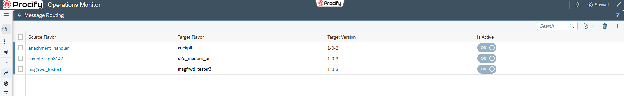

	2.1. How to verify generated Messages

If a message is forwarding messages a Icon will be visible beside Message ID.

Note : Icon color \- green means all the forwarded messages are success

	Icon color \- red means all the forwarded messages got failed

	Icon color \- yellow means few got failed and few got success.

	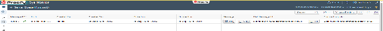

 	Click on Icon to see the detailed forwarding .

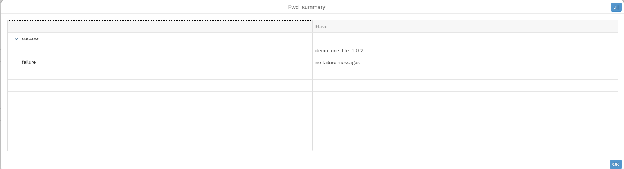

Click on Ref Msg Id button to see the forwarded  messages. On click on Message ID detailed information can be visible in the new tab.

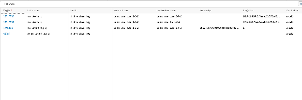

2.3. How to Differentiate Messages

A new Column Type is being introduced which can be used to Identify the message type in Inbound MessagesServer Queue Monitor.

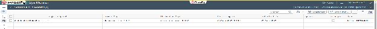

## 3.0. Troubleshooting failed messages

Messages that are failed to process can be found in the error q. The error can be found in the error message. Possible reasons a message can fail are.

1. Application logic \- When an application logically rejects a request for processing the message. I.e. Adding items to a closed order. Adding shipments to a closed Delivery etc.  
   **Suggested solution :** Find the root cause why these messages are generated. Eg. screen still allows adding items even if the status of order is closed. And fix the issue / add validation in the client side also.

2. Application bugs \- Some cases where application code has a bug, due to which an exception can be raised the message will fail. Eg. Improper null handling, wrong API parameters, typo etc.  
3. Transaction User not configured \- File processing, transaction user has to be configured with required application & permissions. As all the messages are processed based on the access of the user, messages generated by files need a user to validate against. Refer to the [Landscape Editor](https://docs.google.com/document/d/1snyqwIhTM0nSqHIrOiQhW9QxQFa8p2C9o1me-hmK0WI/edit?usp=sharing) for how to configure the transaction user.  
4. Configured user doesn’t have application assigned : When messages from SAP / File processing are failing with **“Access denied: user lacks permission to the required application.”** error, it means, the user (SAP communication user / File processing user) does not have that flavor assigned to them.   
5. Database Deadlock / Lock Timeout Errors:   
   \-    When the middleware encounters a transient database deadlock or lock wait timeout (e.g., "Deadlock found when trying to get lock; try restarting transaction"), messages are automatically retried up to 3 times with a 1-second delay (default values) between attempts.   
   \-    If all retries are exhausted, the message will move to the error queue.  
   \-    It will have an error message like \- "Message \<msg\_id\> failed after 3 retry attempts due to Lock wait timeout exceeded" or "Message \<msg\_id\> failed after 3 retry attempts due to Deadlock found".  
   \-    The retry settings are configurable via config.json:  
       "MiddlewareRetrySettings": {   
           "DeadlockRetryCount": 3,   
           "RetryDelaySeconds": 1   
       }

#
