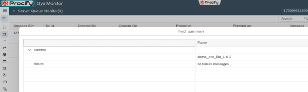
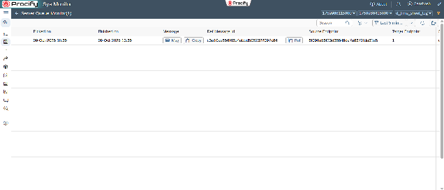
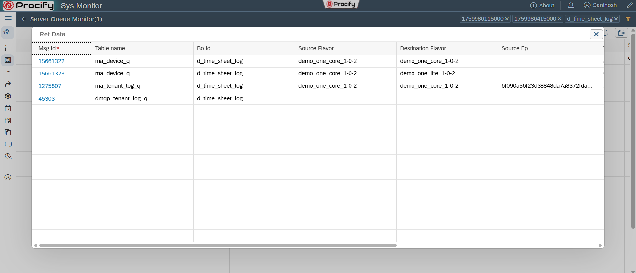
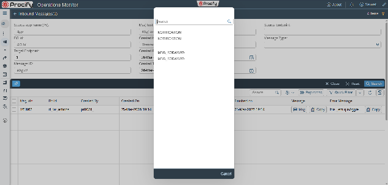

# Middleware Message Forwarding — How to use the feature

### *Common Use Cases*

#### *Multi-Flavor Applications*

*If your application has multiple flavors (e.g., online and offline versions) that share common entities, this feature ensures data consistency across all flavors.*

#### *Example Scenarios:*

*Portal \+ Mobile App: Changes made in the web portal should sync to mobile app users*

***Hierarchical Applications:** Parent flavor changes should sync to child flavor users*

#### *How Does It Work ?* 

***Data Change Trigger:** When you create, update, or delete data in a source flavor*

***Automatic Detection:** The system detects if forwarding is configured for that flavor in Middleware Message Routing ( Operations Monitor )*

***Trigger Endpoint Resolver:** The ENDPOINT\_RESOLVER event will be triggered in target flavor if the same entity exists.*

***Message Generation:** Messages are generated for target flavor users based on the target flavor ENDPOINT\_RESOLVER logic.*

***Synchronized Delivery:** All related messages share the same reference ID for tracking*

### *Entity Requirements*

#### *Target Entity Setup*

##### *Your target entity must have:*

* *Same entity name as source entity*  
* *Same table name (tb field) as source entity*  
* *ENDPOINT\_RESOLVER event configured*  
* *Event implementation in the entity class file*

#### *Example Entity Event Implementation*

| *// In your entity class file (e.g., src/flavor/entity/your\_entity.ts)async onEndpointResolver(txn, dataObj, headers) {    // Your logic to determine which users/endpoints should receive messages    this.addEndpoint(userList, EndpointType.User, ChannelType.Both);}* |
| :---- |

### *Testing in Private Node*

#### *1\. Setup Test Environment*

* *Set up your private node with DEV landscape*  
* *Checkout the source flavor and required target flavors.*  
* *If target flavor is not present in the private node, forwarding will be skipped.*  
* *Create test flavor mappings with specific target versions*

#### *2\. Create Test Data*

* *Perform create, update, delete operations on the source entity*

#### *3\. Debugging*

* *You can debug the target flavor entity event implementation by setting breakpoints in your private node.*

#### *4\. Monitor Message Flow*

##### *Messages generated during forwarding will have:*

* *Same ref\_msg\_id for all related messages*  
* *src\_fv field showing source flavor version*  
* *dst\_fv field showing target flavor version*

## *Message Monitoring Tools*

### *Checking Message Forwarding Status*

*Use the Message Monitoring screen to track forwarded messages and verify successful processing:*

*The forwarding status icon in the message monitoring screen indicates when messages have been forwarded*

#### *Understanding Forwarding Status*

* *Icon Appearance: Look for the forwarding indicator next to messages*  
* *Status Information: Click the icon to see detailed forwarding information*

**

*Detailed view showing forwarding status and target flavor information*

### *Tracking Related Messages by Reference ID*

*All messages from the same transaction share a reference ID for easy tracking:*  
**

*Reference ID icon allows you to view all related messages from the same transaction*

### *Using Reference ID Tracking*

1. *Locate the Reference ID icon in the message list*  
2. *Click to expand and view all related messages*  
3. *Verify both source and target flavor messages are present*

**

*Expanded view showing all messages sharing the same reference ID*

### *Troubleshooting Failed Forwards*

*When message forwarding fails, check the Error Queue for detailed information:*  
**

*Error queue entry showing failed forwarding message with MSG\_FORWARD type*

#### *Error Queue Analysis*

* *Message Type: Look for "MSG\_FORWARD" type entries*  
* *Error Details: Review error messages for troubleshooting*  
* *Retry Options: Use message reprocessing to retry failed forwards*

### *Behavioral Changes to Expect*

#### *Message Generation*

* *Additional Messages: You'll see target flavor messages in device/tenant queues*  
* *Message Grouping: Related messages share the same reference ID*  
* *Cross-Flavor Sync: Changes in source flavor should trigger messages in target flavor*

#### *Error Handling*

* *Isolated Failures: If target flavor processing fails, source transaction still completes*  
* *Error Queue Entries: Failed forwards create entries in error queue with type MSG\_FORWARD*  
* *Retry Capability: Failed messages forwarding can be reprocessed later. It will only retry the forwarding, not the original transaction. The dirty state and from state is preserved from the original transaction.*

### *Understanding Message Reference IDs*

#### *What is a Reference ID?*

*The reference ID (ref\_msg\_id) is a unique identifier that groups all messages generated from a single transaction.*

#### *How It Works*

| *Original Message → ref\_msg\_id: "ABC123" ├── Source Flavor Message → ref\_msg\_id: "ABC123" ├── Target Flavor 1 Message → ref\_msg\_id: "ABC123" └── Target Flavor 2 Message → ref\_msg\_id: "ABC123"* |
| :---- |

### *Detecting Forwarded Messages*

*In your entity event handlers, you can detect if the event was triggered by message forwarding:*

| *async onEndpointResolver() {    let headers \= await this.getHeaders();    let sourceApp \= headers.src\_app;    let currentFlavor \= this.txn.\$SYSTEM.flavor;    if (sourceApp \!== currentFlavor) {        // This event was triggered by message forwarding        this.info(\`Message forwarded from \${sourceApp} to \${currentFlavor}\`);    } else {        // This is a normal event execution    }}* |
| :---- |

## *Best Practices*

#### *Configuration Management*

* *Minimal Mappings: Only configure necessary flavor mappings*  
* *Environment-Specific: Use similar configurations for DEV/TEST/PROD*  
* *Regular Review: Periodically audit your forwarding configurations*

#### *Testing Strategy*

* *Verify End-to-End: Test complete data flow from source to target users*  
* *Monitor Queues: Watch queue growth during testing*  
* *Check Error Logs: Review error queues for any issues*

### *Troubleshooting Common Issues*

#### *Messages Not Forwarding*

***Checklist:***

* *✅ Mapping exists in Msg Forward Mapping*  
* *✅ r\_is\_active is set to true*  
* *✅ Target entity exists with same name and table*  
* *✅ Target flavor entities have ENDPOINT\_RESOLVER events*  
* *✅ If private node is used, make sure target flavor is assigned.*

#### *Using Message Monitoring Tools:*

1. *Check the forwarding status icon in Message Monitoring*  
2. *Look for error entries in Error Queue with MSG\_FORWARD type*  
3. *Verify Reference ID grouping shows both source and target messages*  
4. *Review detailed forwarding information in status dialogs*

### *Monitoring and Maintenance*

#### *Regular Checks*

* *Queue Monitoring: Review device and tenant queue sizes*  
* *Error Analysis: Check error queues for failed forwards*

#### *Maintenance Tasks*

* *Error Queue Cleanup: Process and resolve failed messages*  
* *Configuration Updates: Modify mappings as application evolves*  
* *Documentation Updates: Keep mapping documentation current*

### *Getting Help*

#### *Support Information*

##### ***When contacting support, provide:***

* *Source and target flavor names/versions*  
* *Entity name and table name*  
* *Reference ID of problematic messages*  
* *Relevant error log entries*  
* *Current mapping configuration*
