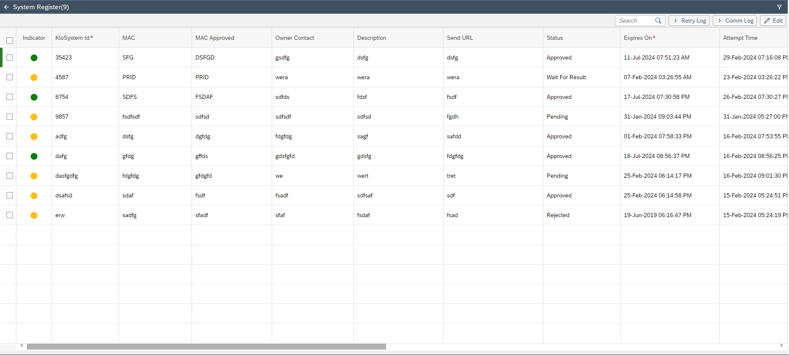

# System Registry

| **Parameters**            | **Description**                                                                                                                                                 |
|---------------------------|-----------------------------------------------------------------------------------------------------------------------------------------------------------------|
| Indicator                 | It checks where Green for the last communication was successful and status is Approved and Expires on is in future and Amber for the Last communication failed. |
| klosystem ID              | klosystem id, we need to provide the unique ID of the klosystem.                                                                                                |
| Description               | In the klosystem descriptor, we need to provide the klosystem description.                                                                                      |
| MAC                       | It represents the system MAC ID                                                                                                                                 |
| MAC Approved              | It represents the system MAC ID                                                                                                                                 |
| Owner Contact             | It represents the manager of the landscape                                                                                                                      |
| Send URL                  | It represents the kloSystem URL                                                                                                                                 |
| Status                    | It is the status we have to maintain for Approved, Pending, Rejected, and Wait For Results.                                                                     |
| Expires On                | It checks when the kloSystem will expire for that ID                                                                                                            |
| Attempt Time              | Current Date and Time of message creation.                                                                                                                      |
| Sync Time                 | Current Date and Time of message creation.                                                                                                                      |
| Created On                | Current Date and sync Time of message creation.                                                                                                                 |
| Reviewed Date             | It represents when the message is reviewed.                                                                                                                     |
| Is Reviewed               | It checks whether the review is done or not                                                                                                                     |
| Reviewed By               | It represents the name who reviewed the message                                                                                                                 |
| Comment ..( comment 1, 2) | This field is for any extra comments to be put for kloSystem messages                                                                                           |
| More Info                 | It represents any extra details if any needs to be mentioned.                                                                                                   |
