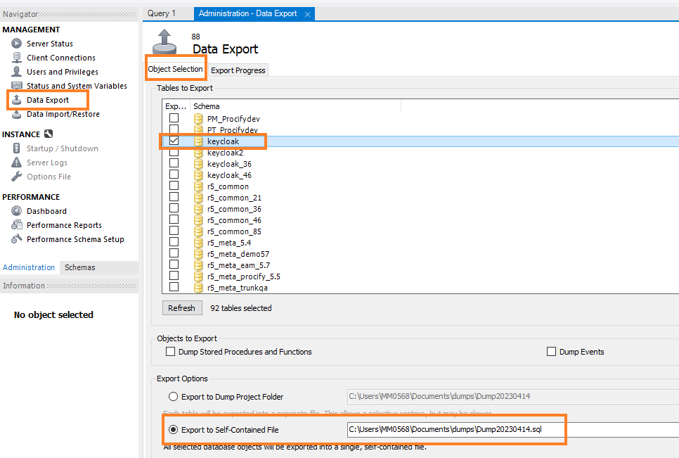
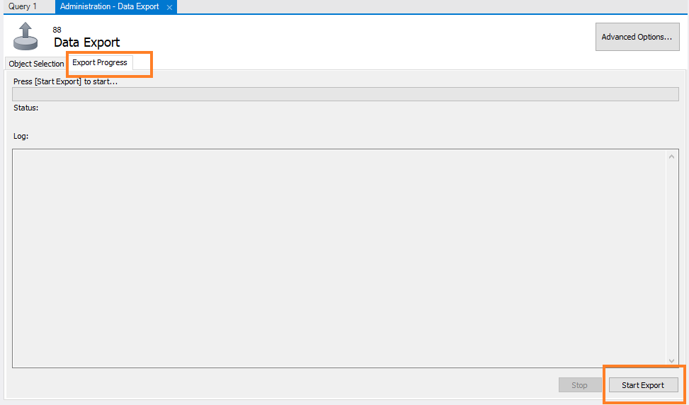
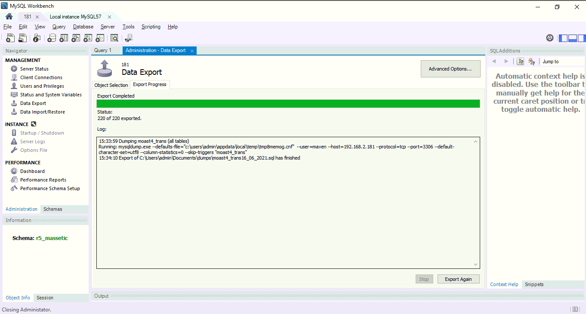

# DB Backup

1)  Open MySql workbench and connect to the server in which you want to take backup.

2)  Open the server connection in the workbench and click on **“Data Export”** and select the database which you want to export.

3)  After that click on **“ Export to self contained file”** if you want to change your file name and path else leave it as default.

1)  Then click on **Export Progress** and click on **“Start Export”**.

Then wait for some time and your db will be exported and you will see the below image:

