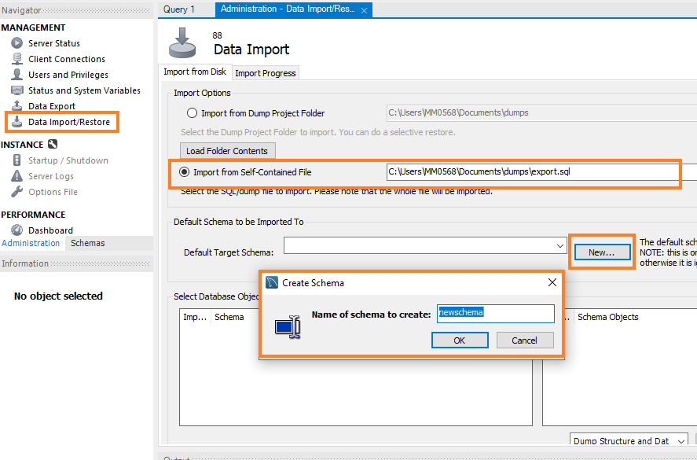
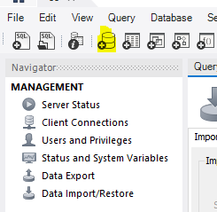
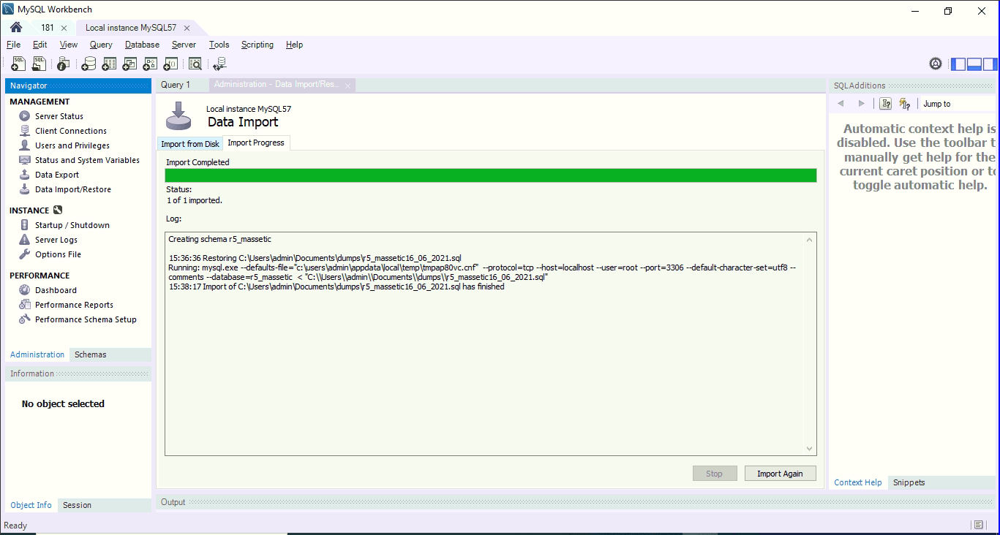

# DB Restore

1)  Open local instance (localhost) in your MySql workbench and click on **“Data import/Restore”**.

- Then click on **“Import from the self contained file”** and select the file which you want to restore. After that click on **“new”** in the default schema to be imported to option and enter your new schema name and click on **ok**.

- For creating a new schema you can also create by selecting the below option. After that give the name of the new schema and click on apply.

> 

1)  Then click on export progress and click on **“start import”**. Wait for sometime then your Import will be completed.

