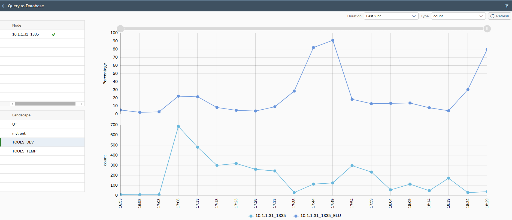

# Query to Database

Initially shows the total number of Queries to the database of the selected node and landscape.

X-axis: time duration

Y-axis: count of Queries

Selection of query time from type dropdown shows the total time taken by Queries to the database of the selected node and landscape.

X-axis: time duration

Y-axis: time taken by queries
