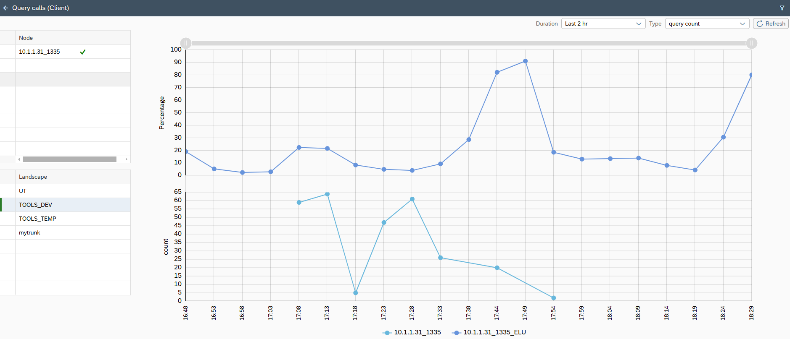

# Client Queries

Initially shows the total number of fireQuery calls from clients of the selected node and landscape.

X-axis: time duration

Y-axis: count of fireQuery calls from the client

Selection of query time from type dropdown shows the total time taken by fireQuery calls from clients of the selected node and landscape.

X-axis: time duration

Y-axis: time that is taken by fireQuery calls from the client
