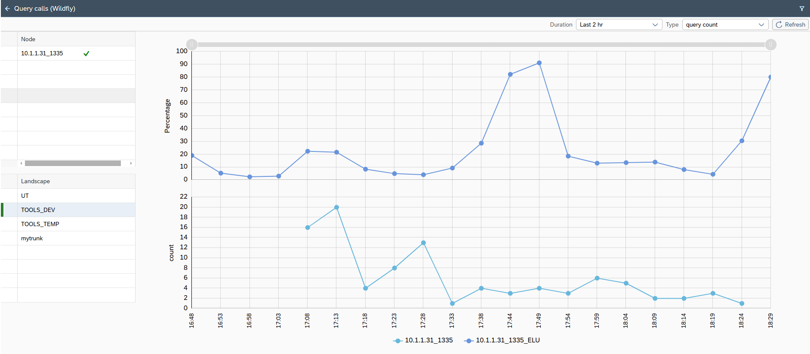

# Server Queries

Initially shows the total number of calls to the wildfly of the selected node and landscape.

X-axis: time duration

Y-axis: count of calls to wildfly

Selection of query time from type dropdown shows the total time taken by calls to wildfly of the selected node and landscape.

X-axis: time duration

Y-axis: time taken by calls to wildfly
