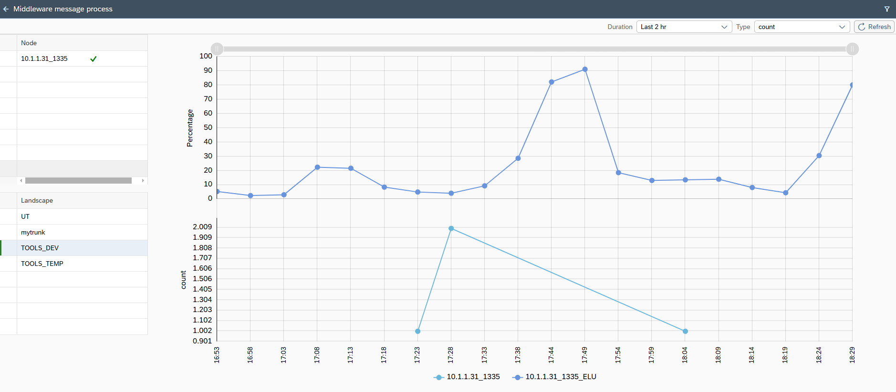

# Middleware message Process

Initially shows the total number of middleware message processes of the selected node and landscape.

X-axis: time duration

Y-axis: count of middleware message processes

Selection of query time from type dropdown shows the total time taken by middleware message processes of the selected node and landscape.

X-axis: time duration

Y-axis: time taken by middleware message processes
