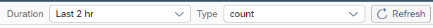

# Toolbar options

Duration dropdown will be useful to see the frequent data.

Type dropdown is used to see the data of count or time taken for the queries.

The refresh button will be used to refresh the time period to last 2hr.
